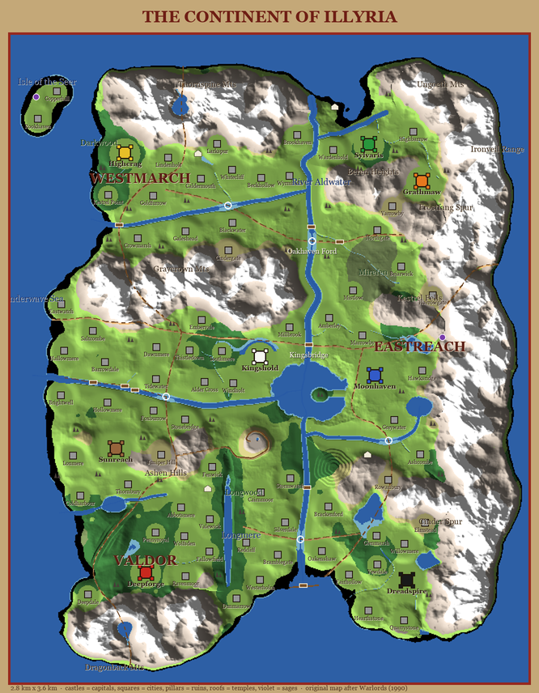

# The Continent of Illyria



An **original** map with the strategic structure of the 1990 *Warlords* map: a western sea and island, a great river from the north coast with branches running west to the sea that seal off the realms, a sealed-off north-west, rugged mountain country across the east, a long lake inside a long forest. Every coastline, river course, placement and name is new; only the kind of land is kept: a sea on one side, a great river splitting the realms, mountain passes and river crossings as chokepoints, 80 cities and a few dozen places to explore. Everything is generated deterministically from code (`engine/sim/src/continent.cpp`), so every player, on any device, has exactly the same land. A test pins its checksum.

- **Size:** 2.8 km west to east and 3.6 km south to north: a third each way of the 8.5 × 10.7 km it was before One World ([ONE_WORLD.md](ONE_WORLD.md)), two ninths of the 12.8 × 16 km it was first laid out at. It is the same map drawn smaller: every coast, range, river, lake, forest, town and site placed by fractions of the map, and every map-scale distance and noise wavelength scaled by 2/9 in `continent.cpp` (`scaled`). What a battle sees up close keeps its size: river and road widths, bridges, gates, ramps, houses, the ruins, the groves scattered over the open country, the creeks and pools of the bake (as many to a square kilometre as before), and the relief at battle scale below. The towns' walls come in to three quarters (below).
- **Heights:** the mountains are a third as high as they were (`Continent::peakHeight`), the Ironveil about 150 m, the Thornspine 140 m, the Barrow Downs 30 m, and the swells of the land between them a third as high too. So every slope and every pass is as steep as it was before the map shrank, and what is judged by height (bare rock, snow, the campaign's hills and mountains, how high a town may stand) is a third of what it was.
- **Realms:** Westmarch (north-west), Valdor (south-west) and Eastreach (east of the Aldwater).
- **Water:**
  - The Sunderwave Sea runs along the whole west coast, with the Isle of the Seer offshore.
  - The great river Aldwater flows south from the northern coast.
  - The Greymere leaves it in the north and runs west to the sea, cutting off the north-west country (Darkwood, the Thornspine). Only Greymere Bridge and Greymere Ford lead in.
  - Below Kingsbridge the Aldwater forks: the Westrun runs west to the sea and the Sorrow runs on south. The Emberflow drains Silverlake into it from the east, and the Wending is a smaller stream.
  - Longmere, a long lake, lies inside the Longwood.
  - Every river slopes steadily downhill to the sea.
- **Mountains:**
  - The Thornspine closes off the north. The Graycrown splits Westmarch from the central plain, with one pass through it.
  - The Ironveil walls off the whole east; the Frostfang and Cinder spurs reach west from it, with a pass to the far east.
  - The east is broken country: the Ungoeth Mountains, Beren Heights, Kestrel Fells and Grimtor Hills, as well as the Mirefen swamp.
  - The Dragonback Mountains lie to the south, and the Ashen Hills, Northmoor Hills and Southdown Hills stand inland.
- **Hills:** rolling hill country comes and goes in patches a few hundred metres across, with open plains between. It grows rougher toward the east, and the whole land is hummocky up close.
- **Relief at battle scale** (`continent_relief.cpp`): over the design's broad shape, on every battlefield:
  - knolls 40 to 100 m across and hillocks twice that, up to a quarter as high as they are wide, scattered thinly over open country and crowded together in patches of broken ground; here and there a tor, a steep knob of rock;
  - ridge country: patches a kilometre or so long of parallel ridges 140 to 210 m apart, one behind another, their crests rising and falling;
  - gorges: a tableland a few hundred metres long split by a cleft, sheer walls 20 to 30 m high either side of a floor 20 to 30 m wide, with a ledge and a second cliff set back where the tableland is thickest. A search places one wherever there is room, but on this map the 80 towns leave none: the Narrows is the only gorge.
  - None of it is dug out: a gorge's floor is the old ground, and every slope but a cliff stays under 1 in 1, so nowhere that could be reached before is cut off. It keeps clear of the towns, sites, crossings, rivers, creeks, lakes and pools, which stand where the design put them, and eases off on the mountains.
- **Landmarks** (set pieces, made by hand, keeping their size): each goes to the nearest place to where it was drawn with room for it, found before the towns, which keep their walls 20 m off it.
  - *Church Hill*, south of the Westrun by the Longwood's north end, between Fenwick and Cairnmoor: a hill 330 m across standing 40 m over the land, rocky in its upper part. A church and a pond stand on its level top, and a lane leaves the nearest road (where its straight way keeps clear of the towns) and winds up round it at 1 in 13, cut into the slope as a level bench.
  - *The Narrows*, on the south road between Mirrormere and the Dragonback Mountains, by Pennyroyal: the road runs along the floor of a gorge 400 m long. Where the land falls away from the road the tableland is built up, so its cliffs stand their full height over the floor.
  - *The Terraces*, in the fields east of the Sorrow below the Grimtor Hills, by Brackenford: a low hill stepped into five level fields, about 3 m apart.
  - Each is a place a match can be fought over (Horde, Capture the Flag), as is each gorge.
- **Up close (any battlefield):** groves and copses, rocky outcrops, fallen logs, ponds ringed with reeds, tussocks and dips. They are placed in patches, not spread evenly.
- **Crossings:** the fords (Oakhaven, Westrun, Sorrow, Emberflow, Greymere) can be waded but slow an army to a crawl. The bridges (Kingsbridge, Greymere Bridge) are quick but as wide as the road; Old Bridge crossed water no bridge can stand across (a bank within 100 m is needed) and is a ford now; Southbridge, over a lake no road reaches, is gone. Elsewhere the rivers are too deep to cross.
- **Places:** 80, of three kinds. **Eight capitals** (walls 85 m from the middle, an outer ring and an inner bailey). **Walled towns**, about twenty (walls 55 m from the middle, one gate): the first of them are set to hold the narrow places, the nearest good site within 260 m of each named crossing but Oakhaven Ford and within 420 m of the foot of each pass, and the rest go where the gap to other walls is widest. **Villages**, the other fifty or so: houses round a green and a tower house on a 30 m pad, with no wall, gate or tower, at the end of a lane. Walled places keep at least 170 m of open country between their walls (three bowshots: two hosts can form up between two towns out of reach of both; on this map the closest are 173 m apart, typically 210 m), a village stands at least 85 m from any wall (beyond a bow's reach from the walk) and 60 m from the next village. Before, all 80 were walled towns with a typical 73 m between their walls, and 45% of the open ground and 48% of the roads lay within a bowshot of some wall; now 17% and 19% do. The Isle of the Seer, too small for walls (a town and its bowshot covered all of it), has one fishing village, counted among those of the lord nearest over the water; no place stands within 350 m of Oakhaven Ford, where the set battle is fought. They stand on slopes to 1 in 5 and into the foothills (levelled pads), 15 m from the rivers' water, beside a road rather than astride it.
- **The lords' seats** are set so that no realm starts hemmed in: Sylvaris stands in the Longwood (it was in the north-east, 300 m from Grathmaw, the two sharing three towns each), Sunreach in the west between the Greymere and the Westrun, Dreadspire nearer the Sorrow. **Every realm is laid out alike**, as the realms of Warlords are (`Continent::placeCities`): each lord has ten places, his seat and nine drafted for him: three walled towns (those that hold the crossings and passes in his country among them) and six villages, the realms taking one each in turn from their own country: the sites nearest that lord's seat on foot, or nearly so (the marches between two realms belong to both), each where the gap to its neighbours is widest. A realm with no room left for walls takes a village in a town's stead (21 walled towns and 51 villages on this map). Counted afterwards by real marching, over the bridges the roads build, each realm has 7 to 11 places and 93 to 169 gold a day nearest it (it was 3 to 16 places and 72 to 423 gold before the land was opened), and no two capitals stand nearer than 575 m of marching. Computer lords playing each other from these starts hold 4 to 10 places each after 35 days on three different games (3 to 21 before the draft; before the land was opened the Elves never took a second town).
- **Places to explore:** 34 ruins in the forests and foothills, 4 temples and 2 sages ([§4.4](GAME_DESIGN.md)). Every one stands on ground a walker can reach on the campaign map: the mountains' by their passes, the Drowned Abbey by the Spit, the Seer's Tower from the village on its isle.

Regenerate the picture with:

```
cmake --build build --target illyria_continentmap
./build/tools/illyria_continentmap map.ppm map.json
python3 tools/continentmap/label.py map.ppm map.json docs/images/continent-map.png
```
