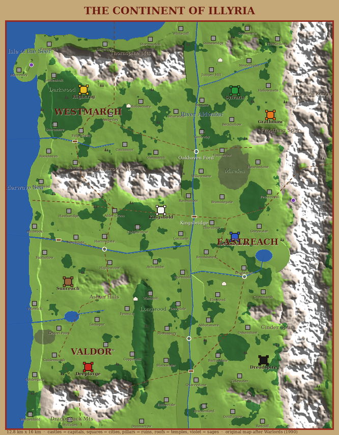

# The Continent of Illyria



An **original** map with the strategic structure of the 1990 *Warlords* map. Every coastline, river course, placement and name is new; only the kind of land is kept: a sea on one side, a great river splitting the realms, mountain passes and river crossings as chokepoints, 80 cities and a few dozen places to explore. Everything is generated deterministically from code (`engine/sim/src/continent.cpp`), so every player, on any device, has exactly the same land. A test pins its checksum.

- **Size:** 12.8 km west to east and 16 km south to north. A soldier crossing it on foot takes hours of game time, a griffin much less.
- **Realms:** Westmarch (north-west), Valdor (south-west) and Eastreach (east of the Aldwater).
- **Water:**
  - The Sunderwave Sea runs along the whole west coast, with the Isle of the Seer offshore.
  - The great river Aldwater flows south from the northern coast. At Kingsbridge it forks: the Westrun runs west to the sea and the Sorrow runs on south. The Emberflow drains Silverlake into it, and the Greymere, Wending and Coldbrook are tributaries.
  - Every river slopes steadily downhill to the sea.
- **Mountains:**
  - The Thornspine closes off the north. The Graycrown splits Westmarch from the central plain, with one pass through it.
  - The Ironveil walls off the whole east; the Frostfang and Cinder spurs reach west from it, with a pass to the far east.
  - The Dragonback Mountains lie to the south, and the Ashen Hills, Northmoor Hills and Southdown Hills stand inland.
- **Crossings:** the fords (Oakhaven, Westrun, Sorrow, Emberflow) can be waded but slow an army to a crawl. The bridges (Kingsbridge, Old Bridge, Southbridge, Greymere Bridge) are quick but narrow. Elsewhere the rivers are too deep to cross.
- **Cities:** 80, placed by a deterministic search that prefers roads and river valleys and keeps cities apart. Eight are capitals (see [GAME_DESIGN.md §4.2.2](GAME_DESIGN.md)); the rest start neutral.
- **Places to explore:** 34 ruins in the forests and foothills, 4 temples and 2 sages ([§4.4](GAME_DESIGN.md)).

Regenerate the picture with:

```
cmake --build build --target illyria_continentmap
./build/tools/illyria_continentmap map.ppm map.json
python3 tools/continentmap/label.py map.ppm map.json docs/images/continent-map.png
```
