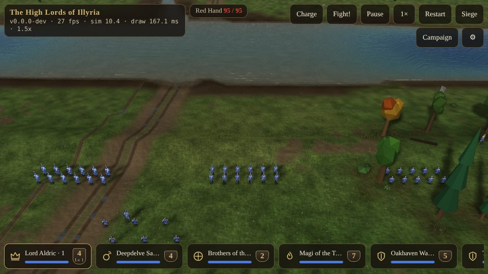
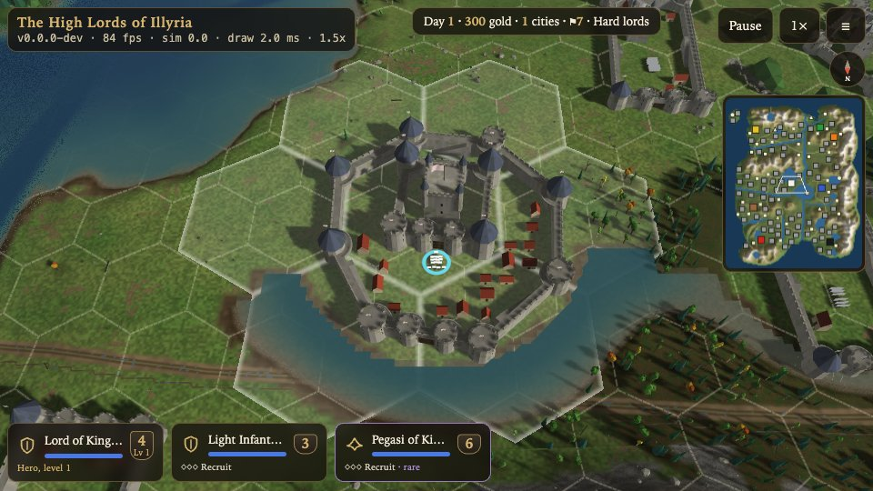

# Getting Started {#quick-start}

::: lore
*"Pick a man. Tell him where to stand. Then watch what he does when the arrows come."*

— Sir Aldric, to his squires
:::

The game runs in a web browser, on a phone, a tablet or a computer, with nothing to install. On an iPhone, *Share › Add to Home Screen* makes it an app of its own that opens full screen with no browser bars; on Android, Chrome's *Install app* does the same. Sound starts on your first touch (phones insist on it), so if all is silent, tap the screen once.

## The title screen and settings {#title-screen}

The game opens on its title screen, where you choose what to play: **Continue** (your latest saved war, once there is one), the **Conquest** (a new war, or one you saved), a **Skirmish** (a battle on its own: Oakhaven Ford, or the siege), **Horde** or **Capture the Flag** (chapter ), the **Sandbox** (set any army down and let them fight), and along the bottom the **Manual**, the **Settings**, the **Controls** (every tap, click and key on one page) and **About**. While you play, the ☰ menu at the top right has Restart (in a battle), Save (in a Conquest), Settings, Controls, the Manual and **Main menu**, which brings you back here. The manual opens in a tab of its own, so the game waits where you left it.

The **settings** (⚙) have four tabs, and the game keeps your choices on the device:

- **Graphics.** Three presets, *Low*, *Medium* and *High* (phones start on Medium, computers on High), and each part of the look on its own: ground detail, grass and ground cover (and dense cover), sun shadows (and sharp, wide ones), detailed distant land, the sky with its haze and clouds, the film look (bloom, grade and grain), full resolution, and dynamic resolution, which draws the picture coarser when the frame rate drops. *Show frame rate* (or the [[I]] key) puts the figures by the game's name. These change only how the battle looks: everyone sees the same battle on any setting, and the rules never change with them. If a phone grows hot or the battle stutters, step down a preset.
- **Sound.** A master volume, then three groups, each with a switch and a volume of its own: the soldiers' **voices** (and whether lines not yet recorded are read aloud by the browser's own speech voice meanwhile), the sound **effects**, and the **ambience** (wind, the swamp, flies over the dead, the war drums, rain). A link opens the sound test page, where every sound in the game can be heard on its own.
- **Gameplay.** How fast the days pass when a Conquest starts (1×, 2×, 4× or 8×), how well the other lords play in a new Conquest (Easy or Hard; Hard until you change it), whether the Conquest saves itself each dawn, whether Disband must be tapped twice, and whether the reminder of the controls shows when a battle starts.
- **Controls.** The same page of controls as on the title screen, for a phone or for mouse and keys.

## Your first battle, in five minutes {#first-battle}

Choose **Skirmish**, then **Oakhaven Ford**. You are where the northern road crosses the Aldwater. Your host stands on the near bank in blue; across the river the warband of the **Red Hand** is forming in red: footmen, dead men risen from the barrows, berserkers, wolf riders and hyena-folk, giants, minotaurs, spiders, devils and demons, archers, bombers, wizards, a mangonel and a dragon at the back. Their number is at the top of the screen, beside their name.

1. **Look around.** Pinch to zoom (or turn the mouse wheel), drag one finger to move over the land (the left mouse button), and twist two fingers to turn the view (the right mouse button). You can come down until one soldier fills the screen, or go up until the whole island is a map.
2. **Pick a squad.** Tap one soldier of the **Grey Watch**, your heavy infantry in their blue tunics, and tap him again: every heavy infantryman in view is selected. They wear blue rings. (Or hold on them and drag a box round them.)
3. **March.** Tap the ground near the ford. The Grey Watch march there in line and halt facing the way they marched. Yellow rings on the ground show where each man will stand.
4. **Face the enemy.** With them still selected, press and **hold** on the ground where you want them, and when a gold ghost of the formation appears, **drag** toward the river. They will form up across your line, facing along it.
5. **Shoot.** Tap one of the **1st Oakhaven Bowmen** twice to select them, then tap a soldier of the Red Hand. The archers walk until he is in range and loose. Watch the arrows: they fly, and they can miss.
6. **Charge.** When the enemy are across the ford and in your bowmen's arrows, press **Charge** at the top: every squad goes at the nearest enemy, the archers and others who shoot stopping at a long bowshot (the engines stay where they are).
7. **Find the fight.** **Fight!** brings the camera to the fiercest fighting, on the field or on the Conquest map. **Pause** stops the battle while you think (and orders can still be given); **1×** cycles the speed.

The battle is won when the last of the Red Hand is dead (a man who has broken and run is still on the field, and must be ridden down), and lost when the last of yours is. Then you may fight it again, or go back to the main menu. To learn the walls and gates instead, choose **Skirmish** and **The siege**: the foot of the same host, without its horse, before the gate of the walled town nearest the ford, with two catapults and two squads of grenadiers, against a garrison on its walls (chapter ).

## Your first Conquest, in ten minutes {#first-conquest}

**Starting a Conquest.** From the title screen choose **Conquest**, a slot and **New game**, and the game asks three things before you press **Raise your banner**. *Who will you be?* Any of the eight lords (the Aurelian Throne at Kingshold, the Highcrag Giants, the Ironhold Dwarves, the Orcs of Grath, the Sylvaran Elves, the Sunreach Riders, the Moonward Order or Lord Malvoren): your lord's capital, hero, purse and training are theirs. *Which lords will you face?* Any of the other seven, from none to all; **All** and **None** are there for speed. A lord you do not face is not in the war at all: their capital and towns are plain neutral places with garrisons like any other, and nobody raises an army for them. Face nobody and the game has no end: there is only the land to take. *How well should they play?* **Easy** (Warlords' *Knights*: slow, careless, short of gold) or **Hard** (*Warlords*: every trick, no mercy), for the lords you face. The computer plays by the same rules as you on either. Choose Easy for your first war. Opening the game with `?conquest` skips the questions: you are the Aurelian Throne against all seven, on Hard (`?Conquest=easy` for Easy).

The camera looks down on **Kingshold** (or your own lord's capital) with your lord's stack standing in it: your hero, a company of light infantry, your realm's rare troops (the pegasi of the Throne), and the capital's guard of archers and heavy infantry. The bar at the top says what day it is, how much gold you have (the Throne starts with 300), how many cities you hold, and how many hexes of land (⚑).

1. **Train an army.** Your lord's stack starts selected (a ring round his men, standing in the courtyard in front of the keep). Tap Kingshold's square on the map (or the ground in the town: the army of yours standing there is picked, too, and the panel opens): the city's panel opens, and stays open until you select something else. It lists what the city can train, with the days, the price and the daily upkeep of each. Tap **Light Infantry** (two days, 12 gold): the price is paid at the next dawn, and since a capital drills at twice a town's pace, giving two days' drill each day, the army stands in the courtyard that same dawn. The city goes on training the same kind until you tap **Stop training**. Close the panel.
2. **Choose a target.** Round your capital lie the nine places of your own country: six **villages**, a cluster of houses round a green with no wall, and three **walled towns**. Take the villages first. Each has one levy of light infantry or pikemen and nothing to hide behind; a walled town has three to five armies, bowmen on its walls and a gate to break, and is work for later (chapter ). Select your lord's soldiers (tap one, tap him again for all of his kind in view, or hold and drag a box round them; shift and drag with a mouse), but leave the two squads of the **Guard** at home to keep your walls. Then tap the village, or one of its men. The same orders as in a battle are there above the cards: the formations, ⚔ Attack, Scatter, Hold, Find. The selected squads set off (roads are quickest), and a line under the bar at the top says how long the march will take.
3. **Fight.** Nothing stops and there is nothing to choose: when your men reach the levy they fight it, there on the green, by the battle's own rules. Zoom in to watch, and give orders if you like; anyone who is hit stays hit. **Fight!** (top right) takes the camera to the fiercest fighting on the island, and the minimap glows where men are fighting.
4. **Raise your banner.** You have killed or driven off the levy, but the village is not yours until your banner flies over it. Keep your men on the green among the houses (at a walled place, inside the outer wall: men at the foot of the wall or before the gate do not count). A bar under the place's name shows your banner rising, faster the more armies stand there: about a minute for one army, less than half that for five. If you march them out, the banner is abandoned. When it reaches the top the place is yours: a village pays 8 to 12 gold a day and trains light infantry; a walled town pays 21 to 30 and trains more.
5. **Keep going.** The Conquest is saved for you at every dawn, and you may keep a war in any of three save slots, to come back to from the title screen. The bar's **Pause** stops the clock; **1×** makes days pass two, four or eight times as fast. A Conquest day is two minutes at normal speed. The news (top left, under the game's name) reports what your heroes and armies did, and what was done to you. **Save** in the ☰ menu saves at once.

::: tip "The race"
In the first two weeks every lord is racing for the neutral places. A village taken on day three pays you gold every day from then on and trains armies of its own: one taken on day twenty has already paid someone else.
:::

## The screen in battle {#screen-battle}

- **Top left:** the game's name and version. The frame rate and where a frame's time goes are off until you ask: [[I]] on a keyboard, or *Show frame rate* in the settings, or `?stats` at the end of the address; useful if a phone is struggling.
- **Top middle:** the enemy's name and how many of them still stand, out of how many.
- **Top right:** **Charge** (every squad at the nearest enemy), **Fight!** (the camera to the hottest fighting), **Pause**, the **speed**, and the **☰** menu (Restart, Settings, Controls, the Manual, Main menu). Under them is the compass: its needle points north, and a tap turns the view north up.
- **Bottom:** the **cards**: your heroes in gold, and any groups you make (**+ New group** makes one of the selection), each with its name, how many are left and a health bar. Above the cards, when something is selected, the **action row**: **Formation**, **⚔ Attack**, **Scatter**, **Hold**, **Plan** and **Find** (and **Raid** when hyena-folk are selected); above that a line naming the selection and its edges. It is the same row in the Conquest, for men asleep on the march as for men in a fight (chapter ).
- **In a siege:** a bar at the top shows the flag in the courtyard (chapter ). Under the title a tag says whose land the battle is fought on.

## The screen in the Conquest {#screen-conquest}

- **Top:** *Day 12 · 340 gold · 6 cities · ⚑ 22 · Easy lords*, then Pause, the speed, and the ☰ menu.
- **The map:** every soldier is a point in his lord's colour (a hollow grey one for a town's own garrison), each ringed so that it shows on any ground, at least eight pixels wide from the whole island, the town's square standing above them, the points becoming the men themselves as you come close; the men you have selected are ringed, with the same cards and orders along the bottom as in a battle. At the top right a **minimap** shows every town and site, the soldiers (as heat where there are too many to tell apart) and the ground you can see: tap or drag it to go there. Capitals and walled towns are castles in their owner's colours and villages are clusters of houses; ruins, temples and sages are marked, and searched ruins are greyed. Each hex of land is washed with the colour of whoever holds it.
- **Bottom:** the battle's cards and action row (see above). Under the bar at the top, a line tells how long the selected men's march will take; over a ruin, temple or sage a button there offers to **Search**, **Visit** or **Consult**, and when whole armies are selected, **Disband** there sends them home. The bar at the bottom is the battle's own.
- **Panels:** a city's panel (what it trains, where its new armies go, its walls, its port), a hero's offer of service, the voyage panel for embarking and landing (chapter ), and the news.
