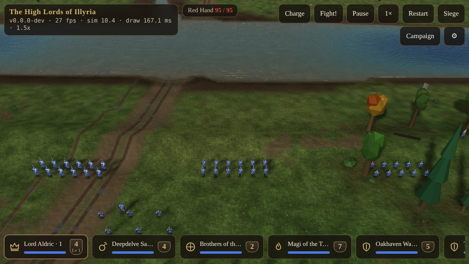
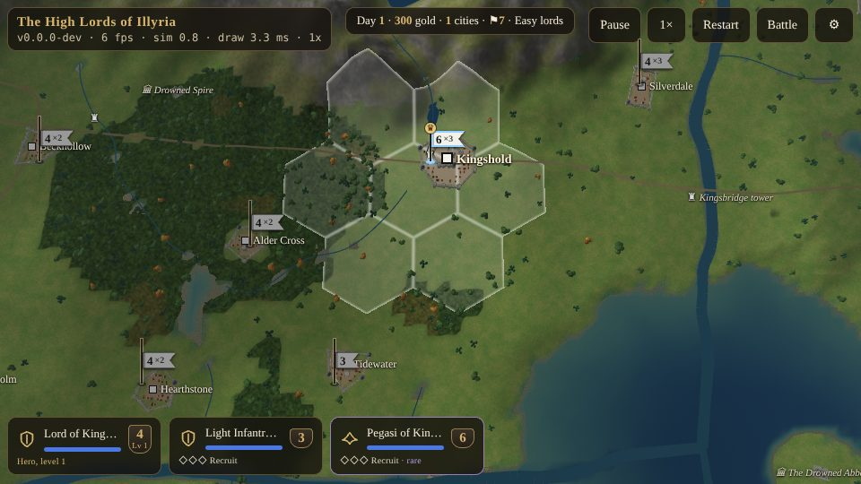

# Getting Started {#quick-start}

::: lore
*"Pick a man. Tell him where to stand. Then watch what he does when the arrows come."*

— Sir Aldric, to his squires
:::

The game runs in a web browser, on a phone, a tablet or a computer, with nothing to install. On an iPhone, *Share › Add to Home Screen* makes it an app of its own that opens full screen with no browser bars; on Android, Chrome's *Install app* does the same. Sound starts on your first touch (phones insist on it), so if all is silent, tap the screen once.

## The title screen and settings {#title-screen}

The game opens on its title screen, where you choose what to play: a **battle** on its own (a skirmish at the ford or the siege), the **campaign** (a new war, or one you saved), **Horde** or **Capture the Flag** (chapter ), this **manual**, or the **settings**. The same choices are in the ☰ menu at the top right while you play; the manual opens in a tab of its own, so the game waits where you left it.

The **settings** (⚙) hold three groups, and the game keeps your choices on the device:

- **Graphics.** Three presets, *Low*, *Medium* and *High* (phones start on Medium, computers on High), and each part of the look on its own: ground detail, grass and ground cover (and dense cover), sun shadows (and sharp, wide ones), detailed distant land, the sky with its haze and clouds, and full resolution. These change only how the battle looks: everyone sees the same battle on any setting, and the rules never change with them. If a phone grows hot or the battle stutters, step down a preset.
- **Voices.** The soldiers' voices on or off, their volume, and whether lines not yet recorded are read aloud by the device's own speech voice meanwhile.
- **Sound.** Sound effects on or off, their volume, and the ambience (wind, the swamp's insects, flies over the dead, the enemy's war drums). A link opens the sound test page, where every sound in the game can be heard on its own.

## Your first battle, in five minutes {#first-battle}

Choose a battle. You are at **Oakhaven Ford**, where the road from the north crosses the Aldwater. Your host stands on the near bank in blue; across the river the warband of the **Red Hand** is forming in red: footmen, dead men risen from the barrows, wolf riders, giants, minotaurs, spiders, devils and demons, archers, wizards and a dragon at the back. Their number is at the top of the screen, beside their name.

1. **Look around.** Pinch to zoom (or turn the mouse wheel), drag one finger to move over the land (the left mouse button), and twist two fingers to turn the view (the right mouse button). You can come down until one soldier fills the screen, or go up until the whole island is a map.
2. **Pick a squad.** The cards along the bottom are your squads. Tap the card of the **Grey Watch**, your heavy infantry. Their soldiers wear blue rings.
3. **March.** Tap the ground near the ford. The Grey Watch march there in line and halt facing the way they marched. Yellow rings on the ground show where each man will stand.
4. **Face the enemy.** Tap the card again to be sure they are selected; then press and **hold** on the ground where you want them, and when a gold ghost of the formation appears, **drag** toward the river. They will form up across your line, facing along it.
5. **Shoot.** Tap the card of the **1st Oakhaven Bowmen**, then tap a soldier of the Red Hand. The archers walk until he is in range and loose. Watch the arrows: they fly, and they can miss.
6. **Charge.** When the enemy are across the ford and in your bowmen's arrows, press **Charge** at the top: every squad goes at the nearest enemy, the archers stopping at a long bowshot.
7. **Find the fight.** **Fight!** brings the camera to the fiercest fighting on the field. **Pause** stops the battle while you think (and orders can still be given); **1×** cycles the speed.

The battle is won when the last of the Red Hand is dead or fled, and lost when the last of yours is. Then you may fight it again. To learn the walls and gates instead, switch to the **Siege**: the same host before the gates of the neutral town beyond the ford, with two catapults and grenadiers, against a garrison on its walls (chapter ).

## Your first campaign, in ten minutes {#first-campaign}

Choose the **campaign**. First you are asked how well the seven computer lords should play: **Easy** (Warlords' *Knights*: slow, careless, short of gold) or **Hard** (*Warlords*: every trick, no mercy). Choose Easy for your first war.

The camera looks down on **Kingshold**, your capital, with your lord's stack standing in it: your hero, a company of light infantry, and the pegasi of the Throne. The bar at the top says what day it is, how much gold you have, how many cities you hold, and how many hexes of land (⚑).

1. **Train an army.** Tap your lord's banner in Kingshold: the stack is selected and the city's panel opens. It lists what the city can train, with the days, the price and the daily upkeep of each. Tap **Light Infantry**: the price is paid now and the army comes out in two days. Close the panel.
2. **Choose a target.** Look for the nearest grey square: a neutral town. Tap your lord's banner to select the stack, then tap the town. The stack sets off along the road (roads are quickest) and attacks when it arrives.
3. **Fight or resolve.** The campaign stops: *Battle at Alder Cross: your 3 armies against 2*, say. The prompt shows each side's strength and its small edges. **Resolve** rolls the dice; **Fight it** opens the battle in 3D, at the town's walls. For now, **Resolve**.
4. **Raise your banner.** You have beaten the garrison, but the town is not yours until your banner flies over it. Stay in the town: a bar under its name shows your banner rising. When it reaches the top the town is yours, with its income and its training.
5. **Keep going.** The campaign is saved for you at every dawn, and you may keep a war in any of three save slots, to come back to from the title screen. The bar's **Pause** stops the clock; **1×** makes days pass two, four or eight times as fast. A campaign day is thirty seconds at normal speed. The news (top right) reports what your heroes and armies did, and what was done to you.

::: tip "The race"
In the first two weeks every lord is racing for the neutral towns. A town taken on day three pays you gold every day from then on and trains armies of its own: a town taken on day twenty has already paid someone else.
:::

## The screen in battle {#screen-battle}

- **Top left:** the game's name and version, the frame rate and how long the simulation and the drawing take (useful if a phone is struggling).
- **Top middle:** the enemy's name and how many of them still stand, out of how many.
- **Top right:** **Charge** (every squad at the nearest enemy), **Fight!** (the camera to the hottest fighting), **Pause**, the **speed**, and the **☰** menu (restart, the other set battle, the campaign, the settings). In a campaign battle, **Withdraw** leaves the field: the survivors go back to the map as an army thrown back.
- **Bottom:** the **cards**, one for each squad, with its name, how many are left, a health bar and its strength badge. Heroes and special troops have their cards at the front, heroes in gold. Above the cards, when something is selected, the **action row**: **Formation**, **⚔ Attack**, **Scatter**, **Hold** and **Find**; above that a line naming the selection and its edges.
- **In a siege:** a bar at the top shows the flag in the courtyard (chapter ). Under the title a tag says whose land the battle is fought on.

## The screen in the campaign {#screen-campaign}

- **Top:** *Day 12 · 340 gold · 6 cities · ⚑ 22 · Easy lords*, then Pause, the speed, and the ☰ menu.
- **The map:** every stack is a banner on a pole in its lord's colour, with a pennant; a veteran stack shows ◆ and how many veterans it has. Cities are castles in their owner's colours; ruins, temples and sages are marked, and searched ruins are greyed. Each hex of land is washed with the colour of whoever holds it.
- **Bottom:** the armies of the selected stack as cards: name and soldiers, strength, rank pips or the hero's level, blessings (✦) and artifacts (✧). Over a ruin, temple or sage a button offers to **Search**, **Visit** or **Consult**.
- **Panels:** a city's panel (what it trains, its walls, its port), the battle prompt, a hero's offer of service, the voyage panel for embarking and landing (chapter ), and the news.
