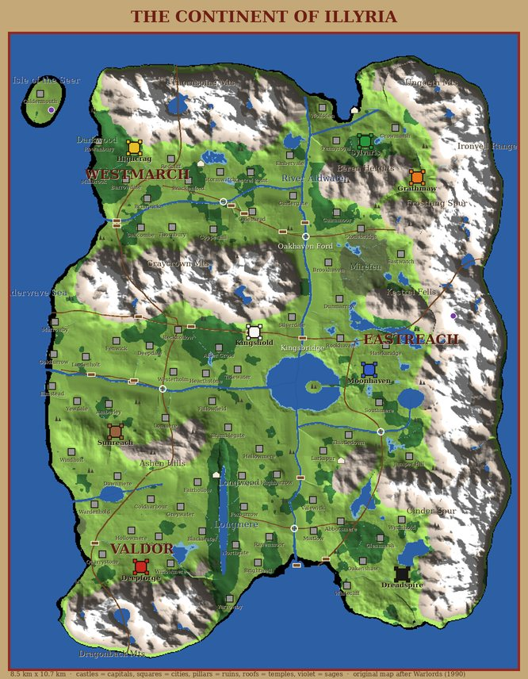

# The Continent {#continent}

::: lore
*"Every road in Illyria leads to a ford, and every ford to a grave."*

— a saying of the Valdor drovers
:::

There are no separate battle maps in this game. Illyria is one continuous land, modelled down to the tussock, and the camera goes all the way from a god's view of the island, where armies are banners on poles, to the mud of a single ford, where you can count the arrows in a shield. The campaign is played high up; battles are fought at the bottom; it is the same land all the way down, and a battle fought anywhere is fought on the hills, woods and streams that are really there.

## The lie of the land {#lie-of-the-land}

::: note "The measure of the land"
The island is **8.5 km** from west to east and **10.7 km** from south to north. The campaign map divides it into cells **133 m** across, 64 by 80 of them; ownership is reckoned in hexes **267 m** between centres, **33** columns by **47** rows (1,551 hexes, 1,112 of them with land). A battle is fought on a window **1 km** square cut out of the land where the armies met. The towns stand at least 330 m apart. *(The numbers of this edition. Rivers, roads, bridges, walls and gates keep their real sizes; it is the distances between places that the map sets.)*
:::

- **The sea.** The Sunderwave Sea runs the length of the west coast and round the north; the Isle of the Seer lies off the north-west, with the first of the two sages on it. The coast is a wandering shore of bays and headlands, with sand beaches and surf.
- **The rivers.** The **Aldwater** flows south from the northern coast down the middle of the land. The **Greymere** leaves it in the north and runs west to the sea, cutting off the north-west country of the Darkwood and the Thornspine: only Greymere Bridge and Greymere Ford lead in. Below **Kingsbridge** the Aldwater forks: the **Westrun** runs west to the sea and the **Sorrow** runs on south. The **Emberflow** drains Silverlake into it from the east; the Wending and the Coldbrook are smaller streams. Every river runs downhill to the sea, and every one is too deep to wade except at a ford.
- **The lakes.** The **Heartmere** lies where the rivers meet, a broad lake with **Abbey Isle** in it, reached only by the Spit from the eastern shore; on the isle stand the ruins of the Drowned Abbey. **Longmere** lies inside the Longwood; Mirrormere and Silverlake are smaller.
- **The mountains.** The Thornspine closes off the north. The Graycrown splits Westmarch from the central plain, with one pass through it. The **Ironveil** walls off the whole east; the Frostfang and Cinder spurs reach west from it. The east is broken country: the Ungoeth Mountains, the Beren Heights, the Kestrel Fells, the Grimtor Hills and the **Mirefen** swamp. The Dragonback lies to the south, and the Ashen Hills, Northmoor and Southdown hills stand inland. High mountains are closed to everything that walks; only fliers cross them.
- **The forests.** The Darkwood in the north-west, the Elderwood in the middle, the Thornwood and the Eastwood in the east, the Northwood round Sylvaris, and the long Longwood in the south around its lake.
- **The realms.** Westmarch is the north-west, beyond the Greymere and the Graycrown; Valdor the south-west, the plains and the hills down to the Dragonback; Eastreach the land east of the Aldwater.

## Crossings {#crossings}

The rivers are the walls of the realms and the crossings are their gates. There are five fords, which can be waded but slow an army to a crawl (the trodden margins are mud, and the water is to the knee), and four road bridges, quick but narrow. A few timber footbridges away from the roads let infantry over in single file.

| Crossing | Kind | Where |
|---|---|---|
| Oakhaven Ford | ford | the Aldwater, north of Kingsbridge: the set battle |
| Westrun Ford | ford | the Westrun |
| Sorrow Ford | ford | the Sorrow, in the south |
| Emberflow Ford | ford | the Emberflow, below Silverlake |
| Greymere Ford | ford | the Greymere, into the north-west |
| Kingsbridge | bridge | the Aldwater, at the fork |
| Old Bridge | bridge | the Westrun |
| Southbridge | bridge | the Sorrow, far south |
| Greymere Bridge | bridge | the Greymere |
| Heron Footbridge, Millrace Footbridge, Hangman's Span | footbridges | for men on foot only |

Every crossing has an **outpost tower** beside it, and whoever holds the land there holds the tower (chapter ).

## Cities and places {#places}

There are **eighty** walled cities. Eight are the capitals of the lords, castles with heavier walls, a tall keep and more towers; seventy-two start neutral. Every castle is different: square, long, many-sided or shield-shaped walls, drum towers at the corners and beside the gate, a keep, streets of houses, and a courtyard behind the gate kept open for mustering troops. Nine cities stand near enough to the sea to be **ports**, with a pier below the walls (chapter ).

Out in the wild places there are **34 ruins** in the forests and foothills, **4 temples**, one in each quarter of the land (the Temples of the Dawn, the Tides, the Stars and the Oak), and **2 sages**: the Seer's Tower on its island and the Hermit of the Peaks, high in the Ironveil. What they hold is in chapter .

## From the gods to the mud {#zoom}

| Zoom | What you see |
|---|---|
| The whole island | the realms, the hexes washed in their holders' colours, banners and castles |
| A region | cities, roads, rivers, army banners on their poles, the woods as clumps |
| The battlefield | formations, every soldier, arrows in flight |
| The ground | shields turning blades, the dead where they fell, blood on the grass |

Wherever the camera comes closer than about 850 m, on the campaign map too, the land under it is drawn at the battlefield's own detail: 4 m heights, roads with ruts, forest floor, rock, snow and banks, grass and ferns and flowers, every tree and rock that a battle fought there would have. It fades in as you come down, a little at a time, so nothing jumps. A battle fought at that place later looks exactly as it did from the air.

## The ground and what it does {#ground}

Each cell of the campaign map is one kind of ground: **road**, **bridge**, **plain**, **forest**, **hill**, **mountain**, **marsh**, **water** or **city**. The kind decides how much it costs to march across (chapter ) and how some armies fight on it (chapter ).

On the battlefield the ground is finer: road, plains, forest, swamp, shallows, rock, mud, sand and bridge decks, and every soldier moves at his own pace on each (chapter ). The hills are real hills, the slopes really slow a man climbing them, and a cliff steeper than 45 degrees is a wall. Mountains are impassable except where a pass or a road is cut through, so the passes, fords and bridges are where armies meet.
