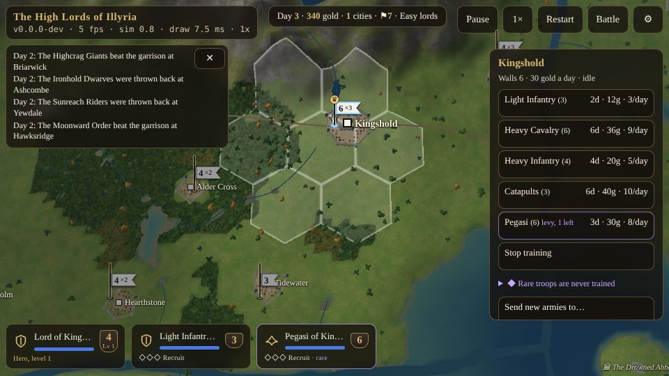

# Cities, Gold and Production {#cities}

::: lore
*"A castle is a purse with walls round it. Take the purse; the walls will follow."*

— Dame Isolde of Kingshold
:::

Cities are everything. They pay you, they train your armies, they hold your realm's land around them, and the war is won by holding them. Every lord starts with one, its capital. Every other city must be taken.

## What a city gives {#city-gives}

Tap one of your cities (or a stack of yours standing in one) and its **panel** opens: its name, its **walls**, the **gold** it pays you each day, and what it is training. Below that, every kind of army it can train, each with its strength, the days it takes, its price and its daily upkeep.

| | Capital | Town |
|---|---|---|
| Walls | 6 | 3 to 5 |
| Gold a day | 30 | 21 to 30 (the stronger its walls, the more) |
| Trains | light infantry and the realm's specialties | light infantry and one or two kinds the land raises |
| A levy | always (the realm's rare troops) | about one town in twelve |
| Garrison at the start | the lord's stack | 1 to 3 armies, more behind stronger walls |

## Gold {#gold}

Money is gold, and only gold. Every city you hold pays you every day: a capital 30, a town 21 to 30. The land pays a little too: one gold a day for every five hexes you hold (a realm of thirty hexes, six gold). Heroes find gold in ruins and are paid it by sages; the Purse of Plenty pays ten a day to whoever carries it.

Each lord begins the war with a chest of its own:

| Lord | Starting gold |
|---|---|
| The Aurelian Throne | 300 |
| The Highcrag Giants | 200 |
| The Ironhold Dwarves | 450 |
| The Orcs of Grath | 250 |
| The Sylvaran Elves | 250 |
| The Sunreach Riders | 300 |
| The Moonward Order | 300 |
| Lord Malvoren | 350 |

Where does it go? Into training (paid when an army is begun), into **upkeep** (paid every day for every army you have), into raising walls, building boats and hiring heroes. There is never enough.

When you take a city from another lord, its treasury suffers: the loser gives up its chest's share for that city (its gold divided by the cities it held), and half of that comes to you. Neutral towns have no chest to lose.

## Training armies {#training}

A city trains **one army at a time**. Tap a kind in the panel to start: the price is paid at once, and the army marches out of the gate when its days are done, into a stack of yours waiting in the city (or a new one). It is then trained again, and paid for again, until you choose something else or **Stop training**. If you cannot pay when an army is due to begin, the city waits for the money.

Armies are named for the order they were raised in, the city and their kind: the *14th Ashcombe Heavy Infantry*, the *2nd Kingshold Light Infantry*.

Cities train **common troops** only, and slowly. In *Warlords* light infantry took a day and four gold; here an army lost is weeks of a city's work.

| Army | Days | Gold | Upkeep a day | Where it is trained |
|---|---|---|---|---|
| Light Infantry | 2 | 12 | 3 | every city |
| Heavy Infantry | 4 | 20 | 5 | hill and plain towns; the Throne, Giants, Dwarves, Malvoren |
| Elven Archers | 4 | 20 | 5 | woodland towns; the Elves, the Order |
| Pikemen | 4 | 20 | 5 | hill and plain towns; the Giants, the Order |
| Dwarven Legion | 4 | 24 | 6 | hill towns; the Dwarves |
| Warriors | 4 | 24 | 6 | woodland towns; the Orcs |
| Light Cavalry | 5 | 28 | 7 | plain towns; the Elves, the Riders |
| Wolf Riders | 5 | 28 | 7 | woodland towns; the Orcs, Malvoren |
| Heavy Cavalry | 6 | 36 | 9 | plain towns; the Throne, the Riders |
| Catapults | 6 | 40 | 10 | the capitals of the Throne, the Dwarves and Malvoren |

A town trains light infantry and one or two more kinds, by the land round it: in the hills dwarves, heavy infantry or pikemen; in the woods archers, wolf riders or warriors; on the plains heavy infantry, light cavalry, pikemen or heavy cavalry. A capital trains light infantry and its realm's specialties:

| Capital | Trains |
|---|---|
| Kingshold (the Aurelian Throne) | Light Infantry, Heavy Cavalry, Heavy Infantry, Catapults |
| Highcrag (the Highcrag Giants) | Light Infantry, Heavy Infantry, Pikemen |
| Deepforge (the Ironhold Dwarves) | Light Infantry, Dwarven Legion, Heavy Infantry, Catapults |
| Grathmaw (the Orcs of Grath) | Light Infantry, Wolf Riders, Warriors |
| Sylvaris (the Sylvaran Elves) | Light Infantry, Elven Archers, Light Cavalry |
| Sunreach (the Sunreach Riders) | Light Infantry, Light Cavalry, Heavy Cavalry |
| Moonhaven (the Moonward Order) | Light Infantry, Elven Archers, Pikemen |
| Dreadspire (Lord Malvoren) | Light Infantry, Heavy Infantry, Wolf Riders, Catapults |

A city holds at most 32 armies; a full city trains no more until some march out. A city in which an enemy is raising a banner trains nothing at all (chapter ).

## Every soldier counts: rare troops {#rare-troops}

The beasts and monsters of Illyria, the allies of the old powers and the specialists of the old wars are **rare troops**, and no city in the land can train them. Each one lost is gone for good.

The rare troops are the **heroes**; the beasts and monsters (**giants, minotaurs, giant spiders, griffins, pegasi, elephants, unicorns**); the allies (**wizards, dragons, devils, demons, the undead, archons**); and the specialists (**dwarven grenadiers, journeymen, berserkers**). Their army cards have a violet border and say so, and disbanding one warns you that it cannot be replaced. A city's panel folds out the full list of rare kinds and where each can be had. They come from:

- **The realms' own.** Each lord's hero marches with rare troops of the realm from the first day: the Throne a flight of pegasi; the Giants two giants; the Dwarves griffins and grenadiers; the Orcs a minotaur and berserkers; the Elves unicorns and pegasi; the Riders elephants; the Order wizards and journeymen; Malvoren giant spiders and a minotaur.
- **Levies.** Every capital holds a **one-off levy** of its realm's rare troops, and so do a few towns (about one in twelve: giants, griffins or minotaurs in the hills, spiders, unicorns or berserkers in the woods, elephants, pegasi or grenadiers on the plains). A levy is shown in violet in the city's panel with how many are left. It takes **3 days** and **5 gold for every point of strength** to muster each army of it (giants, strength 6: 30 gold), once; whoever holds the city may muster it. A town's levy is two armies, or one of the mightiest (strength 7 or more).
- **The temples.** The first hero to kneel at each temple is followed by its guard, blessed there and serving for no pay (chapter ).
- **Heroes for hire.** One hero in three who offers his sword brings a band of rare troops with him (chapter ).
- **The ruins.** A hero who beats a ruin's guardian may find allies waiting: undead, wizards, devils, archons, dragons or demons (chapter ).

| Levy (capital) | Armies |
|---|---|
| Kingshold | 1 pegasi |
| Highcrag | 1 giants |
| Deepforge | 2 dwarven grenadiers |
| Grathmaw | 2 berserkers |
| Sylvaris | 1 unicorns |
| Sunreach | 1 elephants |
| Moonhaven | 2 journeymen |
| Dreadspire | 2 giant spiders |

**Siege engines are the exception.** Catapults are trained, at the three capitals that keep the craft, because walls are worth more than any army: without engines no capital would ever fall.

## Upkeep {#upkeep}

Every army costs gold every day it lives. A common army costs a **quarter of its training price** (rounded up): light infantry 3, heavy cavalry 9. Rare troops cost what *Warlords* asked for them:

| Rare army | Upkeep a day |
|---|---|
| Giant spiders, journeymen, berserkers | 3 |
| Giants, minotaurs, dwarven grenadiers | 4 |
| Elephants | 6 |
| Unicorns | 7 |
| Griffins, pegasi | 8 |
| Others (wizards, devils, demons, undead, archons, dragons) | 10 |

**Allies serve for nothing:** the guards of the temples, the companions of hired heroes and the allies of the ruins draw no pay at all. **Heroes** draw no pay either; you paid them once, when you hired them. A **boat** costs 2 gold a day.

## Lack of money {#lack-of-money}

Each dawn your income comes in and your upkeep goes out. If the treasury falls below nothing, armies **desert**, one by one, until it does not: the newest first, and green common troops before veterans and rare troops. Allies and heroes never desert. A lord who has outgrown its purse should not wait for this. Tap an army's card twice to **disband** it: it goes home and costs no more (heroes and armies carrying artifacts cannot be disbanded).

::: tip
Upkeep is a quarter of the price *every day*: a heavy cavalry army costs its own price again in four days. A large army needs a large realm behind it. Garrison your interior lightly, and keep your strength where it is needed.
:::

## Sending new armies elsewhere {#loc}

A city far behind the front can send what it trains to another of your cities. In its panel tap **Send new armies to…**, then tap the city that should receive them. From then on each new army appears there **two days** after it is trained, without marching. At most **four** cities may send to any one city. **Keep new armies here** stops it. If the city they were sent to has fallen or is full when they arrive, they go back home; if both are lost, they are lost on the road.

## Raising the walls {#walls}

A city's **walls** (1 to 9) help its defenders in the dice (chapter ): walls of 2 to 6 add a point to every defender's strength, 7 or 8 two points, 9 three. In the panel, **Raise the walls** costs **25 gold × (the walls + 1)**: from 3 to 4 costs 100, from 8 to 9 costs 225. Every time a city is taken its walls fall by one (never below 1).

::: note "Not yet built"
*Warlords* let a lord **raze** a city to the ground, and chose a new capital when the old one fell. Neither is in the game yet; nothing depends on your capital after the first day.
:::
