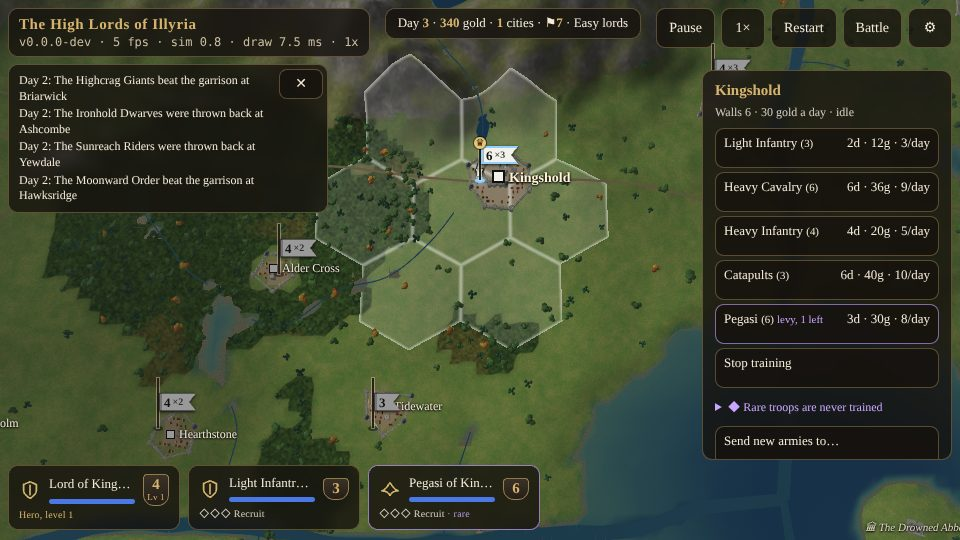

# Cities, Gold and Production {#cities}

::: lore
*"A castle is a purse with walls round it. Take the purse; the walls will follow."*

— Dame Isolde of Kingshold
:::

Cities are everything. They pay you, they train your armies, they hold your realm's land around them, and the war is won by holding them. Every lord starts with one, its capital. Every other city must be taken.

## What a city gives {#city-gives}

Tap one of your cities (its square on the map, or the ground in it with nothing selected) and its **panel** opens (it stays under the minimap and over the bottom bar, and shuts when you select something else): its name, its **walls**, the **gold** it pays you each day, and what it is training. Below that, every kind of army it can train, each with its strength, the days it takes (a town's days: a capital takes about half of them, see ), its price and its daily upkeep.

| | Capital | Walled town | Village |
|---|---|---|---|
| Walls | 6 | 3 to 5 | none (1) |
| Gold a day | 50 | 21 to 30 (the stronger its walls, the more) | 8 to 12 |
| Trains | light infantry and the realm's two or three specialties, at twice the pace | light infantry and one or two kinds the land raises | light infantry only |
| A levy of rare troops | always (the realm's own) | about one town in twelve | about one in twelve |
| Garrison at the start | the lord's stack, the capital's guard among it | 3 to 5 armies, bows on the walls | a levy on the green, spears as often as not |

Of the eighty places of Illyria only eight are capitals and about twenty are walled towns, and those stand where the land narrows: by the fords and bridges, and at the feet of the passes. The rest are open villages: a tower house, a green and a dozen roofs. A village falls to whoever stands on its green; a walled town must be entered, and its banner counts only the men **inside the wall**.

## Gold {#gold}

Money is gold, and only gold. Every place you hold pays you every day at dawn: a capital 50, a walled town 21 to 30, a village 8 to 12 (the panel shows what each pays). The land pays a little too: one gold a day for every five hexes you hold, rounded down (a realm of thirty hexes, six gold). Heroes find gold in ruins and are paid it by sages; the Purse of Plenty pays ten a day to whoever carries it.

Each lord begins the war with a chest of its own:

| Lord | Starting gold |
|---|---|
| The Aurelian Throne | 300 |
| The Highcrag Giants | 200 |
| The Ironhold Dwarves | 450 |
| The Orcs of Grath | 250 |
| The Sylvaran Elves | 250 |
| The Sunreach Riders | 300 |
| The Moonward Order | 300 |
| Lord Malvoren | 350 |

Where does it go? Into training (paid when an army is begun), into **upkeep** (paid every day for every army you have), into building boats and hiring heroes. There is never enough.

When you take a city from another lord, its treasury suffers: the loser gives up its chest's share for that city (its gold divided by the cities it held, this one among them), and half of that comes to you. Neutral towns have no chest to lose. A city that changes hands stops what it was training, and forgets where it was sending its armies.

## Training armies {#training}

A city trains **one army at a time**. Tap a kind in the panel to choose it. The price is paid at the next dawn, when the drill begins, and the army marches out when its days are done, into a stack of yours standing idle in the city (or a new one). It is then trained again, and paid for again, until you choose something else or **Stop training**. If you cannot pay at the dawn an army is due to begin, the city waits for the money.

::: note
Choosing another kind, or **Stop training**, throws away the days already drilled, and the gold paid for them does not come back.
:::

Armies are named for the order they were raised in, the city and their kind: the *14th Ashcombe Heavy Infantry*, the *2nd Kingshold Light Infantry*.

Cities train **common troops** only, and slowly. In *Warlords* light infantry took a day and four gold; here an army lost is weeks of a city's work. A **capital drills two days in one**, whoever holds it: an army of two days takes one there, one of four days two, one of five or six days three. Its panel shows the days as they pass there.

| Army | Men | Days in a town | Days in a capital | Gold | Upkeep a day | Where it is trained |
|---|---|---|---|---|---|---|
| Light Infantry | 12 | 2 | 1 | 12 | 3 | every capital, town and village |
| Heavy Infantry | 12 | 4 | 2 | 20 | 5 | hill and plain towns; the Throne, Giants, Dwarves, Malvoren |
| Archers | 12 | 4 | 2 | 20 | 5 | woodland towns; the Elves, the Order |
| Pikemen | 12 | 4 | 2 | 20 | 5 | hill and plain towns; the Giants, the Order |
| Dwarven Grenadiers | 6 | 4 | 2 | 24 | 6 | hill towns; the Dwarves |
| Warriors | 12 | 4 | 2 | 24 | 6 | woodland towns; the Orcs |
| Light Cavalry | 8 | 5 | 3 | 28 | 7 | plain towns; the Elves, the Riders |
| Wolf Riders | 8 | 5 | 3 | 28 | 7 | woodland towns; the Orcs, Malvoren |
| Heavy Cavalry | 8 | 6 | 3 | 36 | 9 | plain towns; the Throne, the Riders |
| Catapults | 2 | 6 | 3 | 40 | 10 | only the capitals of the Throne, the Dwarves and Malvoren |

A **village** trains light infantry and nothing else. A **walled town** trains light infantry and one or two more kinds, by the land round it: in the hills dwarven grenadiers, heavy infantry or pikemen; in the woods archers, wolf riders or warriors; on the plains heavy infantry, light cavalry, pikemen or heavy cavalry. A **capital** trains light infantry and its realm's specialties, and goes on training them for whoever takes it:

| Capital | Trains |
|---|---|
| Kingshold (the Aurelian Throne) | Light Infantry, Heavy Cavalry, Heavy Infantry, Catapults |
| Highcrag (the Highcrag Giants) | Light Infantry, Heavy Infantry, Pikemen |
| Deepforge (the Ironhold Dwarves) | Light Infantry, Dwarven Grenadiers, Heavy Infantry, Catapults |
| Grathmaw (the Orcs of Grath) | Light Infantry, Wolf Riders, Warriors |
| Sylvaris (the Sylvaran Elves) | Light Infantry, Archers, Light Cavalry |
| Sunreach (the Sunreach Riders) | Light Infantry, Light Cavalry, Heavy Cavalry |
| Moonhaven (the Moonward Order) | Light Infantry, Archers, Pikemen |
| Dreadspire (Lord Malvoren) | Light Infantry, Heavy Infantry, Wolf Riders, Catapults |

Nothing limits how many armies may stand in a city. A city in which an enemy is raising a banner trains nothing at all (chapter ).

## Every soldier counts: rare troops {#rare-troops}

The beasts and monsters of Illyria, the allies of the old powers and the specialists of the old wars are **rare troops**, and no city in the land can train them. Each one lost is gone for good.

The rare troops are the **heroes**; the beasts and monsters (**giants, minotaurs, giant spiders, griffins, pegasi, elephants, unicorns**); the allies (**wizards, dragons, devils, demons, the undead, archons**); and the specialists (**journeymen, berserkers**). The grey card of one you look at says so, and disbanding one warns you that it cannot be replaced. A city's panel folds out the full list of rare kinds and where each can be had. They come from:

- **The realms' own.** Each lord's hero stands in his capital on the first day with a company of light infantry, the capital's guard of archers and heavy infantry, and rare troops of the realm, all in one stack: the Throne a flight of pegasi; the Giants two giants; the Dwarves two flights of griffins; the Orcs a minotaur and berserkers; the Elves unicorns and pegasi; the Riders elephants; the Order wizards and journeymen; Malvoren giant spiders and a minotaur.
- **Levies.** Every capital holds a **one-off levy** of its realm's rare troops, and so do a few towns and villages (about one in twelve: giants, griffins or minotaurs in the hills; spiders, unicorns or berserkers in the woods; elephants, pegasi or unicorns on the plains). A levy is shown in violet in the city's panel with how many are left. Each army of it takes **3 days** to muster (2 in a capital) and **5 gold for every point of strength** (giants, strength 6: 30 gold), once; whoever holds the city may muster it. A town's or village's levy is two armies, or one of elephants.
- **The temples.** The first hero to kneel at each temple is followed by its guard, blessed there and serving for no pay (chapter ).
- **Heroes for hire.** One hero in three who offers his sword brings a band of rare troops with him (chapter ).
- **The ruins.** A hero who beats a ruin's guardian may find allies waiting: undead, wizards, devils, archons, dragons or demons (chapter ).

| Levy (capital) | Armies | Gold each |
|---|---|---|
| Kingshold | 1 pegasi | 30 |
| Highcrag | 1 giants | 30 |
| Deepforge | 1 griffins | 30 |
| Grathmaw | 2 berserkers | 25 |
| Sylvaris | 1 unicorns | 30 |
| Sunreach | 1 elephants | 35 |
| Moonhaven | 2 journeymen | 10 |
| Dreadspire | 2 giant spiders | 25 |

Minotaurs, where a hill town has them to muster, cost 30 gold each.

**Siege engines and grenadiers are the exceptions.** The dwarves' grenadiers are trained like any common troops, in Deepforge and the hill towns. Catapults are trained, at the three capitals that keep the craft, because walls are worth more than any army: without engines no capital would ever fall.

## Upkeep {#upkeep}

Every army costs gold every day it lives, however few of its men are left. A trained army costs a **quarter of its training price** (rounded up): light infantry 3, grenadiers and warriors 6, heavy cavalry 9, catapults 10 (the table above has them all). Rare troops cost what *Warlords* asked for them:

| Rare army | Upkeep a day |
|---|---|
| Giant spiders, journeymen, berserkers | 3 |
| Giants, minotaurs | 4 |
| Elephants | 6 |
| Unicorns | 7 |
| Griffins, pegasi | 8 |
| Others (wizards, devils, demons, undead, archons, dragons) | 10 |

**Allies serve for nothing:** the guards of the temples, the companions of hired heroes and the allies of the ruins draw no pay at all. **Heroes** draw no pay either; you paid them once, when you hired them. An army on the road to another city (see ) is paid like any other. A **boat** costs 2 gold a day.

## Lack of money {#lack-of-money}

Each dawn your income comes in and your upkeep goes out. If the treasury falls below nothing, armies **desert**, one by one, each taking his day's pay off the bill, until it does not: the newest first, and green common troops (recruits and regulars) before veterans, elites and rare troops. Allies and heroes never desert; if nobody is left to desert, the debt is forgiven. The boats' pay is taken first each dawn, and only from what gold there is: an empty treasury keeps its boats, and no one deserts for them.

A lord who has outgrown its purse should not wait for this. Select an army (box its soldiers) and tap **Disband** twice: it goes home and costs no more (heroes cannot be disbanded).

::: tip
Upkeep is a quarter of the price *every day*: a heavy cavalry army costs its own price again in four days. A village's gold keeps three armies of light infantry, a walled town's five of heavy foot, give or take one. A large army needs a large realm behind it. Garrison your interior lightly, and keep your strength where it is needed.
:::

## Sending new armies elsewhere {#loc}

A city far behind the front can send what it trains to another of your cities. In its panel tap **Send new armies to…**, then tap the city that should receive them. From then on each new army appears there **two days** after it is trained, without marching (and is paid its upkeep on the way). At most **four** cities may send to any one city. **Keep new armies here** stops it. If the city they were sent to has fallen, or an enemy is raising a banner in it, when they arrive, they go back home; if home is no better, they are lost on the road.

## Walls {#walls}

A walled city's **walls** are real: the stone, the towers, the gate and the walk along the top that you see on the map are the ones its garrison fights on and its attackers must breach (chapter ). The number the panel shows beside *Walls* (a capital 6, a walled town 3 to 5, a village 1) is the old *Warlords* rating, which the computer lords still use to reckon whether an attack is worth making; it falls by one each time the city is taken, never below 1. It cannot be bought up: walls that change nothing a soldier can see were not worth the gold.

::: note "Not yet built"
*Warlords* let a lord **raze** a city to the ground, and chose a new capital when the old one fell. Neither is in the game: a capital that falls stays a capital, and pays its 50 gold and drills at its double pace for its new lord.
:::
