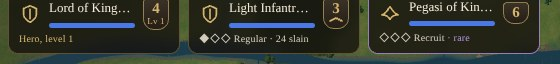

# Armies and Stacks {#armies}

::: lore
*"Count your men by name, captain. The enemy counts them by the dozen."*

— from the drill book of the Grey Watch
:::

## What an army is {#army}

An **army** is a company of soldiers of one kind, raised together, named together and fighting together: the *1st Oakhaven Bowmen*, the *Iron Hill Legion*, the *Garrison of Ashcombe*. On the campaign map it is one card in a stack; on the battlefield it is a **squad**, every one of its soldiers a figure of his own. A fresh army has its full number:

| Soldiers | Armies |
|---|---|
| 12 | light and heavy infantry, elven archers, pikemen, warriors, undead |
| 10 | dwarven legion, berserkers |
| 8 | light and heavy cavalry, wolf riders |
| 6 | giant spiders, dwarven grenadiers |
| 4 | griffins, pegasi, minotaurs, unicorns, journeymen |
| 3 | giants, wizards, archons, devils |
| 2 | elephants, demons, catapults |
| 1 | a hero; a dragon |

Losses are real. An army that comes out of a battle with five men left is an army of five, until it is gone; nothing in the game refills it. Its card shows how many still stand, and a bar how many that is of its full number.

## Strength: the one number {#strength}

Every army shows a single **strength from 1 to 9** on its badge and its banner, as in *Warlords*: light infantry 3, heavy cavalry 6, a dragon 9. It is all you need to read to know what an army is worth in the dice. Every **blessing** adds one, a **hero's level** adds one a level, and a hero's **battle artifacts** add theirs, never past 9. The full list of strengths is in the compendium (chapter ) and the tables at the back.

::: tip
The dice favour quality over quantity: four heavy infantry of strength 4 will find it hard going against one dragon of strength 9. But the weakest light infantryman can still kill a dragon. Just don't count on it.
:::

## Ranks: veterans {#ranks}

Soldiers who kill come out of their battles better soldiers. A soldier is a **recruit** until he has killed twice, a **regular** after 2 kills, a **veteran** after 5 and **elite** after 10. In the dice, an army's kills are counted for the army: it is regular when it has killed twice its full number, veteran at five times, elite at ten times.

An army shows the average rank of its survivors as pips: ◇◇◇ recruit, ◆◇◇ regular, ◆◆◇ veteran, ◆◆◆ elite, with the tally of its kills; a veteran army's pips are gold. On the battlefield each soldier's health bar carries a gold shield for each of his grades. A rank is a small edge, not a whole point of strength: **+3% a rank** to the army's blows and its roll in the dice (regular 3%, veteran 6%, elite 9%), with a little more besides on the battlefield (chapter ). Ranks are kept from battle to battle, in the dice and in 3D alike.

Since the rank is the survivors' average, **losses cost rank as well as men**: a veteran army that loses its oldest hands to a volley may come out regular. A banner on the map shows ◆ and the number of veterans in the stack.

## Stacks {#stacks}

Armies move about the map in **stacks**. A stack is shown as a banner on a pole in its lord's colour. At most **eight armies** may stand on one cell of the map, and a stack may not march through a cell where that would make more than eight; inside a city the limit is **32** (a *Warlords* city is four squares of eight). An attack commits the whole stack that makes it, eight armies at most, but a city defends with everything inside it.

Tap a banner of yours to select its stack; its armies appear as cards along the bottom. A stack that arrives where another of yours is standing joins it, as many armies as the limit of eight allows. New armies trained in a city join a stack of yours standing idle there.

::: note "Not yet built"
In this edition a stack cannot yet be split by hand. A stack boarding a boat leaves its weakest army on the quay when it has eight (chapter ); a hero going to search a ruin takes the stack with him.
:::

## Heroes {#heroes-armies}

A **hero** is an army of one: a named champion who fights, leads, and above all explores. Every lord starts the war with one, for free; others offer their swords for gold now and then (chapter ). A hero's card is gold and shows **Lv** and his level instead of rank pips.

- **Levels.** A hero rises from level 1 to level 9 by kills: level 2 at 3 kills, then 7, 12, 18, 25, 33, 42 and 52 for level 9.
- **Strength.** A hero's strength is **3 + his level** (level 1: 4; level 6: 9), plus his battle artifacts, never past 9.
- **Leadership.** The best hero in a stack leads every army beside him: strength 4 to 6, **+2%**; 7 or 8, **+4%**; 9, **+6%** (chapter ). His command artifacts add whole points to every army in the stack (chapter ).
- **In battle** a hero is a mighty fighter, worth a squad on his own, who never breaks and steadies everyone near him; when he falls, those near him may break at once (chapter ).

A hero goes where his stack goes; a stack of fliers carries its hero over the mountains. A hero who dies is gone, with everything he carried dropped where he fell.

## The army cards {#army-cards}

Each card shows:

- the army's **name** and how many **soldiers** it has, and a bar of its full number;
- its **strength** badge, and under it the **rank** (◆◇◇) or the hero's **level** (Lv 3);
- **✦** for each blessing, **✧** and the names of any artifacts a hero carries;
- the tally of the army's **kills**;
- a **violet border** for rare troops, which no city can train or replace.

Tap a hero's card to hear what he carries. Tap any other card twice to **disband** that army: it goes home and costs no more upkeep. The game warns you when the army is rare or seasoned, since nothing will replace it.
