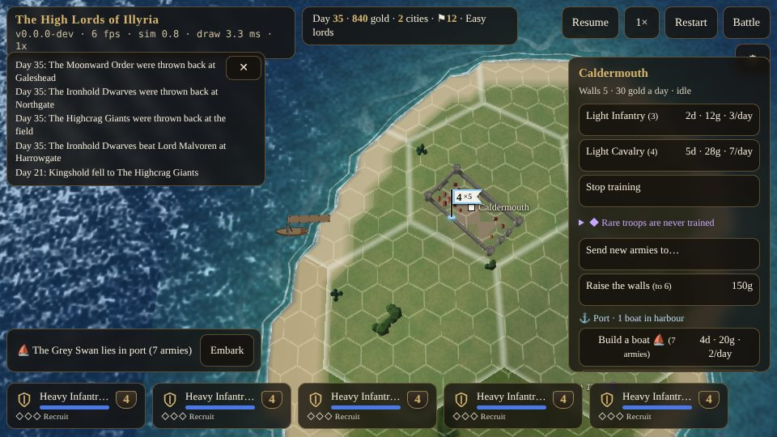

# Moving {#moving}

::: lore
*"The road is the shortest way to a town and the longest way round a wood. Ask any horse."*

— a Sunreach saying
:::

## Giving the order {#march-order}

Select a stack by tapping its banner, then tap where it should go: a cell of open ground, a city of yours, a friendly stack to join, or an enemy to attack. The stack works out its own way there, the quickest it can find for the armies in it, and sets off at once. It keeps to the roads where the roads are quicker, crosses rivers only at the fords and bridges, goes round mountains, lakes and enemy stacks, and takes a boat where that is quicker still (if a boat is free; see below). Tap somewhere else to change its orders on the march.

Time on the campaign map runs on its own: a **campaign day** is thirty seconds at normal speed, and the speed button makes it two, four or eight times as fast. **Pause** stops it. Stacks move a little every moment, not in jumps, so a stack ordered far away is on the road for days and can be met on the way.

## Movement points {#movement-points}

Every kind of army has its **movement points**, the distance it can cover in a day, and every kind of ground a **cost** for entering a cell of it. A stack that spends its day's points has gone as far as it can go that day: light infantry (10 points) cover ten cells of road in a day (1.3 km), or five of plain (670 m), or two and a half of forest.

| Army | Points a day |
|---|---|
| Wizards | 20 |
| Light Cavalry, Dragons, Archons | 18 |
| Heavy Cavalry, Unicorns, Griffins, Pegasi | 16 |
| Wolf Riders | 14 |
| Elven Archers, Heroes, Elephants, Giant Spiders | 12 |
| Light Infantry, Giants, Minotaurs, Undead, Devils, Demons, Journeymen, Berserkers | 10 |
| Dwarven Legion, Dwarven Grenadiers | 9 |
| Heavy Infantry, Pikemen, Warriors | 8 |
| Catapults | 6 |

## The cost of the ground {#terrain-costs}

The costs are those of the *Warlords* movement table; P means the army may not go there at all.

::: keep
| Army | Road | Bridge | Plain | Forest | Hill | Marsh | Mountain | Water |
|---|---|---|---|---|---|---|---|---|
| Light Infantry, Heroes, Wizards, Journeymen, Berserkers | 1 | 1 | 2 | 4 | 6 | 5 | P | P |
| Heavy Infantry, Pikemen, Warriors | 1 | 1 | 2 | 4 | 6 | 5 | P | P |
| Elven Archers | 1 | 1 | 2 | **2** | 5 | 6 | P | P |
| Dwarven Legion, Grenadiers | 1 | 1 | 2 | 6 | **3** | 6 | P | P |
| Light and Heavy Cavalry, Elephants, Unicorns | 1 | 1 | 2 | 5 | 6 | 5 | P | P |
| Wolf Riders, Giant Spiders | 1 | 1 | 2 | 4 | 6 | **4** | P | P |
| Giants, Minotaurs | 1 | 1 | 2 | 5 | **4** | 5 | P | P |
| Undead | 1 | 1 | 2 | 4 | 5 | **4** | P | P |
| Devils, Demons | 1 | 1 | 2 | 4 | 5 | 5 | P | P |
| Catapults | 1 | 1 | 2 | 6 | 6 | P | P | P |
| Pegasi, Griffins, Dragons, Archons | 2 | 2 | 2 | 2 | 2 | 2 | 3 | 2 |
:::

A city costs 1 to enter, like a road. An **attack** costs 2 points whatever the ground (it is a fight, not a walk).

## Moving in stacks {#stack-movement}

A stack moves together. It has the points of its **slowest** army (a hero among them), and pays, for each cell, the cost of the army that finds that ground **dearest**. So one company of heavy infantry slows a stack of light horse to 8 points a day, and one catapult keeps the whole stack out of the marshes.

A **hero** is the exception for costs, as in *Warlords*: he pays whatever the rest of his stack pays. A hero with a stack of griffins flies over the mountains with them. Alone, he walks like a man.

A stack made only of fliers (and their heroes) crosses rivers anywhere, and mountains at 3 a cell. The **Winged Sandals**, if a hero in the stack carries them, add 4 points a day to the whole stack.

## Where you may not go {#illegal}

- Onto ground marked P for any army in the stack.
- Across a river except at a ford or a bridge (unless the whole stack flies).
- **Through** a cell held by another lord's stack, or a neutral or enemy city: those must be fought for, and a stack ordered into one attacks it.
- Onto or through a cell of your own that would then hold more than eight armies (32 in a city). A stack that finds the way filled by its own side halts where it is.
- Off the island, except by boat.

## Roads, rivers and crossings {#roads}

Roads are dirt tracks, curving with the land, and they are the arteries of every realm: an army on a road moves twice as fast as on the open plain and four or five times as fast as in a wood. Every river is crossed at a ford or a bridge, so the crossings are where the war is fought. Each has an outpost tower whose holder fights with an edge there (chapter ).

::: tip
Look at where the roads meet the rivers. A stack standing on a bridge or a ford blocks it to the enemy, who must go round by the next crossing or fight for this one.
:::

## Boats and ports {#boats}

The sea is the fastest road of all. As the *Warlords* navy did, a boat "can carry a maximum of seven other armies" and "ignores the movement points of the armies it carries."

- **Ports.** Nine of the eighty cities stand within two cells of the open sea and are ports, with a pier below their walls. Only the sea is navigable (the Sunderwave Sea along the west coast and round the north): the lakes and rivers are too narrow to sail.
- **Building a boat.** A port's panel has **Build a boat**: 20 gold, ready in 4 days, 2 gold a day upkeep. It is built beside the city's training, not instead of it. Boats have names: the *Grey Swan*, the *Sea Hawk*.
- **Embarking.** A stack in a port with a free boat of yours boards it with **Embark** (in the voyage panel), taking any idle friends in the port aboard too, up to seven armies. A stack of eight leaves its weakest army (never a hero) on the quay. A stack also boards simply by being ordered out onto the water.
- **Sailing.** Afloat, a stack moves 40 points a day at 2 a sea cell: twenty cells, 2.7 km, a day, whatever it carries. Light infantry on foot manage five cells of plain.
- **Landing.** **Land** puts the stack ashore on any coast it can walk, or order it inland; a boat sails straight into a friendly port. A boat that landed elsewhere rides at anchor off that coast, where a stack of yours next to it may board again.
- **Planning.** A march order considers the sea whenever you have a free boat, and takes it when that is quicker: from Thistledown in the north to Whitecliff in the far south is 4 days by sea and 11 on foot.
- **Losses.** A boat whose armies all fall goes down with them. Armies fighting from a deck fight **a point weaker**, both sides, and a battle at sea is always settled with the dice (there is no ground to fight a 3D battle on). An empty boat in a port that falls changes hands; one at anchor is burnt by an enemy boat that reaches it.

