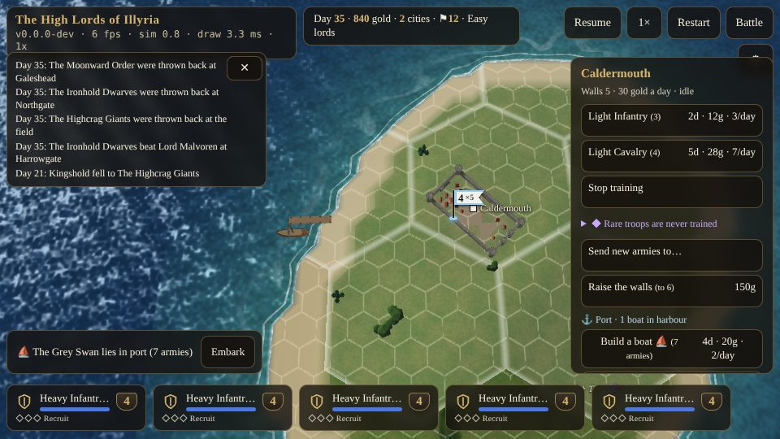

# Moving {#moving}

::: lore
*"The road is the shortest way to a town and the longest way round a wood. Ask any horse."*

— a Sunreach saying
:::

## Giving the order {#march-order}

Select soldiers (chapter ), then tap where they should go: a cell of open ground, a city of yours, the ground beside a friendly stack, or an enemy to attack. Their squads work out their own way there, the quickest it can find for the armies in them, and set off at once. It keeps to the roads where the roads are quicker, crosses rivers only at the fords and bridges, goes round mountains, lakes and enemy stacks, and takes a boat where that is quicker still (if a boat is free; see below). Tap somewhere else to change its orders on the march.

Time on the Conquest map runs on the battle's clock: a **Conquest day** is two minutes at normal speed (1×), and the speed button steps it to 2×, 4× and 8× and round again: a day in one minute, in thirty seconds, in fifteen. (The settings choose the speed a Conquest starts at.) **Pause** stops it. Stacks march at their real pace every moment, not in jumps, so a stack ordered far away is on the road for days and can be met on the way. While a selected stack marches, the bar above the action row says when it will be there: in days, and in minutes at the present speed.

## Speed {#speed}

There are no movement points. Every army marches at the speed its soldiers walk or ride on the battlefield (the unit sheet's speed, chapter ), and the ground changes it as it does in battle. Heavy infantry cross a cell of level plain (44 m) in 23 seconds; light cavalry in 6. In a day, light infantry walk about 290 m of level plain (six or seven cells), twice that on a road and 200 m in a forest.

Metres a day on level ground are the speed times 120: heavy infantry 228, light infantry and archers 288, heavy cavalry 660, light cavalry 840, catapults 96.

| Army | On open ground |
|---|---|
| Wolf Riders | 7.5 m/s |
| Light Cavalry, Unicorns | 7.0 m/s |
| Heavy Cavalry | 5.5 m/s |
| Giant Spiders | 5.0 m/s |
| Berserkers | 3.6 m/s |
| Demons | 3.4 m/s |
| Elephants, Devils | 3.2 m/s |
| Minotaurs | 3.0 m/s |
| Heroes | 2.8 m/s |
| Light Infantry, Archers, Giants | 2.4 m/s |
| Journeymen | 2.3 m/s |
| Warriors | 2.2 m/s |
| Pikemen, Wizards | 2.0 m/s |
| Heavy Infantry | 1.9 m/s |
| Dwarven Grenadiers | 1.8 m/s |
| Undead | 1.6 m/s |
| Catapults | 0.8 m/s |
| Pegasi, Griffins, Archons, Dragons, walking | 4.5, 3.0, 2.8, 2.5 m/s |

## The ground {#terrain-costs}

Each kind of army has its **gait**, the battlefield's, and each gait its pace on each ground. A road doubles everyone's pace, horse and wheel alike. A hill is plain ground with a climb: going up divides the pace by 1 + 2.5 × the slope × the gait's share of the climb (a man up a slope of one in ten takes a quarter longer over it), going down is up to 15% quicker, and slopes steeper than about one in three slow everyone a further fifth. Each step from one cell to the next is half over each cell's ground; a diagonal step is 1.4 times as long.

::: keep
| Gait | Road | Plain | Forest | Marsh | Climb | Armies |
|---|---|---|---|---|---|---|
| Foot | 2 | 1 | 0.70 | 0.50 | 100% | light and heavy infantry, pikemen, warriors, berserkers, wizards, journeymen, heroes; fliers on foot |
| Horse | 2 | 1 | 0.50 | 0.30 | 120% | light and heavy cavalry, unicorns |
| Wolf | 2 | 1 | 0.85 | 0.35 | 90% | wolf riders |
| Dwarf | 2 | 1 | 0.70 | 0.50 | 50% | dwarven grenadiers |
| Woodland | 2 | 1 | **0.95** | 0.55 | 100% | archers, giant spiders |
| Giant | 2 | 1 | 0.65 | 0.60 | 80% | giants, minotaurs, elephants, devils, demons |
| Undead | 2 | 1 | 0.70 | **1.00** | 100% | undead |
| Wheeled | 2 | 1 | 0.40 | 0.25 | 150% | catapults |
:::

A city is plain ground, or road where a road runs through it. Mountains and water are closed to everyone on foot. An **attack** is the last step of the march, into the enemy's cell, at the same pace.

The way a stack is sent is the quickest for the armies in it, worked out with these same speeds, so each kind takes its own way: horse round a wood that infantry cuts through, and the road wherever the road is quicker.

### A realm's own country {#own-country}

Every realm's armies march **15% quicker** over the kind of country their realm is at home on, as its soldiers do on the battlefield (and they fight a little better there: chapter ). It is the ground that counts, not whose land it is; fliers on the wing gain nothing by it.

| Realm | Its own country |
|---|---|
| The Aurelian Throne | the open country |
| The Highcrag Giants | the hills |
| The Ironhold Dwarves | the hills |
| The Orcs of Grath | the fens and the hills |
| The Sylvaran Elves | the woods |
| The Sunreach Riders | the open country |
| The Moonward Order | the water's edge and the woods |
| Lord Malvoren | the fens and the woods |

## Moving in stacks {#stack-movement}

A stack moves together, at the pace of its **slowest** army on each step. One company of heavy infantry holds a stack of light horse to 1.9 m/s on the plain; one catapult holds the whole stack to 0.8 m/s, and to a fifth of a metre a second in a marsh.

A **hero** walks like any man, at 2.8 m/s. A hero with a stack of griffins keeps them on the ground, out of the mountains and the sea.

A stack made **only of fliers** flies, over mountains, water and rivers alike, at the long-run pace of their flight: a run to take off, a flight as long as their wings will carry them, then twice as long resting on the ground. Griffins make 4.0 m/s so, pegasi 4.7, dragons 4.9 and archons 3.7, whatever lies below; a mixed flight goes at the pace of its slowest.

The **Winged Sandals**, if a hero in the stack carries them, make the whole stack a third quicker.

## Where you may not go {#illegal}

- Onto mountains or water, unless every army in the stack flies.
- Across a river except at a ford or a bridge (unless the whole stack flies).
- **Through** a cell held by another lord's stack (a garrison is one): those must be fought for, and a stack ordered into one attacks it.
- Off the island, except by boat.

## Roads, rivers and crossings {#roads}

Roads are dirt tracks, curving with the land, and they are the arteries of every realm: an army on a road moves twice as fast as on the open plain, and in a wood foot go about three times slower than on the road, horse four times and catapults five. (On the battlefield a bridge's deck is crossed at the pace of the fields: castle walls and ramps are decks too.) Every river is crossed at a ford or a bridge, so the crossings are where the war is fought. Each has an outpost tower whose holder fights with an edge there (chapter ).

::: tip
Look at where the roads meet the rivers. A stack standing on a bridge or a ford blocks it to the enemy, who must go round by the next crossing or fight for this one.
:::

## Boats and ports {#boats}

The sea is a fast road for anyone but horse. As the *Warlords* navy did, a boat "can carry a maximum of seven other armies" and "ignores the movement points of the armies it carries."

- **Ports.** Every place that stands within two cells of navigable water is a port, town or village, and its panel says so (⚓ Port). The sea is navigable, and so are the great lakes; ponds, narrow reaches and the rivers are not.
- **Building a boat.** A port's panel has **Build a boat**: 20 gold, paid at once, ready in 4 days (a capital's yards are no quicker), 2 gold a day upkeep from the day it is launched. It is built beside the city's training, not instead of it, one boat at a time. Boats have names: the *Grey Swan*, the *Sea Hawk*.
- **Embarking.** A stack in a port with a free boat of yours boards it with **Embark** (in the voyage panel), taking any idle friends in the port aboard too, up to seven armies. A stack of eight leaves its weakest army (never a hero) on the quay. A stack also boards simply by being ordered out onto the water.
- **Sailing.** Afloat, a stack sails at 6 m/s, 720 m a day, whatever it carries: quicker than anything on foot, and than horse off the road.
- **Landing.** **Land** puts the stack ashore on any coast it can walk, or order it inland; a boat sails straight into a friendly port. A boat that landed elsewhere rides at anchor off that coast, where a stack of yours next to it may board again.
- **Planning.** A march order considers the sea whenever you have a free boat, and takes it when that is quicker; it is the only way on or off an island for those who cannot fly.
- **Losses.** A boat whose armies all fall goes down with them. Boats do not fight yet: a stack aboard is never drawn into a fight, so armies at sea can neither attack nor be attacked; a stack that lands fights where it lands. An empty boat in a port that falls changes hands; one at anchor is burnt by an enemy boat that reaches it.

