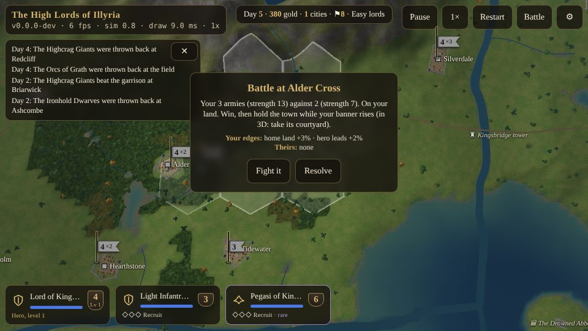
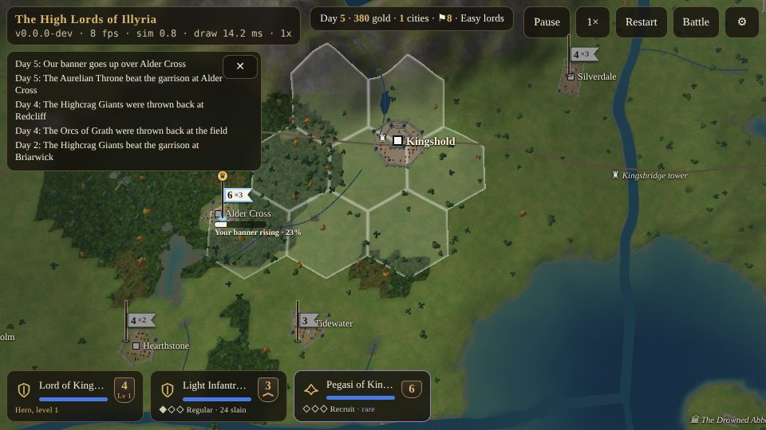
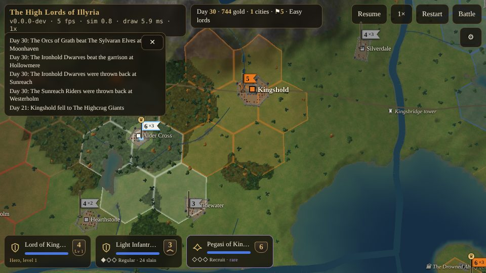

# War on the Map {#war}

::: lore
*"The dice are honest. It is the men who roll them who are not."*

— Brannoc the Bold
:::

## Attacking {#attacking}

To attack, order a stack into an enemy stack, an enemy city or a neutral town: tap the enemy banner or the town with your stack selected. The march ends at the enemy, and the attack costs two movement points whatever the ground. Attacking is also the only way to take a city.

When the stack arrives, the campaign stops and asks:

> **Battle at Alder Cross.** Your 3 armies (strength 13) against 2 (strength 7). On your land. Win, then hold the town while your banner rises (in 3D: take its courtyard).
>
> **Your edges:** home land +3% · hero leads +2%. **Theirs:** none.
>
> **Fight it** · **Resolve**

**Resolve** settles it at once with the dice, the way *Warlords* did. **Fight it** takes you down to the ground where the stacks met, and the battle is fought in full (chapter ): every army in the two stacks is there with its numbers, its ranks and its heroes, on that exact ground. A town is held from its walls. When the battle is won, lost or withdrawn from, the survivors go back on the map with their kills and new ranks; withdrawing counts as being thrown back.

The computer lords' battles with each other, and their attacks on you, are always settled by the dice. Battles at sea, from or against a boat, have no ground under them and are always resolved.

## How the dice work {#dice}

The dice battle follows the *Warlords* appendix rule for rule:

1. Each side's armies are **lined up**: the weakest first, the strongest last, and heroes, the most valuable, last of all.
2. The first army of each side fights the first of the other, **one on one**.
3. Each round, both roll a ten-sided die. A roll no higher than the **other** army's strength is *low*; higher is *high*.
4. If both roll low, or both high, nothing happens. If one rolls low and the other high, **the low roller takes a hit**.
5. **Two hits destroy an army.** The survivor fights on against the next in the other line, with whatever hits it has taken.
6. The battle ends when one side has no armies left.

So an army is hit more often the stronger its foe is, and hits more often the stronger it is itself. A strength-9 army rolling against a strength-3 one rolls low nine times in ten; the strength-3 army rolls low only three times in ten.

The strengths are not whole numbers any more, because of the small edges (below). Each army's fighting strength is

> (its strength + the force modifier) × (1 + its edges), never above 9 nor below 1,

and the die has a thousand faces against strengths in hundredths: the same odds as a ten-sided die against whole strengths, but a 3% edge counts for 3%.

## The force modifier {#force-modifier}

As in *Warlords*, whole points are added to the strength of every army in a side's line for:

| Modifier | Worth |
|---|---|
| A flier in the stack (pegasi, griffins, dragons, archons) | +1 |
| A special army in the stack (wizards, undead, devils, demons, dragons) | +1 (a dragon counts for both) |
| A hero's command artifacts | +1 to +3 each (chapter ) |
| Defending a city: walls 2 to 6 / 7 or 8 / 9 | +1 / +2 / +3 (walls 0-1: nothing) |
| Each catapult in the attacking stack, against a city's walls | takes one point off the walls' bonus |
| A catapult attacking a city | fights 2 points stronger itself |
| Armies on a boat's deck, both sides | −1 |

A hero's leadership, which *Warlords* counted in whole points, is an edge now (below).

## The small edges {#edges}

Like the fittings on a good sword, each worth a few percent, the edges add up, and none decides a fight alone. A weaker army with every edge is still the weaker army. The same edges, with the same numbers, count in the dice and on the battlefield.

| Edge | When | Worth |
|---|---|---|
| **Home land** | the battle is fought in a hex of your side's land | +3% |
| **Familiar ground** | the army's kind likes the ground (elves in forest; dwarves and griffins in hills; pegasi in forest; the dead in marsh), +4%; and its lord's liking, +2% a point | at most +6% |
| **Veterans** | regular +3%, veteran +6%, elite +9% (soldiers; a hero's levels are his strength) | at most +9% |
| **A hero leads** | the best hero in the stack: strength 4-6 +2%, 7-8 +4%, 9 +6% | at most +6% |
| **High ground** | fighting from 10 m or more above the other side's cell | +4% |
| **Holding** | a defender holding a temple, a ruin's stones or an outpost tower | +4% |
| **All together** | | **at most +15%** |

The lords' likings are the *Warlords* empires' (by archetype): the Giants like hills; the Dwarves hills (two points); the Orcs and Malvoren marsh; the Elves forest; the Riders roads and plains; the Order the water and the shore; the Throne does not mind where it fights. The minuses of the old tables are gone: bad ground already costs movement on the map and speed on the battlefield, and fighting away from home costs nothing but the edge you lack.

What they are worth: four strength-4 armies against four are a coin toss; home land alone makes it 53 in 100; veterans 56; every edge together (+15%) about 69. Three and a half against four with every edge still loses.

## A battle, round by round {#dice-example}

Day two. Your lord, **Lord of Kingshold**, a hero of level 1 (strength 4), marches out with his escort of light infantry (3) and the pegasi of the Throne (6) against a neutral town with walls 4, held by a garrison of light infantry (3) and archers (4).

*The force modifiers.* You have a flier: +1 to all three of yours. The town's walls (2 to 6) give its defenders +1. *The edges.* Your hero (strength 4) leads: +2%. Nobody is on his own land; nobody has the high ground.

*The lines.* Yours: light infantry (3 + 1) × 1.02 = 4.08; pegasi (6 + 1) × 1.02 = 7.14; and the hero last, (4 + 1) × 1.02 = 5.10. Theirs: light infantry 4, archers 5.

Your light infantry and theirs are evenly matched: each round, either may take the hit. Say yours fall after wounding theirs once. The pegasi step up at 7.14 against a wounded 4: they take a hit only one round in five that anything happens, and finish them. Against the archers (5) the pegasi still have the better of it, nearly three to one. Your hero, last in line, may never draw his sword.

Worked out exactly, as the computer lords do it, this attack succeeds **91 times in a hundred**. Without the pegasi, the hero and his light infantry alone would win only **3 times in 10**: the flier's point is worth more than any army in the stack.

::: tip
The A-team of *Warlords* still works: a hero with artifacts, a flier, a special army, and strong armies behind them. One griffin adds a point to every army in the stack.
:::

Kills in the dice count exactly as kills in 3D: every army destroyed is its soldiers killed, credited to the army that struck the second blow, and ranks and levels rise. The fallen are gone; the survivors' wounds heal before the next fight.

## Sieges and walls {#siege-map}

A town defends with everything in it, up to 32 armies, though only eight can attack it at once; a big garrison is ground down by wave after wave. Its walls add to every defender's strength, and they fall a point each time the town is taken. Catapults (trained at Kingshold, Deepforge and Dreadspire) break a point of the walls' bonus each, and fight two points stronger against a town themselves, though they are weak in the field (strength 3) and slow on the road (6 points, no marshes).

In the 3D battle the walls, the towers and the gate are real (chapter ).

## Raising a banner {#banners}

**Beating a town's defenders does not take the town.** When you win the battle for a town (the dice, or a 3D battle won by killing or routing its defenders), or march into a town nobody defends, your army stands in it and **raises its banner**. The town is yours when the banner reaches the top.

- **More troops raise it faster.** A lone army takes about 16 seconds at normal speed (13 hours of the campaign's day), four armies half that, a full stack of eight about 5 seconds.
- **Enemies near stop it.** Armies of any other lord in the town or on the eight cells around it contest it: while they are as many as yours or fewer, the banner stops; while they are more, it comes down as fast as it would rise for them.
- **Leaving gives it up.** If your armies march out, or fall, the attempt is abandoned and its progress lost.
- **At the top** the town is yours: its income, its training (stopped, for you to choose again), the loser's share of its treasury (half to you), its walls one lower, and its own hex and the six round it.
- **A town being taken trains nothing** and takes in no new armies until the raisers are gone.

The bar under the town's name says *Your banner rising · 45%*, *held up* (amber) or *coming down* (red); over the keep a tall pole carries the old colours down and the new ones up. A 3D siege won by taking the courtyard raises the banner then and there (chapter ).

::: tip "Hold the gates"
A computer lord on Hard answers a banner going up over one of its towns at once: its nearest stack that can beat the raisers marches on them, or one that can reach the walls stands next to the town to hold the banner up. Bring enough armies to raise it quickly, and something to guard the road.
:::

## Territory and outposts {#territory}

The land itself is held, hex by hex. The hexes are drawn faintly on the map, each washed in its holder's colour, stronger at the rim and the firmer the claim; the top bar shows ⚑ and how many you hold.

- **Claiming.** Ten times a day each hex of land is reckoned. Where one lord's armies stand and nobody else's, that lord's claim grows: 10 points, and 5 more for each army there (four at most), to 100. Another lord's claim is worn away first, then the hex changes colour. Where two lords stand, nothing changes. Where nobody stands it fades a point at a time (a full claim in ten days) and is nobody's at nothing.
- **Towns** claim their own hex and the six round it as two armies would, so a town's land is its lord's unless an enemy stands on it; taking a town hands you that ring at once at half a claim.
- **Outposts.** A tower stands at each of the 24 river crossings. An outpost's hex is claimed twice as fast, and once held (half a claim or more) it claims the six hexes round it as one army would. On the map each shows as ♜ with its name, in its holder's colour.

- **Worth.** Land gives the **home land** edge (+3%) in every battle fought on it, in the dice and in 3D. A defender standing in an outpost's hex has the **holding** edge (+4%). And land pays: one gold a day for every five hexes.
