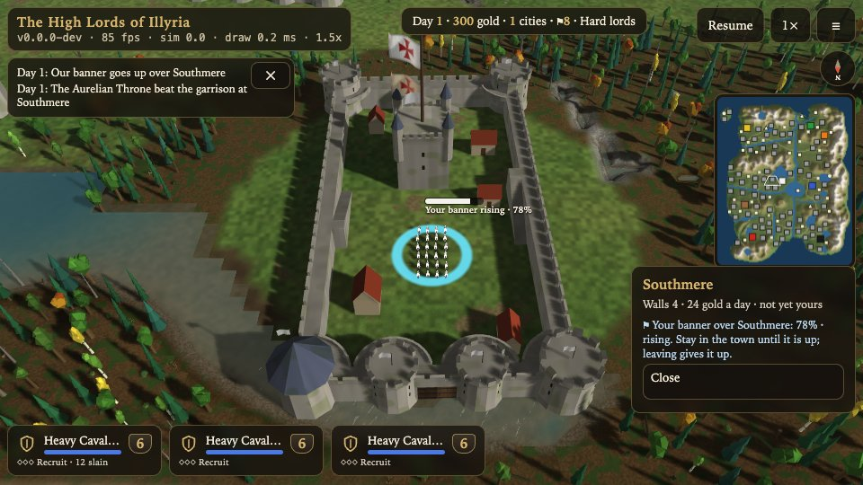
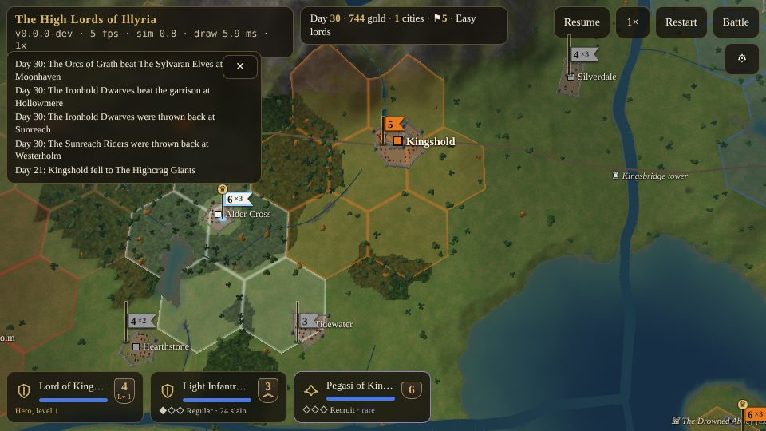

# War on the Map {#war}

::: lore
*"There is no map and no battle. There is only the ground, and who is standing on it."*

— Brannoc the Bold
:::

## Ordering men {#war-orders}

The war is a battle seen from as high or as low as you like, so your men are ordered as in any battle (chapter ): tap a soldier to select him, tap him again for all of his kind in view, hold and drag to box them, tap a card to find a hero; then the same row: **As they stand**, a **formation**, **⚔ Attack**, **Scatter**, **Hold**, **Find**, and **Charge** at the top. Every man on the land is a soldier of the one battle, marching, resting or fighting: it makes no difference.

- **In a fight** (and near it, within about 200 m of the men), an order is the battle's own: they march to the place in their formation, go after the foe you tap, hold, scatter. Once ordered, a stack's men stand to your orders as in a skirmish until you march them again, or until the fight is over.
- **Further off,** a tap on the ground, on a town, on a gate or on an enemy is a **march**: the **squads** of the men selected (a squad is an army: its soldiers all go) set off for it along the quickest road, apart from the rest of their stack if you chose only some of its squads, at their pace, and meet whatever is in their way. The route is only a string of waypoints: every step between them is the battle's, so your men go round walls, through their own town's gates and up the ramps as in a skirmish. **Hold** stops them where they stand.
- Men who are not yours, and gates, are looked at when you tap them with nothing selected: a grey card with his life (or the gate's hit points), view only, and no order for them.

## Attacking {#attacking}

To attack, order your men at an enemy stack, an enemy city or a neutral town: tap the enemy soldiers or the town with your men selected. The march ends at the enemy: the attack is its last step, at the stack's pace. Marching in is also the only way to take a city (see ).

There is no prompt, and no waking: every man on the land is a soldier of the battle's world at all times, and when two stacks of different lords meet they fight where they meet, stepped by the battle's rules (chapter ). The soldiers on the map are those men. Zoom out and you see them as points in their lords' colours, and a man who is fighting flashes, rapidly and at random in strength; zoom in and the points become the battle's own soldiers, striking, shooting and flinching, standing exactly where the points were. The dead lie about for ten minutes at most, then are taken away.

**Stacks.** A stack is up to **eight squads** that march together, at the pace of its slowest. Eight is only the size of a marching group: any number of stacks may stand in one place, and all of them fight.

**How stacks meet.** Twice a second every stack looks about it.

- **Marching,** its men go on along their route with the battle's initiative: they fight whoever strikes them or crosses their path.
- **Standing,** yours and the computer lords' alike, each man goes for the nearest enemy who comes within about **45 m** of where his stack stands. Foot close with him; missile troops close to a good bowshot (four fifths of their range) and shoot; healers tend their own.
- **A garrison holds its post.** A neutral town's garrison never marches anywhere, and the men who keep a gate stay at their gate; they do not chase you across the fields.
- **Under your orders,** a stack's men stand to those orders as men do in a skirmish, and the stack's own habits leave them alone until you march them again.

**Fight!** appears while there is a fight anywhere, and brings the camera to the fiercest one on the island; the minimap glows where men are fighting.

## How a fight is decided {#decided}

**By the men, and by nothing else.** No dice are thrown for a battle, no odds are consulted, and nothing is worked out in advance. Every soldier of both sides is on the ground, with his own hit points, weapon, shield and nerve, and the fight is every blow and every arrow of chapters  and , one after another, until one side is dead, broken or gone. The men who are left are the men who survived, with the wounds they took.

What tells in a fight on the map is therefore what tells in any battle:

- **How many men there are, and of what kind.** An army of twelve light infantry is twelve men of 60 hit points; a dragon is one beast of 650. Wounds are kept: an army that won yesterday fights today with the men it has left, as hurt as they were.
- **Rank.** Regulars, veterans and elite strike harder (the *veterans* edge below), and a hero grows stronger with every level.
- **Blessings.** A temple's blessing, a hero's battle artifacts (for himself) and his command artifacts (for every man of his stack) all count in the fight as blessings: each is 10% more damage dealt, blows 7% quicker and 6% less hurt taken.
- **Morale.** Men who are losing break and run, and a man who has run is not fighting, however many of his squad are still alive (chapter ).
- **The ground and the walls.** Walls, towers and gates are real: archers on a wall-walk shoot down from cover, a gate must be hacked or battered down, fliers go over. Woods, marsh and slopes slow men as they do in a skirmish.
- **The small edges** that a man has where he stands (see ).
- **Your orders,** if you give any: a formation, a charge, a flank. A fight you watch and command is the same fight as one you leave alone; only the orders differ.

Chance has the part it has in any battle and no more: a shield turns a blow or does not, an arrow lands a little off its mark. Nothing is rolled for an army or for a fight.

You are shown no odds, because there are none to show. The only odds in the war are the ones the computer lords work out for themselves before they march, and those decide whether they come, never what happens when they arrive.

::: note "The one roll of the dice"
A hero who goes into a ruin fights its guardian alone, and that fight is still thrown with dice (chapter ). It is the last thing in the Conquest that is.
:::

## How the computer lords reckon a fight {#dice}

Before it attacks, a computer lord reckons its chances. It does so with the old *Warlords* dice rules, which survive only for this: an estimate, worked out exactly, of whether an attack would succeed. The lord compares it with the odds it wants (chapter ) and goes or stays. The estimate is never shown to you and never touches the fight.

It follows the *Warlords* appendix:

1. Each side's armies are **lined up**: the weakest first, the strongest last, and heroes, the most valuable, last of all.
2. The first army of each side is set against the first of the other, **one on one**.
3. Each round, both are given a ten-sided die. A roll no higher than the **other** army's strength is *low*; higher is *high*.
4. If both roll low, or both high, nothing happens. If one rolls low and the other high, **the low roller takes a hit**.
5. **Two hits destroy an army.** The survivor goes on against the next in the other line.
6. It ends when one side has no armies left.

So the lord thinks an army is hit more often the stronger its foe is, and hits more often the stronger it is itself. An army's reckoned strength is

> (its strength + the force modifier) × (1 + its edges), never above 9 nor below 1.

Its strength is the single figure on its card (light infantry 3, heavy cavalry 6, a dragon 9; a hero 3 + his level; a blessing or a battle artifact a point each).

**What the estimate leaves out.** It counts armies, not men: a squad of twelve and a squad with one man left are the same army of the same strength. It knows nothing of wounds, morale, gates, arrows from a wall-walk, or your generalship. One rule makes up for the worst of that: a lord will **not send a force with fewer than a third as many men** as the defenders it would meet, whatever the dice say.

## The force modifier {#force-modifier}

As in *Warlords*, the lord adds whole points to the strength of every army in a side's line for:

| Modifier | Worth in the reckoning | In the fight itself |
|---|---|---|
| A flier in the stack (pegasi, griffins, dragons, archons) | +1 | nothing: a flier flies over the wall |
| A special army in the stack (wizards, undead, devils, demons, dragons) | +1 (a dragon counts for both) | nothing: it fights as what it is |
| A hero's command artifacts | +1 to +3 each (chapter ) | so many blessings on every man of his stack |
| Defending a town with walls of 2 or more (every walled town and capital) | +1 | the walls, towers and gate themselves |
| Defending a village (walls 1) | nothing | nothing: it has no wall |
| Each catapult in the attacking stack, against a town's walls | takes the walls' point away | its stones break the real gate |
| A catapult attacking a town | reckoned 2 points stronger itself (5, not 3) | as above |

The old rule gives +2 for walls of 7 or 8 and +3 for walls of 9, but no place in Illyria has walls above 6 (a capital's), so the walls are never worth more than the one point.

## The small edges {#edges}

Like the fittings on a good sword, each worth a few percent, the edges add up, and none decides a fight alone. A weaker army with every edge is still the weaker army. The lords reckon with them as a share more strength; in the fight itself a man who has an edge deals that share more damage with every blow and missile. The two do not count quite the same things:

| Edge | Worth | In the lords' reckoning | In the fight itself |
|---|---|---|---|
| **The realm's own country** | +8% | the fight would be on the realm's kind of land (a town's own cell is nobody's) | each man while he stands on his realm's kind of ground (not while he flies) |
| **Home land** | +3% | the fight would be in a hex of the side's land (chapter ) | +3% to each man standing on land his side holds |
| **Familiar ground** | +4% in the reckoning; to +6% in the fight | the army's kind likes the ground: archers and pegasi in forest, dwarven grenadiers and griffins in hills, the dead in marsh | the ground under his feet suits his gait or his kind (see ) |
| **Veterans** | regular +3%, veteran +6%, elite +9% | by the army's rank (soldiers; a hero's levels are his strength) | by the man's rank |
| **A hero leads** | strength 4-6 +2%, 7-8 +4%, 9 +6% | the best hero in the stack | the best living hero of his side within 30 m of him |
| **High ground** | to +4% | not reckoned | striking down at a foe below: +1% for every 1 in 20 of slope between them |
| **Holding** | +4% | a defender on a temple, a ruin's stones or an outpost tower's hex (not in a town) | not counted |
| **All together** | **at most +20%** | | |

Each realm's own country, where its men also march 15% quicker:

| Realm | Its own country |
|---|---|
| The Aurelian Throne, the Sunreach Riders | open country and the roads over it |
| The Highcrag Giants, the Ironhold Dwarves | hills |
| The Orcs of Grath | fens and hills |
| The Sylvaran Elves | woods |
| The Moonward Order | the water's edge (shore, fords and bridges) and woods |
| Lord Malvoren | fens and woods |

There are no minuses: bad ground already costs speed, and fighting away from home costs nothing but the edge you lack.

What they are worth to a lord doing his sums: four strength-4 armies against four are a coin toss; home land alone (+3%) makes it 54 in 100; veterans (+6%) 58; the realm's own country (+8%) 60; every edge together (+20%) about 74. Four armies of strength 3 against four of strength 4, with every edge, are still reckoned to lose (37 in 100).

## A lord's reckoning, round by round {#dice-example}

Suppose a computer lord sat where you sit on day one, as the Aurelian Throne: the **Lord of Kingshold**, a hero of level 1 (strength 4), with his light infantry (3), the pegasi of the Throne (6) and the capital's guard of archers (4) and heavy infantry (4). Near by is a neutral walled town with walls 4, and so a garrison of four armies: archers (4), light infantry (3), archers (4) and heavy infantry (4).

*The force modifiers.* The pegasi fly: +1 to all five of his. The town's walls give its defenders +1. *The edges.* His hero (strength 4) leads: +2%. A town's cell is nobody's country, and the land is not his.

*The lines.* His: light infantry (3 + 1) × 1.02 = 4.08; archers and heavy infantry (4 + 1) × 1.02 = 5.10 each; pegasi (6 + 1) × 1.02 = 7.14; and the hero last, (4 + 1) × 1.02 = 5.10. Theirs: light infantry 4, then archers, archers and heavy infantry at 5.

His light infantry and theirs are evenly matched: each round, either may take the hit. Say his fall after wounding theirs once. His archers step up at 5.10 against a wounded 4, and so down the line. The pegasi, at 7.14, take a hit less than one round in three that anything happens against a 5. The hero, last in line, may never draw his sword.

Worked out exactly, this attack is reckoned to succeed **86 times in a hundred**, and a Hard lord (who wants 45 in 100 with a hero, and 6 more for the pegasi he would risk) goes. The same sum for other hosts:

| He marches with | Reckoned chance |
|---|---|
| the whole stack: hero, light infantry, archers, heavy infantry, pegasi | 86 in 100 |
| the same without the pegasi (no flier's point) | 23 in 100 |
| hero, light infantry and pegasi, the guard left at home | 57 in 100 |
| the whole stack and a catapult (the walls' point gone) | 99 in 100 |
| hero and light infantry alone | he does not go: 13 men against 48 is fewer than a third |

That is the lord's sum, and only his sum. What happens when the host arrives is a siege (chapter ): the pegasi fly over the wall and land among the archers, the foot must get through a real gate under real arrows, and forty-one men fight forty-eight. It may go far better than 86 in 100 or far worse; the dice were never thrown.

::: tip
The estimate is worth knowing because the lords act on it. A griffin or a band of wizards in a garrison adds a point to every army beside it in a lord's sums, and a cautious lord may leave that town alone. It will not help the garrison at all against one who comes anyway.
:::

## Sieges and walls {#siege-map}

A town defends with every man inside it, however many, and is attacked by every man who marches on it. Its walls, towers and gate are real, and so is everything that happens to them (chapter ): your men march up to the gate and hack at it, their archers shoot from the walk, your catapults throw stones, and what is hit stays hit. A village has no wall, gate or tower: it is fought for on its green. Catapults (trained at Kingshold, Deepforge and Dreadspire) are helpless in the field and slow on the road (0.8 m/s, a third of a foot soldier's pace, and a quarter of that in a marsh), but a stone is what breaks a gate.

## Raising a banner {#banners}

**Beating a town's defenders does not take the town.** When its men are dead or gone, or you march into a town nobody defends, your men stand in it and **raise their banner**. The town is yours when the banner reaches the top.

**Who is in the town.** Only men **inside its outer wall** count (for a capital, the outer of its two rings). Men at the foot of the wall or before the gate are not in the town. A village has no wall: its men are those on its 30 m pad and within 10 m of it. An army is in the town if any one of its living men is. Men aboard a boat are nowhere.

- **It starts** when armies of one lord are in the town and nobody else's are: none of the town's own (its lord's, or a neutral garrison) and none of any third lord's.
- **More armies raise it faster.** The banner climbs by 2 points and 1 more for each army you have in the town (eight at most) every tick, to 5,760. A lone army takes 64 seconds at normal speed (a little over half a Conquest day), four armies 32 seconds, eight or more 19 seconds.
- **Enemies in the town stop it.** Armies of anyone else in the town contest it: while they are as many as yours or fewer, the banner stops; while they are more, it comes down as fast as it would rise for them.
- **Leaving gives it up.** If none of your men is left in the town, marched out or fallen, the attempt is abandoned and its progress lost.
- **A town being taken trains nothing,** takes in no armies sent to it and hires no hero until the raisers are gone.

**At the top** the town is yours, and with it:

- its income and its training (stopped, for you to choose again);
- gold, if it was a lord's: he loses his treasury divided by the number of places he held, and half of what he loses is yours;
- its walls, counted one lower (never below 1);
- its gates, which your men now pass and no longer hack at;
- its own hex and the six round it, at half a claim or better;
- any empty boat of his lying in its port.

Towns that were sending their new armies there stop sending them.

The bar under the town's name says *Your banner rising · 45%*, *held up* (amber) or *coming down* (red); over the keep a tall pole carries the old colours down and the new ones up. A town wears its holder's colour all over: the banners on its towers and keep, the tiles of its houses and the cones of its tower roofs. They change when the town changes hands, not before: while a banner is still rising the town is its old holder's (or nobody's, plain clay roofs and linen flags), and only the pole shows the raiser. The courtyard's flagpole of the set siege battle is a different rule (chapter ).

::: tip "Hold the gates"
A computer lord on Hard answers a banner going up over one of its towns at once, not at the next dawn: the nearest of its stacks that could be there before the banner is up, and that it reckons can beat the raisers, marches on them; failing that, the nearest goes in all the same, to hold the banner up for as long as its men last inside. Bring enough armies to raise the banner quickly, and something to guard the road. To hold up a banner yourself, remember that only men inside the wall count.
:::

## Boats in war {#boats-war}

Boats carry armies; they do not fight (chapter ).

- Men aboard are out of the world until they are put ashore: they cannot attack or be attacked, they raise no banner, contest none, and claim no land.
- A stack that lands is on the ground from that moment, and fights where it lands.
- An empty boat lying in a port is taken with the port. An empty boat at anchor off a coast is burnt by an enemy boat with armies aboard that sails onto it.

## Territory and outposts {#territory}

The land itself is held, hex by hex (the hexes are 89 m across). They are drawn faintly on the map, each washed in its holder's colour, stronger at the rim and the firmer the claim; the top bar shows ⚑ and how many you hold.

- **Claiming.** Ten times a day each hex of land is reckoned. Where one lord's armies stand and nobody else's, that lord's claim grows: 10 points, and 5 more for each army there (four at most, so 30 at best), to 100. Another lord's claim is worn away first, then the hex changes colour. Where two lords stand, nothing changes. Where nobody stands it fades a point at a time (a full claim in ten days) and is nobody's at nothing. A stack counts in the hex it stands in; armies aboard a boat and neutral garrisons claim nothing.
- **Towns** claim their own hex and the six round it as two armies would (20 points a reckoning), so a town's land is its lord's unless an enemy stands on it. Each lord begins with the seven hexes of his capital at a full claim; taking a town hands you its seven at once, at half a claim or better.
- **Outposts.** A tower stands at the river crossings, the fords and the bridges, one to a hex. An outpost's hex is claimed twice as fast, and once held (half a claim or more) it claims the six hexes round it as one army would. On the map each shows as ♜ with its name, in its holder's colour.

- **Worth.** Land pays: one gold a day for every five hexes you hold. And it fights for you: every soldier standing on land his side holds strikes 3% harder (**home land**, one of the small edges, chapter ), and the computer lords count it in their sums. They count **holding** too (+4%, for a defender standing in an outpost's hex), which no soldier feels in the fight itself.
