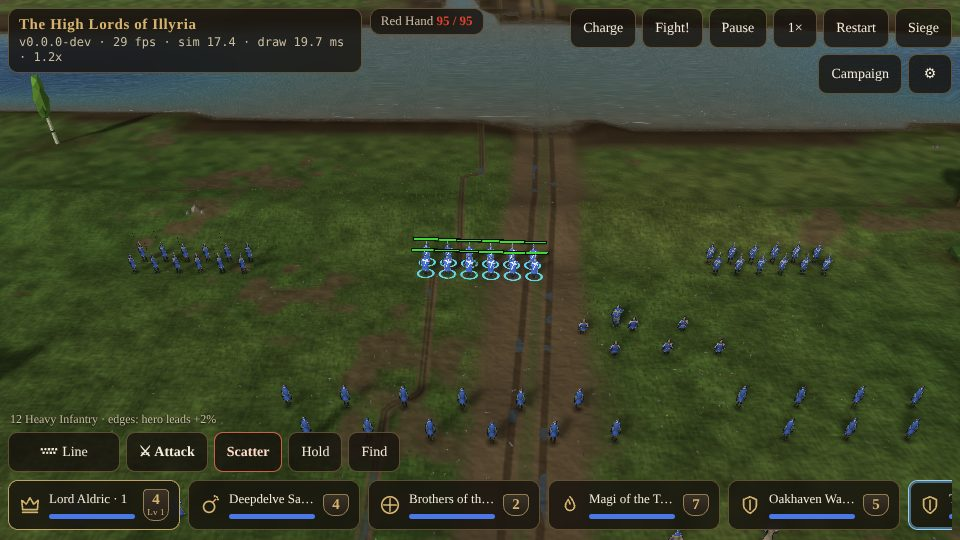
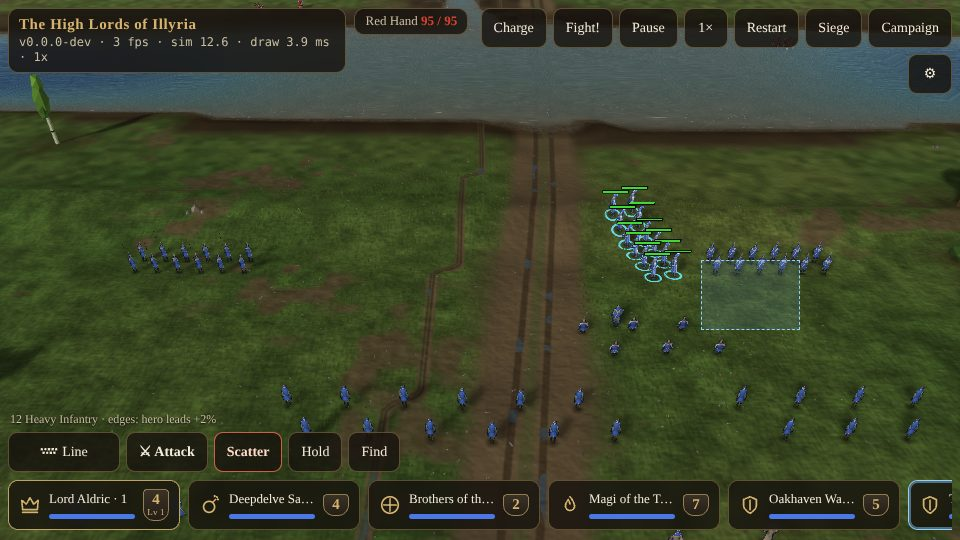

# The Battlefield {#battlefield}

::: lore
*"From up here they look like ants. Go down and look at their faces before you send them in."*

— Lady Mirelle, to a young lord
:::

A battle is fought on a window of the real land, about a kilometre square, cut out where the stacks met: its hills, its woods and fields, its streams and fords, the town's walls if it was fought for a town. Every soldier of every army in the two stacks is on it, as a figure of his own. Your soldiers are in blue, the enemy's in red.

The battle runs in real time, thirty steps of the simulation every second, and it is exactly the same on every device and every graphics setting: the look changes, the battle never does. You may **pause** at any moment (the Pause button or [[Space]]) and still give orders, and speed it up with the speed button.

## The camera {#camera}

| | Phone or tablet | Desktop |
|---|---|---|
| Zoom | pinch | the mouse wheel |
| Move over the land | drag one finger | drag with the left button |
| Turn the view | twist two fingers | drag with the right button |
| Move and zoom together | drag two fingers | |
| To a squad | tap its card twice | tap its card twice, or its group's key twice |
| To the selection | **Find** | **Find**, or [[F]] |
| To the fiercest fighting | **Fight!** | **Fight!** |

The camera comes down until one soldier fills the screen and goes up until the whole island is a map; near the ground the soldiers are drawn from closer pictures, and far out they become coloured specks. A battle's sounds and voices are heard from where the camera looks, so a fight far off is quiet (chapter ).

## Selecting {#selecting}

Everything starts with choosing who is to obey.

- **One soldier:** tap him. A second tap on him (or a double-tap, or a double-click) selects **every soldier of his kind** the camera can see.
- **A squad:** tap its card.
- **A box:** press and hold on your own men (or anywhere with nothing selected), and drag: everyone of yours inside the box is selected. On a desktop, shift-drag draws a box at once.
- **Adding and removing:** on a desktop, shift-click adds a soldier to the selection or takes him out.
- **The heroes:** [[`]] on a desktop selects your heroes; on a phone their gold cards lead the row.
- **Letting go:** [[Esc]] lets go of the selection.

Selected soldiers wear a **blue ring**. The cards of squads wholly selected light up, dashed when only part of a squad is. Above the action row, a line names the selection and its edges: *12 Heavy Infantry · edges: home land +3% · veterans +6%*.

Zoomed far out, when the soldiers are only specks, a tap near a squad picks the whole squad.

## The cards {#cards}

Each squad has a **card** along the bottom: an icon for its kind (a crown for a hero, a shield for foot, a bow, a flame for a wizard, a satchel for grenadiers...), its name and how many stand, a health bar, and the strength badge with the hero's level or the rank pips. Heroes and special troops (wizards, grenadiers, healers, engines) have their cards at the front of the row, heroes in gold. Tap a card to select its squad; tap it again to bring the camera to it.

## Groups {#groups}

You may keep up to ten **groups** of your own choosing, any soldiers you like.

- **On a phone:** whenever the selection is not already one card, a **+ Save group** card appears at the start of the row; tap it, and the selection becomes a group with its own card (its number, its kind, how many live). A long press on a group card puts the current selection into it instead, or forgets the group if it is the selection already.
- **On a desktop:** [[Alt]] (or [[Ctrl]] where the browser allows) and a number **saves** the selection as that group; the number alone **recalls** it; the number twice brings the camera to it.

## The health bars {#health-bars}

Over a soldier who is hurt, ranked, shaken or selected, close enough to read, floats his **health bar**. It carries a **gold shield** for each of his veteran grades; an **amber** frame means he is wavering, a **white flag** that he has broken (chapter ).

## Speed, pause and the end {#battle-end}

- The battle is **won** when the last enemy soldier on the field is dead or has fled, or, in a siege, when your flag reaches the top of the courtyard's pole (chapter ).
- It is **lost** when the last of yours is, or, when the enemy is besieging a town of yours, when his flag reaches the top.
- In a campaign battle, **Withdraw** leaves the field: your survivors go back to the map with their kills, as an army thrown back.
- The herald reports your losses as they mount: *"Casualties"* at a quarter of your soldiers lost, *"Severe casualties"* at a half, *"Total casualties"* at four fifths.
