# Orders {#orders}

::: lore
*"An order is a promise you make on another man's behalf."*

— Hadric Stormborn
:::

As in *Myth*, every soldier is worth commanding on his own: you may move one man, a squad, or every archer on the field. Every order is given to whoever is selected, and each soldier then carries it out as well as he can, with a will of his own (see *Marching with initiative*, below).

## The orders at a glance {#orders-table}

| Order | Phone | Desktop |
|---|---|---|
| March there (with initiative) | tap the ground | click the ground |
| March there and face a way | hold at the spot, drag the way to face | the same |
| Attack a soldier | tap the enemy | click the enemy (a red sword cursor) |
| Attack a friend (force attack) | **⚔ Attack**, then tap him | [[Ctrl]] (or [[Cmd]]) + click him, or [[A]] then click |
| Shoot at, or march on, the ground | **⚔ Attack**, then tap the ground | [[A]], then click (a crosshair); or [[Ctrl]] + click the ground |
| Batter a gate | tap the gate (or **⚔ Attack**, then the gate) | click it (a target cursor) |
| Strike at a wall, a house or a tree | **⚔ Attack**, then tap it | [[A]] then click, or [[Ctrl]] + click |
| Force march | hold **⚔ Attack** until it turns gold (» March), then tap the ground | [[Alt]] + click (a gold double chevron), or [[M]] then click |
| Formation | **Formation**, then pick one | the keypad 1-9, or shift + 1-9 |
| Scatter | **Scatter** | [[S]], or the keypad 0 |
| Halt | **Hold** | [[H]] |
| The camera to the selection | **Find** | [[F]] |
| Cancel a mode, let go | tap the mode's button again | [[Esc]] |
| Pause | **Pause** | [[Space]] |

The **⚔ Attack** button sits in the action row. One tap lights it red, and a line above it says what the next tap does: *Attack: tap a soldier (ours too), a gate, a wall, house or tree, or the ground*. Held, it turns gold for a force march. Either lasts one order. On a desktop the cursor always shows what a click would do: a hand over your own men, a sword over an enemy (or over a friend with Ctrl), a target over a gate, wall, house or tree in attack mode, a crosshair over the ground in attack mode, a double chevron for a force march, and "not allowed" when nobody selected can strike what is under it.

## Marching and facing {#move}

**Tap the ground** and the selection marches there in its formation, and halts facing the way it marched. Each man's place shows as a **yellow ring** on the ground, with a tick the way he will face: exactly where he will stand. The rings show while he is selected, and for a few seconds after any order, then fade; only his current order shows, and the ring goes when he arrives.

**To face a way**, press and hold at the destination. After a moment (0.3 s) a **gold ghost** of the formation appears there; drag, and a dotted line follows your finger. The formation turns to face along the line, laid out across it. Let go, and they march; they arrive facing that way, whichever way their road took them.

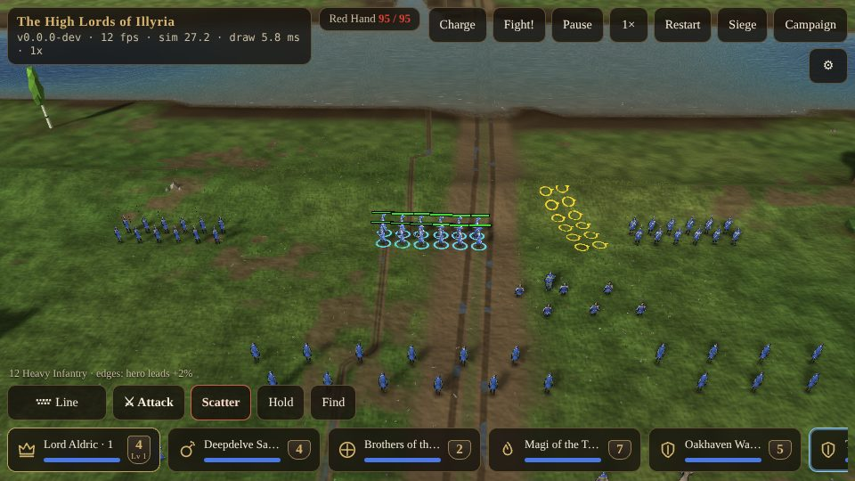

A selection of several squads moves as **one formation**, spaced for its biggest soldier and paced to its slowest, so a line of heavy infantry and light infantry arrives together. Every soldier takes the **fastest** way there for his kind, not the shortest: a squad in the fields marches to the nearby road and along it rather than straight over the plough, and cavalry ride round a wood that foot would cut through. The men of a squad all follow the squad's one route, each keeping his file a little to the side of it, so on a road they go in a column of march and spread into their formation at the end.

## Marching with initiative {#initiative}

A marching soldier is not deaf to the enemy.

- **Struck, he answers.** A soldier struck at turns on whoever struck him (within 10 m, and remembered for 2 s).
- **A fighter takes on what crosses his path.** Any fighter (but not missile troops, wizards or healers, who only defend themselves) takes on an enemy who comes within **5 m** of him.
- **The mission comes first.** He follows no farther than **15 m** from the route he was on, lets a foe go once it is more than 10 m off, and lets a broken, fleeing foe go once it is 2 m beyond his reach. Then he marches on to his place.
- **Breaking off.** A soldier ordered away out of a melee has **2 s** to break off before he answers blows again.

The computer's squads march the same way, so its columns fight back too.

## Force march {#force-march}

A **force march** ignores the enemy altogether, as *Myth*'s moves did: the men march to their places and do not turn aside, whatever strikes them. Use it to pull a squad out of a fight, or to run it past one. Hold **⚔ Attack** until it turns gold and reads **» March**, then tap the ground; on a desktop, [[Alt]] + click, or [[M]] then click.

## Attacking {#attack}

- **A soldier.** Tap an enemy with soldiers selected and all of them go after him. Missile troops close to 90% of their reach and shoot, leading a walking man by his pace times the arrow's flight; if no arc gets there (a wall, a house in the way) they move closer. The rest run him down, re-routing every half second as he moves. Zoomed far out, a tap on an enemy squad sends each attacker after the nearest man of it. To break two riders off to hit the archers, select just the two and tap an archer.
- **The ground.** With **⚔ Attack**, tap the ground: missile troops shoot at the spot; everyone else marches there with initiative, fighting what they meet (an attack-move).
- **A gate.** Tap the gate: missile troops shoot the doors, engines and grenadiers batter them, and the rest go up to the gate and hack at it (gates are the only thing on the field that breaks).
- **A wall, a house or a tree.** Only what flies and bursts does any harm there: catapults, grenadiers and wizards bombard the wall-walk or the ground beside the house or tree, hitting whoever stands or shelters there. The stone and timber stand. Order anyone else at a wall and the game tells you: *Only engines, grenadiers and wizards can strike at a wall.*
- **A friend** (force attack): only when you mean it, with **⚔ Attack** or Ctrl-click on him. He does not strike back, and the kill earns no rank. Otherwise friends never fight each other (arrows that miss are another matter).

An attack shows a **red ring** under the soldier your men are after; it follows him and breathes, and a dotted red line creeps to it from each attacker. Shooting at a spot or a gate rings the spot.

## When the target falls {#target-down}

When the man they were sent after falls, each of your attackers decides for himself what to do next. His choice is between the **nearest foe still standing** within 15 m (missile troops: within their reach) and **going back** to his place beside the squad-mate he left (or, with nobody to go back to, standing his ground).

He weighs his **odds** against that foe: his fighting power (hit points, blows a second, his rank and blessings) and half of each friend's near the foe, against every unbroken enemy near it. Going back is worth the odds of his own troop if it is fighting, or a safe 60 in 100 if it is not. Then the **dice**: he sees his odds only roughly, give or take 70 in 100 for a recruit, 55 for a regular, 40 for a veteran and 25 for an elite, and presses on if what he sees beats going back.

So an **elite** always leaves a demon alone (his true odds about 8 in 100) and always finishes a lone wounded archer (94 in 100); a **recruit** goes at the demon about one time in six, and lets the archer go about one time in three. Veterans make the better choice; recruits get themselves killed. A soldier who presses on cries out (the charge). A fighter on the march makes the same choice when his foe falls, with only foes within his leash to choose from, and the march worth 70 in 100.

## Other orders {#other-orders}

- **Hold** halts the selection where it stands.
- **Find** brings the camera to the selection.
- **Scatter** (below) sends everyone selected running outward.
- **Charge** (at the top of the screen) sends every one of your squads at the nearest enemy, the archers stopping at a long bowshot.

## Formations {#formations}

The **Formation** button opens a picker of nine formations, each sketched as it stands. On a desktop the keypad's 1 to 9 (or shift and 1 to 9) choose one, and 0 scatters. The formation applies to the selection's next march.

::: grid
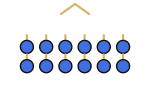

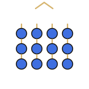

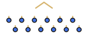

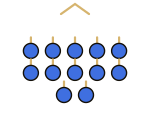

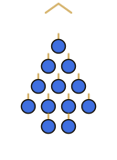

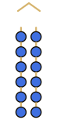

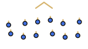

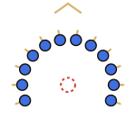

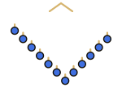
:::

*Twelve men in each formation, seen from above, the front up (the gold chevron); the ticks show the way each man faces. In Encircle the red ring is the point ringed.*

| Key | Formation | Layout | Pace | Use |
|---|---|---|---|---|
| 1 | **Line** | two ranks | 90% | the shield wall; the default for foot |
| 2 | **Short line** | three ranks, narrower | 90% | a narrow front: a ford, a gate, a gap in a wall |
| 3 | **Staggered** | two ranks in a checkerboard, nobody within 1.8 gaps of another | 95% | missile troops and grenadiers (their default): one stray bomb or fireball takes one man |
| 4 | **Box** | a near-square block | 85% | all round; the slowest |
| 5 | **Wedge** | one at the point, two behind, three behind them | 90% | horse and wolf riders (their default) |
| 6 | **Column** | two abreast | 100% | the column of march |
| 7 | **Loose** | a wide, ragged skirmish line | 100% | wizards, healers, fliers and berserkers (their default) |
| 8 | **Encircle** | a crescent of 220 degrees round the point itself, every man facing out | 90% | pinning a lone champion, or ringing a hero |
| 9 | **V** | the point at the back, the arms reaching forward at 45 degrees | 90% | drawing a charge onto the point and closing on its flanks; a wide front from few men |
| 0 | **Scatter** | not a formation: everyone runs flat out 7-10 m directly away from the group's centre | full speed | the moment a bomb, stone or fireball is in the air |

The gap between men is set by the biggest soldier selected (2.6 times his girth, at least 1.8 m); Staggered and Loose open it wider, so the loose formations are also the safe ones against blasts. A squad marches at its slowest member's pace times the formation's pace: the tight formations a little slower than the loose ones. The computer forms its squads the same way: archers and grenadiers staggered, foot in line, horse in a wedge, wizards and healers loose.

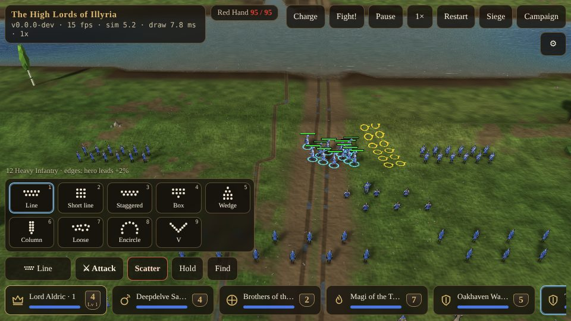
