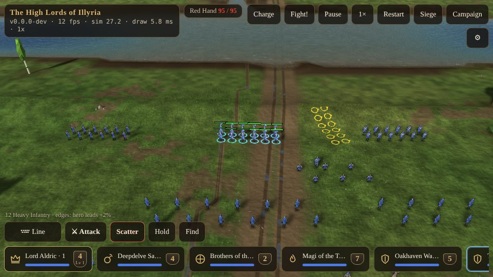
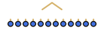
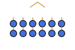
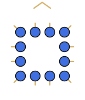
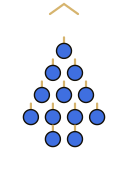
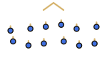
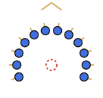
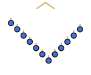
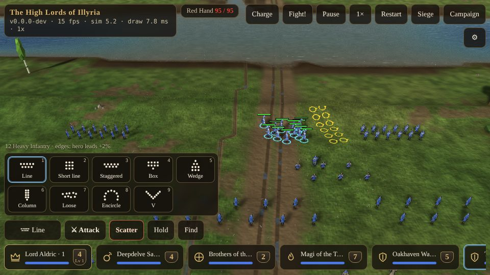

# Orders {#orders}

::: lore
*"An order is a promise you make on another man's behalf."*

— Hadric Stormborn
:::

As in *Myth*, every soldier is worth commanding on his own: you may move one man, a squad, or every archer on the field. Every order is given to whoever is selected, and each soldier then carries it out as well as he can, with a will of his own (see *Marching with initiative*, below).

## The orders at a glance {#orders-table}

| Order | Phone | Desktop |
|---|---|---|
| March there as they stand (with initiative) | tap the ground | right-click the ground |
| March there and face a way | hold where they should go, drag the way to face | hold the right button still where they should go for a moment (a third of a second), then drag the way to face. A right drag that starts moving at once turns the view instead |
| Attack a soldier | tap the enemy | right-click the enemy (a red sword cursor) |
| Attack a friend (force attack) | **⚔ Attack**, then tap him | [[Ctrl]] (or [[Cmd]]) + click him, or [[Z]] then click (or right-click) |
| Shoot at, or march on, the ground | **⚔ Attack**, then tap the ground | [[Z]], then click (a crosshair); or [[Ctrl]] + click the ground |
| Batter an enemy gate | tap the gate (or **⚔ Attack**, then the gate) | right-click it (a target cursor) |
| Open or shut a gate of yours | tap it (men selected or not), or **Open gate** / **Close gate** on its card | click it (a gate cursor), or [[O]] |
| Let a gate of yours go back to its habit | **Let go** on its card | [[Shift]] + [[O]] |
| Strike at a wall, a house or a tree | **⚔ Attack**, then tap it | [[Z]] then click, or [[Ctrl]] + click |
| Force march | hold **⚔ Attack** until it turns gold (» March), then tap the ground | [[Alt]] + click (a gold double chevron), or [[V]] then click |
| Queue an order (after the one in hand) | **Plan** (below) | [[Shift]] + right-click (or right-hold and drag, for a facing) |
| Plan: hold orders, then send them all at once | **Plan**, give orders, **Send** | [[`]] to start, [[`]] to send, [[Backspace]] to drop them |
| Formation | **Formation**, then pick one (or **As they stand**, the last) | the keypad 1-7 (8: as they stand), or shift + 1-8 |
| Scatter | **Scatter** | [[X]], or the keypad 0 |
| Halt (stop the march, and the queue) | **Hold** | [[Space]] or [[B]] |
| The camera to the selection | **Find** | [[C]] |
| The next / previous group of units | | [[Tab]] / [[Shift]] + [[Tab]] |
| Raid (hyena-folk) | **Raid** | [[T]] (or [[L]]) |
| Lay satchels (grenadiers) | | [[T]], then click where |
| Cancel a mode | tap the mode's button again | [[Esc]] (with no mode in hand: in the browser it lets the selection go; in the desktop app it pauses and opens the menu) |
| Pause | **Pause** | [[P]] (the desktop app: [[Esc]] pauses and opens the menu) |

The **⚔ Attack** button sits in the action row. One tap lights it red, and a line above it says what the next tap does: *Attack: tap a soldier (ours too), a gate, a wall, house or tree, or the ground*. Held, it turns gold for a force march. Either lasts one order. On a desktop the left button only selects: click one of your men to pick him (again, for all his kind in view), drag a box, shift-click to add or drop one, click the ground to let everyone go. The right button gives the orders (a click, or held and dragged for a facing line), the right button dragged at once turns the view (also with soldiers selected; [[Q]] and [[E]] turn it too), and the middle button dragged pans it. The cursor shows what a right click would do: a hand over your own men, a sword over an enemy (or over a friend with Ctrl), a target over a gate, wall, house or tree in attack mode, a crosshair over the ground in attack mode, a double chevron for a force march, and "not allowed" when nobody selected can strike what is under it.

## Marching and facing {#move}

**Tap the ground** and the selection marches there **as it stands**: every soldier keeps his place beside the others, and the whole keeps facing as it does. Knights with archers behind them arrive with the archers still behind them, facing the same foe. Each man's place shows as a **yellow ring** on the ground, with a tick the way he will face: exactly where he will stand. The rings show while he is selected, and for a few seconds after any order, then fade; only his current order shows, and the ring goes when he arrives.

What they keep is where each was last *sent*, not where the fighting or the road has left him: a squad caught in a scrum, or strung out in a column of march, forms up again as it was ordered, there where it now stands. A place that falls on a rock, a tree or a house moves just clear of it.

**To face a way**, press and hold where they should go. After a moment (0.3 s) a **gold ghost** of the selection appears there; drag the way they should face, and a dotted line follows your finger. The ghost turns with it, the whole arrangement at once, so the archers stay behind the knights. Let go, and they march; they arrive facing that way, whichever way their road took them.

**Formations.** Pick one and the selection re-forms in it where it stands, and marches in it (closing the gaps its dead leave) until you select it afresh, or pick **As they stand**, the picker's last. Select them again later and they march as the formation left them.

**Groups keep their shape.** A group saved (Alt + its number, or the **+** card) remembers how it stood; recalled, it marches so, whatever its squads have done since.

Several squads selected together keep their places beside each other, each squad's men taking that squad's places (the nearest of them, so nobody crosses another, and no squad takes another's), paced to the slowest so they arrive together. In a chosen formation they form as one, spaced for its biggest soldier. Every soldier takes the **fastest** way there for his kind, not the shortest: a squad in the fields marches to the nearby road and along it rather than straight over the plough, and cavalry ride round a wood that foot would cut through. The men of a squad all follow the squad's one route, each keeping his file a little to the side of it, so on a road they go in a column of march and spread into their formation at the end.

## Paths on the ground {#paths}

Where selected men will walk is drawn on the ground, so you can see how they mean to get round walls, water and rocks. The line starts at the middle of the men and ends where they are going; it is the route the soldiers themselves will take, and it shortens as they walk. It shows while they are selected, and for a few seconds after an order, fading. Lines are shown for your own men only: a foe's route is never drawn, and a gate of a castle you cannot see is drawn as shut, so a line never tells what you cannot see.

How they will go is told by the **shape** of the line, not only its colour:

| Line | Colour | End | Meaning |
|---|---|---|---|
| Dashes with small chevrons | green-cyan | open ring | **Patrol**: the ordinary march. They fight whoever strikes them or crosses their path, then go on. |
| Solid line with arrowheads | red-orange | cross-hair on the quarry | **Hunt**: after one soldier, ignoring all others. The line runs to him wherever he goes. |
| Dots | white | filled spot | **Force march**: deaf to the enemy on the way. |

Orders queued behind the one in hand (see *Queued orders*) are drawn after it, each leg in the look of its own stance, ending in a numbered disc.

Men who go together are one line, however many, so an army is a handful of lines and not a thicket; a man whose way bends round something the others cross straight has his own. Lines keep the same width on the screen at any zoom. Close in on a few men (twelve or fewer) and each shows his own, fainter. In Conquest the route of a marching stack, cell by cell across the island, is drawn the same way; with the camera far out, your marching stacks show faintly even when not selected.

## Queued orders {#queue}

Hold [[Shift]] as you right-click and the order is **added to the end** of each selected man's queue, rather than replacing the one he is on. March here, then there, then attack that: right-click, [[Shift]] + right-click, [[Shift]] + right-click. Each begins when the one before is over: he has arrived, the gate would not let him through, the man he was hunting is dead, or the order could not be done at all (that one is passed over, and the next begins). A plain right-click replaces what he is doing and **clears the queue**; so does [[Space]] or [[B]] (Hold).

- **A hunt that ends** (the man dies) does not turn into a fight with someone else when there are orders waiting: the next order is what he does.
- **Shooting at the ground, a wall, a house or a tree** never ends of itself, so with orders behind it it lasts ten seconds, or until the gate it shoots at is broken.
- **At most eight** orders wait behind a man's own; the ninth is dropped. (He carries them, the game checks them every tick, and they are in a save.)
- **A save keeps the queue** (but not the march he was on, nor an attack on a soldier, who is a different man in a loaded game), so after loading a man goes on to the first of his queue.
- **In the Conquest** it is the same, within about 200 m of the men. A march beyond that is a stack's across the map, which has no queue: with [[Shift]] it still goes, replacing, and the game says so.
- **Seen** only for your own men: the queue is drawn behind the line of the order in hand, each leg in the look of its own stance (below) and ending in a small **numbered disc** (1, 2, 3...) for its place in the queue. A leg after a foe you cannot see is not drawn. The legs run straight; the way round a wall or a river is found when the order begins.

## Planning {#planning}

Press [[`]] (the backtick; on a phone, the **Plan** button) and the game says **PLANNING**. The battle keeps running, but the orders you give (a march, a facing drag, an attack, a formation, scatter, raid) are not sent: they are **held**, and drawn as dashed violet paths, each leg ending in its number, for every man who has any, selected or not. Press [[`]] again (**Send**) and every held order goes at once, in the one tick and in the order you gave it, exactly as if you had just given it then: a plain order replaces what the man is doing and a [[Shift]] one is added behind it. [[Backspace]] drops them all and leaves planning.

- A plain order held for a man replaces the orders held for him before it, as it would on arrival.
- [[Space]] (Hold) is never held: it halts at once, and drops whatever was held for those men.
- [[Esc]] does what it always does (above); it neither sends nor drops what is held.
- Held orders are forgotten if the battle or its world changes, and a man dead before the send is skipped.
- Nothing is sent, and nobody else can see anything, until the send: planning is on your own screen only. In the Conquest a march beyond the men's reach (a stack's) is held too, and drawn as one violet line from its squad.

## Marching with initiative {#initiative}

A marching soldier is not deaf to the enemy.

- **Struck, he answers.** A soldier struck at turns on whoever struck him (within 10 m, and remembered for 2 s).
- **A fighter takes on what crosses his path.** Any fighter (but not missile troops, wizards or healers, who only defend themselves) takes on an enemy who comes within **5 m** of him.
- **The mission comes first.** He follows no farther than **15 m** from the route he was on, lets a foe go once it is more than 10 m off, and lets a broken, fleeing foe go once it is 2 m beyond his reach. Then he marches on to his place.
- **Breaking off.** A soldier ordered away out of a melee has **2 s** to break off before he answers blows again.

The computer's squads march the same way, so its columns fight back too.

## Force march {#force-march}

A **force march** ignores the enemy altogether, as *Myth*'s moves did: the men march to their places and do not turn aside, whatever strikes them. Use it to pull a squad out of a fight, or to run it past one. Hold **⚔ Attack** until it turns gold and reads **» March**, then tap the ground; on a desktop, [[Alt]] + click, or [[V]] then click.

## Attacking {#attack}

- **A soldier.** Tap an enemy with soldiers selected and all of them go after him. Missile troops close to 90% of their reach and shoot, leading a walking man by his pace times the arrow's flight; if no arc gets there (a wall, a house in the way) they move closer. The rest run him down, re-routing every half second as he moves. Zoomed far out, a tap on an enemy squad sends each attacker after the nearest man of it. To break two riders off to hit the archers, select just the two and tap an archer.
- **The ground.** With **⚔ Attack**, tap the ground: missile troops shoot at the spot; everyone else marches there with initiative, fighting what they meet (an attack-move).
- **An enemy gate.** Tap the gate: missile troops shoot the doors, engines and grenadiers batter them, and the rest go up to the gate and hack at it (gates are the only thing on the field that breaks).
- **A wall, a house or a tree.** Only what flies and bursts does any harm there: catapults, grenadiers and wizards bombard the wall-walk or the ground beside the house or tree, hitting whoever stands or shelters there. The stone and timber stand. Order anyone else at a wall and the game tells you: *Only engines, grenadiers and wizards can strike at a wall.*
- **A friend** (force attack): only when you mean it, with **⚔ Attack** or Ctrl-click on him. He does not strike back, and the kill earns no rank. Otherwise friends never fight each other (arrows that miss are another matter).

An attack shows a **red ring** under the soldier your men are after; it follows him and breathes, and a dotted red line creeps to it from each attacker. Shooting at a spot or a gate rings the spot.

## When the target falls {#target-down}

When the man they were sent after falls, each of your attackers decides for himself what to do next. His choice is between the **nearest foe still standing** within 15 m (missile troops: within their reach) and **going back** to his place beside the squad-mate he left (or, with nobody to go back to, standing his ground).

He weighs his **odds** against that foe: his fighting power (hit points, blows a second, his rank and blessings) and half of each friend's near the foe, against every unbroken enemy near it. Going back is worth the odds of his own troop if it is fighting, or a safe 60 in 100 if it is not. Then the **dice**: he sees his odds only roughly, give or take 70 in 100 for a recruit, 55 for a regular, 40 for a veteran and 25 for an elite, and presses on if what he sees beats going back.

So an **elite** always leaves a demon alone (his true odds about 8 in 100) and always finishes a lone wounded archer (94 in 100); a **recruit** goes at the demon about one time in six, and lets the archer go about one time in three. Veterans make the better choice; recruits get themselves killed. A soldier who presses on cries out (the charge). A fighter on the march makes the same choice when his foe falls, with only foes within his leash to choose from, and the march worth 70 in 100.

## Raiding {#raid}

The hyena-folk are soldiers like any others until you let them loose. Sent somewhere, they go there and hold, facing as you told them; they fight whoever comes at them, and keep whatever they hold. Ordered at a man with something in hand, they throw it at him.

**Raid** lets them loose. With hyena-folk selected the **Raid** button appears in the action row; on a desktop, [[T]] (the key for each kind's own special: grenadiers lay satchels with it). It needs no target: they start at once, from where they stand. Those let loose together are a **pack**.

- **They know only what they see,** 35 m about them. Send them up close to what you want raided first; let loose in empty fields, they find nothing.
- **They pick on the weak.** They take up whatever lies about (a satchel charge first, then a blade, a head, a trunk, a limb) and throw it at archers, healers, wizards and grenadiers, at the wounded, and at the man who has strayed from his friends, never at a shield wall when there is anyone softer. A thrown head breaks the man it strikes.
- **They count before they go.** A pack weighs itself against the men about its mark and the bowmen covering the ground it would throw from. A lone hyena takes only a lone archer, healer or wizard; a big pack dares more. They keep out of archers' reach while there is other prey, and never stand up to armoured men in a melee.
- **Hit and run.** After each throw a hyena runs to one spot well clear, toward where the raid began, and comes again from there.
- **The raid ends** when you give them any other order, when the pack has lost half its men, or when nothing worth taking has been in sight for 15 seconds. Then they hold where they are.

**Against them,** keep your men in hand: a soldier with no orders of his own does not chase the hyena-folk (only riders catch them). He turns to face one who throws at him, and his shield takes the next throw. Guard your archers and healers with heavy infantry facing out, keep stragglers close, and send horse after the pack.

## Other orders {#other-orders}

- **Hold** halts the selection where it stands.
- **Find** brings the camera to the selection.
- **Tab** selects the next group of units, [[Shift]] + [[Tab]] the previous: first your saved groups in number order (1 to 9, then 0), then the squads that are in no saved group, in a fixed order. It wraps round at both ends, and the camera goes to them if they are off the screen.
- **Scatter** (below) sends everyone selected running outward.
- **Gates.** A gate of yours left to itself opens to your men and shuts behind them. Tap it (or [[O]]) and it is **held open**, or if it stands open, **held shut**, whoever comes; **Let go** on its card (shown only while it is held; [[Shift]] + [[O]]) gives it back to its habit. [[O]] swings the gate whose card is showing, else the gate of yours nearest the selection (with nobody selected, nearest the middle of your men). A broken gate is nobody's. More in chapter .
- **Charge** (at the top of the screen) sends every one of your squads at the nearest enemy, the archers stopping at a long bowshot.

## Formations {#formations}

The **Formation** button opens a picker of seven formations, each sketched as it stands, and **As they stand** last. On a desktop the keypad's 1 to 7 (or shift and 1 to 7) choose one, 8 is as they stand, and 0 scatters. A formation re-forms the selection where it stands. A line turned side on is a column: draw its facing along the road.

::: grid

:::

*Twelve men in each formation, seen from above, the front up (the gold chevron); the ticks show the way each man faces. In Encircle the red ring is the point ringed.*

| Key | Formation | Layout | Pace | Use |
|---|---|---|---|---|
| 1 | **Line** | one rank, everyone abreast | 90% | the widest front; turned side on, the column of march |
| 2 | **Double line** | two ranks | 90% | the shield wall; the default for foot |
| 3 | **Box** | a hollow square, a man at each corner, every side facing out | 85% | all round: nothing takes it in the flank or the back; the slowest |
| 4 | **Wedge** | one at the point, two behind, three behind them | 90% | horse and wolf riders (their default) |
| 5 | **Loose** | a wide, ragged skirmish line, nobody within 1.4 gaps of another | 100% | missile troops, grenadiers, wizards, healers, fliers and berserkers (their default): one stray bomb or fireball takes one man |
| 6 | **Encircle** | a crescent of 220 degrees round the point itself, every man facing out | 90% | pinning a lone champion, or ringing a hero |
| 7 | **V** | the point at the back, the arms reaching forward at 45 degrees | 90% | drawing a charge onto the point and closing on its flanks; a wide front from few men |
| 0 | **Scatter** | not a formation: everyone runs flat out 7-10 m directly away from the group's centre | full speed | the moment a bomb, stone or fireball is in the air |

The gap between men is set by the biggest soldier selected (2.6 times his girth, at least 1.8 m); Loose opens it wider, so it is also the safe one against blasts. A squad marches at its slowest member's pace times the formation's pace: the box a little slower than the lines, and they than the loose. The computer forms its squads the same way: archers, grenadiers, wizards and healers loose, foot in a double line, horse in a wedge. Catapults default to a line, a hero to a box.

