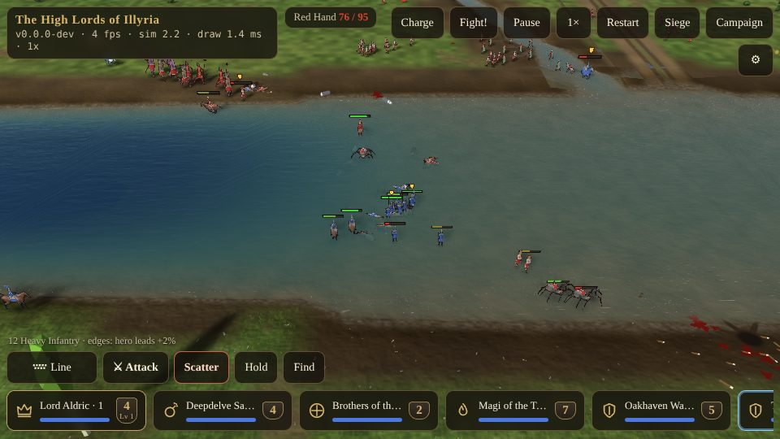

# The Rules of Battle {#rules}

::: lore
*"Never fight uphill, never fight in a bog, never fight a man who is standing on a bridge. Otherwise, fight."*

— Torvald Ironhand
:::

Nothing in a battle is a roll of the dice. An arrow flies until it strikes something; a blow lands on a shield, a flank or a back; a man walks slower uphill than down. This chapter is how the field works.

## Ground and gaits {#terrain}

Every soldier walks at his **speed** (in the compendium) times what the ground under him does for his kind: his **gait**. Cavalry are fast on roads and open ground, slow in woods and hopeless in a bog, so they ride round a wood that infantry cut through. Wolf riders and elven archers move well among the trees; dwarves are the least slowed by rock and slopes; giants, minotaurs and elephants stride through mud and fords; the dead do not mind the swamp; engines want roads; fliers on the ground walk like men.

::: sheet Ground
:::

The same table sets every soldier's path: each takes the way that is quickest **for him**, which is why a mixed host on the march comes apart unless you move it as one formation (which keeps to the pace of the slowest).

- **Deep water** cannot be walked. Fords and their margins are shallows and mud: slow to cross, slower to climb out of.
- **Bridges** are real: men walk on their decks, arrows land on them, and narrow timber footbridges take infantry over one at a time.
- **Climbing.** Speed divides by 1 + 2.5 × the slope × the gait's climb (a 1 in 4 slope takes a man about 1.6 times as long), and going down is up to 15% quicker. Slopes steeper than 35% slow a walker a further fifth. An army that charges uphill arrives late and tired.
- **Cliffs are walls.** No one walks a face steeper than 45 degrees.
- **Bodies have room and weight.** Soldiers do not pass through one another: the lighter gives way, and the dead are shoved aside. Trees, rocks, houses and deep water stand in the way.

## Facing and flanks {#facing}

Every soldier faces a way, and it matters.

- A blow lands on his **front** (the 120 degrees he faces, which his shield covers), a **flank**, or his **rear** (the 120 degrees behind). A blow in the flank does **half as much again**; one in the rear **twice** as much. A berserker strikes 25 to the front, 37 to the flank, 50 to the back.
- Missiles do **+30%** in the flank and **+60%** in the back (an elven arrow: 16, 20, 25).
- **Shields only ever block from the front**, never from behind or the side.
- **Off guard.** A soldier trading blows keeps to his foe while the foe is within reach; anyone else who comes at him then finds him off guard, and a blow in the flank counts as one in the back. Two men on one is murder.
- **Turning.** Soldiers turn on the spot at 270 degrees a second; riders, and anything as heavy as a minotaur, at 120. They strike only within 45 degrees of facing their foe. So a man struck from behind loses a blow or two turning round, and a rider caught side-on loses his charge.

## The high ground {#high-ground}

A soldier striking **down** a slope deals up to **35%** more (about +20% on a 1 in 3 slope) and throws his foe harder; striking **up** it, up to **25%** less. Add the small edge for height (+1% for each 0.05 of grade between them, at most +4%) and a line holding a crest is worth a good deal more than its numbers.

For **archers**, height is reach: missile range grows by a metre for every metre the shooter stands above his target (up to half again) and shrinks as much shooting up (by a quarter at most). Archers 16 m up a 1 in 4 slope hit troops 64 m away, beyond their flat reach of 55 m, who cannot answer them. A **plunging** arrow strikes harder, up to +25% (shot down from a 20 m hill at 70 m: about +18%).

## Charges {#charges}

Riders (the mounted kinds: light and heavy cavalry, wolf riders, pegasi, elephants) build **momentum** as they gather speed: most of the way to their full speed in about a second, shed at 8 m/s a second when slowing, lost at once below 1 m/s, when thrown, or once in melee.

With momentum of at least 60% of their speed (and 2.5 m/s), the **first blow on contact** adds the **impact** of the charge, momentum × mass × 1.2, to the blow, whatever its cooldown, and throws the foe back. The run-in sets a multiplier: downhill, up to twice as hard; uphill, as little as a quarter. Flank and rear multiply the whole blow. A shield turns the blow but not the weight: half the impact still lands.

| Heavy cavalry, 28 m run, into a still heavy infantryman | Damage |
|---|---|
| a standing blow, no charge | 28 |
| a charge on the flat | 54 |
| a charge up a 1 in 4 slope | 17 |
| a charge down it | 64 |
| light cavalry into his front / into his back | 40 / 80 |

Being charged shakes a man (chapter ), the more so in the flank or rear.

### Braced pikes {#pikes}

A charge into the **front** of pikemen who are standing (not marching) runs onto their points: the rider deals nothing, takes the pikeman's blow with its bonus against riders (+150%) and half his own impact, and is thrown back. Heavy cavalry lose about 49 of their 130 hit points in that moment. Into their flank or rear, the charge goes home as usual (106 to the pikeman).

::: tip
Halt your pikes facing the horse, and let them come. The computer's riders know this: they look for a squad of yours locked in melee within 120 m and ride round its nearer flank, 28 m out, to come at its back.
:::

## Missiles {#missiles}

No shot is sure. Every arrow, satchel, fireball and stone is a real thing in flight, under gravity and (for arrows) the wind:

- **Aim.** Each shot is aimed at a point inside a circle around the target, wider the farther the shot, and tighter for veterans (15% a rank). An archer leads a walking man by his pace times the arrow's flight.
- **Range.** Every missile has a **maximum range** (archers 70 m, grenadiers 19 m, catapults 150 m); ordered to shoot farther, they walk into range first. Idle missile troops shoot at foes inside a shorter **auto range** on their own.
- **Misses fall somewhere.** An arrow that misses flies on and comes down where it comes down, on friend or foe alike. **Friendly fire** is real; mind your archers when your own men are in the melee.
- **Arrows stick** in wood (trees, timbers, gates) and in shields, which keep up to five; on stone they glance and fall. Arrows a shield turns stick in it half the time. Stuck or lying, they stay where they fell.
- **Walls and houses** stop missiles; archers who have no arc to a target move to find one.

### Blasts {#blasts}

Grenadiers' **satchel charges** are thrown, bounce, roll down slopes and burst on a fuse (2 s), throwing everyone near off his feet; a burst cuts short the fuses of other satchels near it and throws them: chain reactions. **Fireballs** (wizards, dragons) burst where they strike, and burn. A **catapult stone** lands in a plunging arc and smashes everything within 3 m. Blasts do far more to a gate than blows do (chapter ).

::: sheet Missile troops
:::

::: tip
Against grenadiers, wizards and catapults, fight **Staggered** or **Loose**: a blast that takes three men of a line takes one of a loose rank. When something is in the air above your men, **Scatter**.
:::

## Fliers {#fliers}

Griffins, pegasi, dragons and archons **walk** by default. Only a move longer than about 50 m makes them take off, and they need a run along the ground first. Aloft they cruise over the land low enough for a giant to swat and an archer to shoot, tire, and must land to recover (rest restores their strength at half the rate flight spends it). **They never attack from the air**: flight is a way to get somewhere, over walls, rivers and troops, and to fall on archers and engines in the rear.

::: sheet Fliers
:::

## Healers {#healers}

Journeymen carry a few **charges** of healing (six each). A journeyman looks for a wounded friend within 25 m, goes to him and mends 35 hit points, every 2.5 s, until his charges are spent. Healing comes before fighting. Keep them behind the line, Loose, and they will keep a squad of heavy infantry in the fight a good while longer.

## Veterans and blessings in battle {#veterans-in-battle}

A soldier's rank is one of the small edges: **+3% damage a rank** (an elite's blow 27 where a recruit's is 25), **+3% shield block a rank**, a **15% tighter aim** a rank, and back on his feet after a throw 15% sooner a step (a recruit takes two thirds of a second). Veterans also lose less morale to every shock and rally sooner (chapter ). Each **blessing**, and each of a hero's artifacts, counts for more: +10% damage, blows and reloads 7% quicker, 6% less damage taken. A hero's levels are his strength: **+6% damage and +8% hit points a level**.

The other small edges (home land, familiar ground, a hero leading within 30 m, the high ground) add to every blow and missile, as in the dice (chapter ). A fraction of a point of damage is rounded up by chance in proportion, so +3% is +3% on average.

## Wind {#wind}

A wind blows over every battlefield, and it carries arrows: a crosswind drifts a volley sideways over a long flight, and a following wind carries it farther. It does not move a fifteen-kilo catapult stone.
