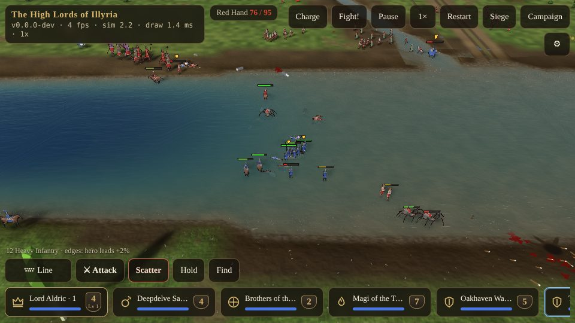

# The Rules of Battle {#rules}

::: lore
*"Never fight uphill, never fight in a bog, never fight a man who is standing on a bridge. Otherwise, fight."*

— Torvald Ironhand
:::

No battle is settled by one roll of the dice. It is decided man by man: an arrow flies until it strikes something; a blow lands on a shield, a flank or a back; a man walks slower uphill than down; and the side whose men are all dead or fled has lost. Chance has two small parts only: whether a shield turns a blow, and where inside its circle a shot is aimed. This chapter is how the field works, with every number.

## Ground and gaits {#terrain}

Every soldier walks at his **speed** (in the compendium) times what the ground under him does for his kind: his **gait**. Cavalry are fast on roads and open ground, slow in woods and hopeless in a bog, so they ride round a wood that infantry cut through. Wolf riders and archers move well among the trees; dwarves are the least slowed by rock and slopes; giants, minotaurs and elephants stride through mud and fords; the dead do not mind the swamp; engines want roads; fliers on the ground walk like men.

::: sheet Ground
:::

The same table sets every soldier's path: each takes the way that is quickest **for him**, which is why a mixed host on the march comes apart unless you move it as one formation (which keeps to the pace of the slowest).

- **Deep water** cannot be walked. Fords and their margins are shallows and mud: slow to cross, slower to climb out of.
- **Bridges** are real: men walk on their decks, arrows land on them, and narrow timber footbridges take infantry over one at a time.
- **His realm's own country.** A soldier walks **15% quicker** over the kind of land his realm is at home on (the table under ), and strikes harder there too.
- **Climbing.** Speed divides by 1 + 2.5 × the slope × the gait's climb (a 1 in 4 slope takes a man about 1.6 times as long), and going down is up to 15% quicker. Slopes steeper than 35% slow a walker a further fifth. An army that charges uphill arrives late and tired.
- **Cliffs are walls.** No one walks a face steeper than 45 degrees.
- **Bodies have room and weight.** Soldiers do not pass through one another: the lighter gives way. The dead lie where they fell and are walked over; only a blast or a heavy blow moves them. Trees, rocks, houses and deep water stand in the way.

## How a blow lands {#blows}

A soldier with nothing better to do goes for the nearest enemy he notices (within 20 m for most foot, 30 m for riders and the fiercer beasts, 4 to 8 m for archers, wizards, grenadiers and healers, who would rather not). Then, every time:

1. **Reach.** He closes until the gap between the two bodies is no more than his weapon's **reach** (a sword 0.6 m, a pike 2.2 m, a giant's club 1.6 m: the compendium has each). A foe too far above or below him (a flier still coming down) cannot be struck.
2. **Facing.** He must face his foe within 45 degrees. Turning takes time (below), and no blow falls meanwhile.
3. **Cooldown.** He strikes, and may not strike again until his weapon's **cooldown** has passed (light infantry 1.3 s, heavy infantry 1.5 s, a berserker 0.95 s, a giant 2.2 s). A **wavering** man's cooldown is a quarter longer. Rank does not shorten it; only a blessing does (below).
4. **The shield.** If the blow comes at the front of a man with a shield, the shield may turn it, and it does nothing at all.
5. **Damage.** Otherwise the blow takes hit points: the weapon's **damage**, times the striker's percentages (his edges, a hero's levels, blessings, a pike's bonus against riders), times the side it landed on. At no hit points the man is dead.
6. **The throw.** Heavy blows (riders', giants', minotaurs', a hero's) also throw the man struck, if he is light enough.

There is **no armour**. Nothing takes a share off a blow but a blessing (6%, below): a heavy infantryman lasts longer than a light one because he has 90 hit points to 60 and a better shield, not because blows glance off him. There is no dodge and no parry either: the shield is the only thing that stops a blow outright.

**Damage types.** Every weapon cuts, cleaves, crushes, pierces, bursts or burns. The type changes nothing in the damage done; it decides the body that is left and the sound of it (chapter ), and only fire or a blast sets off the satchels a grenadier carries.

**Fractions.** A fraction of a point of damage is rounded up by chance in proportion, so +3% is +3% on average.

### Shields {#shields}

| Shield | Turns an arrow | Turns a blow |
|---|---|---|
| Light infantry | 25% | 17% |
| Heavy cavalry | 40% | 28% |
| Heavy infantry, a hero | 55% | 38% |
| Warriors | 65% | 45% |

- A shield covers only the **front**: the 120 degrees its bearer faces. It never blocks from the flank or the rear, nor while he is in the air.
- Blows are turned **seven tenths** as often as missiles: a man at arm's length can work round a shield.
- Every **rank**, every **blessing** and every **level of a hero** above the first adds **3 points** to the chance against missiles (2 against blows): an elite heavy infantryman turns 64% of arrows and 45% of blows.
- A shield does not stop a blast, nor the weight of a charge (half the impact still lands).

## Facing and flanks {#facing}

Every soldier faces a way, and it matters.

- A blow lands on his **front** (the 120 degrees he faces, which his shield covers), a **flank**, or his **rear** (the 120 degrees behind). A blow in the flank does **half as much again**; one in the rear **twice** as much. A berserker strikes 25 to the front, 37 or 38 to the flank, 50 to the back.
- Missiles do **+30%** in the flank and **+60%** in the back (an archer's arrow: 16, 20, 25).
- **Off guard.** A soldier trading blows keeps to his foe while the foe is within reach; anyone else who comes at him then finds him off guard, and a blow in the flank counts as one in the back. Two men on one is murder.
- **Turning.** Soldiers turn on the spot at 270 degrees a second; riders, and anything as heavy as a minotaur, at 120. They strike only within 45 degrees of facing their foe. So a man struck from behind loses a blow or two turning round.
- A blow in the flank or rear also shakes the man struck (chapter ).

## Thrown off his feet {#knockback}

Cavalry, wolf riders, giants, minotaurs, elephants, griffins, unicorns, archons, dragons, devils, demons and heroes strike hard enough to **throw** a man: the blow's push divided by his weight, and nothing happens under 1 m/s. A giant's club (12) sends a man flying and staggers a minotaur (weight 4); it does not move an elephant (12). Striking downhill throws up to half as hard again. Blasts and charges throw too.

A man in the air cannot strike, shoot or use his shield. When he lands he needs **two thirds of a second** to get up before he can strike or shoot again; veterans are up sooner (the table below).

## The high ground {#high-ground}

Height does three things in a melee, none of them large: it is one of the small edges (**+1% damage for each 0.05 of grade** between the striker and the man below him, at most **+4%**, reached on a 1 in 5 slope); a blow struck downhill **throws** up to half as hard again; and the man who had to climb to you arrived slower (a man takes 1.6 times as long up a 1 in 4 slope). Striking uphill costs nothing but the edge you lack. A charge is another matter: the slope of the run-in can double it or kill it (below).

For **archers**, height is reach: missile range grows by a metre for every metre the shooter stands above his target (up to half again) and shrinks as much shooting up (by a quarter at most). Archers 16 m up a 1 in 4 slope hit troops 64 m away, beyond their flat reach of 55 m, who cannot answer them. A **plunging** arrow strikes harder: +1% for each hundredth of the sine of its fall beyond a quarter (about 15 degrees), up to **+25%** (shot down from a 20 m hill at 70 m: about +18%). The small edge for height is for blows only; missiles have the plunge instead.

## Charges {#charges}

Riders (the mounted kinds: light and heavy cavalry, wolf riders, pegasi, elephants) build **momentum** as they gather speed: most of the way to their full speed in about a second, shed at 8 m/s a second when slowing, lost at once below 1 m/s, when thrown, or once in melee.

With momentum of at least 60% of their speed (and 2.5 m/s), the **first blow on contact** adds the **impact** of the charge, momentum × mass × 1.2, to the blow, whatever its cooldown, and throws the foe back. The run-in sets a multiplier on the impact: each 0.1 of grade **downhill** adds 20%, up to twice as hard; each 0.1 **uphill** takes 25% off, down to a quarter. Flank and rear multiply the whole of it, blow and impact (×1.5, ×2). A shield may turn the blow but not the weight: half the impact still lands.

A climb also slows the horse, and a horse too slow has no charge at all: heavy cavalry (5.5 m/s) need 3.3 m/s, which they lose on anything steeper than about 1 in 5.

| Heavy cavalry (blow 20, weight 4) into a man's front, the blow not turned, no edges | Damage |
|---|---|
| a standing blow, no charge | 20 |
| a charge on the flat (5.5 m/s) | 46 |
| a charge down a 1 in 4 slope | about 64 |
| a charge up a 1 in 6 slope | about 30 |
| up a 1 in 4 slope: too slow, no charge | 20 |
| light cavalry on the flat, into his front / his back | 38 / 76 |

Being charged shakes a man (chapter ), the more so in the flank or rear.

### Braced pikes {#pikes}

A charge into the **front** of pikemen who are standing or already fighting (not marching) runs onto their points: the rider deals nothing, takes the pikeman's blow with its bonus against riders (+150%: 35) and half his own impact, and is thrown back. Heavy cavalry lose about 48 of their 130 hit points in that moment. Into their flank or rear, the charge goes home as usual (69 to the pikeman in the flank, 92 in the back), and pikemen carry no shield.

In an ordinary melee the pike's bonus holds too: a pikeman's blow on any rider is 35 where it is 14 on a man on foot.

::: tip
Halt your pikes facing the horse, and let them come. The computer's riders know this: they look for a squad of yours locked in melee within 120 m and ride round its nearer flank, 28 m out, to come at its back.
:::

## Missiles {#missiles}

No shot is sure. Every arrow, bottle, fireball and stone is a real thing in flight, under gravity and (all but the stone) the wind:

- **Aim.** Each shot is aimed at a point chosen evenly inside a **circle** around the mark. The circle's radius is the weapon's spread at 100 m (archers 6 m, wizards, dragons and catapults 4 m, grenadiers 10 m) in proportion to the range: an archer's circle at 50 m has a radius of 3 m, at 25 m of 1.5 m. Each **rank** makes it 15% smaller (a regular's 85%, a veteran's 70%, an elite's 55%); a **wavering** man's is half again as wide; a shot lobbed blind over a wall at a mark he cannot see, twice as wide.
- **Leading.** Ordered at a soldier, an archer aims ahead of a walking man by his pace times the arrow's flight (and a fifth for the arc), at most 15 m.
- **Range.** Every missile has a **maximum range** (archers 70 m, grenadiers 19 m, wizards 50 m, catapults 150 m, and no nearer than 30 m); ordered to shoot farther, they walk into range first. Idle missile troops shoot on their own at the nearest foe inside a shorter **auto range** (archers 55 m). Height adds to both and takes from both (above).
- **Reload and draw.** An archer looses every **4 s** (a wizard every 9, a dragon 6, a grenadier 5, a catapult 14). On a fresh mark he must first **draw and aim for 1.5 s**, however long he has been idle. A wavering man reloads a quarter slower. Rank does not quicken the reload; a blessing does.
- **The arc.** A shot goes by the flat arc when the way is clear. With a brow, a tree, a house or a wall in the way it is lofted just enough to clear it; if only the high lob gets over, it is lobbed. If no arc gets there, it is not loosed, and men under orders move to find one. A catapult always throws high, at 53 degrees, and its stone comes down plunging.
- **What it hits.** A missile strikes the **first body on its path**, whoever's it is, the shooter's own excepted. An arrow that misses flies on and comes down where it comes down. **Friendly fire** is real; mind your archers when your own men are in the melee. (A kill of your own man earns no rank.)
- **The hit.** A shield facing the arrow may turn it (above). If not, it does the bow's damage (an archer's 16), with the shooter's edges as they stood when he loosed, +30% in the flank, +60% in the back, and the plunge.
- **Hand to hand.** A missile man with a foe within a few metres (an archer 6 m) fights him with his knife (5 a blow) rather than shoot. Keep the enemy off your archers.
- **Arrows stick** in wood (trees, timbers, gates) and in shields, which keep up to five; on stone they glance and fall. Arrows a shield turns stick in it half the time. Stuck or lying, they stay where they fell.
- **Walls and houses** stop missiles.

### Blasts {#blasts}

Grenadiers throw **Molotovs**, bottles of burning oil that burst where they strike into fire three metres wide, and lay **satchel charges** on the ground. A laid satchel lies still and never goes off by itself: a blast or a Molotov's fire reaching it sets it off a moment later, throwing everyone near off his feet, and its blast sets off the satchels near it: chain reactions. A grenadier killed by fire or a blast goes up with every satchel he still carries. **Fireballs** (wizards, dragons) burst where they strike, and burn. A **catapult stone** lands in a plunging arc and smashes everything within 3 m. Blasts do far more to a gate than blows do (chapter ).

A blast does its full damage at its centre, falling evenly to nothing at its edge, and throws in the same proportion:

| Blast | Damage at the centre | Radius |
|---|---|---|
| Molotov | 40 | 3 m |
| Wizard's fireball | 40 | 3.5 m |
| Dragon's fireball | 50 | 5 m |
| Satchel charge | 80 | 4 m |
| Catapult stone | 100 | 3 m |

A blast spares nobody: friend and foe alike, shield or no shield, flank or front. It is not made stronger by the rank, the edges or the blessings of whoever threw it, and **the men it kills are nobody's kills**: wizards, grenadiers and catapults earn no rank by their blasts.

::: sheet Missile troops
:::

::: tip
Against grenadiers, wizards and catapults, fight **Loose**: a blast that takes three men of a line takes one of a loose rank. When something is in the air above your men, **Scatter**.
:::

## Fliers {#fliers}

Griffins, pegasi, dragons and archons **walk** by default. Only a move longer than about 50 m makes them take off, and they need a run along the ground first. Aloft they cruise over the land low enough for a giant to swat and an archer to shoot, tire, and must land to recover (rest restores their strength at half the rate flight spends it). **They never attack from the air**: flight is a way to get somewhere, over walls, rivers and troops, and to fall on archers and engines in the rear.

::: sheet Fliers
:::

## Healers {#healers}

Journeymen carry a few **charges** of healing (six each). A journeyman looks for a wounded friend within 25 m, goes to him and mends 35 hit points, every 2.5 s, until his charges are spent. Healing comes before fighting. Keep them behind the line, Loose, and they will keep a squad of heavy infantry in the fight a good while longer.

## Healers {#healers}

Journeymen carry a few **charges** of healing (six each). A journeyman looks for a wounded friend within 25 m, goes to him and mends 35 hit points, every 2.5 s, until his charges are spent. Healing comes before fighting. Keep them behind the line, Loose, and they will keep a squad of heavy infantry in the fight a good while longer.

## Rank, blessings and levels {#veterans-in-battle}

**How rank is won.** Every soldier counts the enemies he has killed with his own hand or his own arrow. At **2 kills** he is a **regular**, at **5** a **veteran**, at **10** an **elite**, at once, in the middle of the fight; there is nothing higher. A friend's death at his hand does not count, and nor does a blast's. His health bar carries a gold shield for each rank. (In Conquest an army's men also carry the army's rank into every battle: chapter .)

### What rank gives {#rank-table}

| | Recruit | Regular | Veteran | Elite |
|---|---|---|---|---|
| Kills needed | 0 | 2 | 5 | 10 |
| **Damage** of his blows and missiles (one of the small edges, inside their cap of +20%) | | +3% | +6% | +9% |
| **Speed of his blows** (the cooldown) | no change | no change | no change | no change |
| **Reload and draw** of a bow | no change | no change | no change | no change |
| **Accuracy**: his aiming circle (bows, and a hyena's throws) | full | 85% | 70% | 55% |
| **Shield**: chance to turn a missile (only if he carries one) | as his kind | +3 points | +6 points | +9 points |
| **Shield**: chance to turn a blow | as his kind | +2 points | +4 points | +6 points |
| **Damage taken** (there is no armour, dodge or parry) | no change | no change | no change | no change |
| **Hit points** | no change | no change | no change | no change |
| **Speed on the march** | no change | no change | no change | no change |
| Up again after being thrown | 0.67 s | 0.57 s | 0.47 s | 0.37 s |
| **Morale** lost to every shock | full | 3% less | 6% less | 9% less |
| Morale comes back | 45 a second | a quarter faster | half again faster | three quarters faster |
| Rallies at morale / with no foe within | 550 / 25 m | 500 / 22 m | 450 / 19 m | 400 / 16 m |
| Steadies lesser men within 12 m (off their shocks) | | | 4% | 6% |
| Calls "Hold the line!" (morale given) | | | +150 | +200 |
| Misjudges his odds when his foe falls (chapter ), give or take | 70 in 100 | 55 | 40 | 25 |

So rank is worth, plainly: a little more damage, a much truer bow, a slightly better shield, and above all **steadiness**. It does **not** make a soldier strike or shoot faster, take less from a blow, or live longer on more hit points. An elite's blow is 27 where a recruit's is 25; what wins him fights is that he is still standing in the line, facing the right way, when the recruits have run.

### What a blessing gives {#blessings-in-battle}

Each **blessing** of a temple, and each of a hero's artifacts that the Conquest counts with them, is worth more than a rank and is the only thing that quickens a soldier's arm or thickens his skin:

| Each blessing | |
|---|---|
| Damage of blows and missiles | **+10%** (not one of the edges: outside their cap) |
| Blows and reloads | **7% quicker** (up to five blessings: 35%) |
| Damage taken, from anything | **6% less** (up to five: 30%) |
| Shield | +3 points against missiles, +2 against blows |
| Thrown, shocks, recovery, rallying | counts as one more rank (rank and blessings together, at most five steps) |

### What a hero's level gives {#hero-levels-in-battle}

A hero's levels are his strength, not an edge. He gains one at **3, 7, 12, 18, 25, 33, 42 and 52 kills** (levels 2 to 9), in the fight where he earns it.

| Each level above the first | |
|---|---|
| Damage | **+6%** (level 9: +48%, a blow of 44 for 30), outside the edges' cap |
| Hit points | **+20** (8% of his 260; level 9: 420), and he is healed by as much at once |
| Shield | +3 points against missiles, +2 against blows (level 9: 79% and 55%) |
| Speed of his blows, his pace | no change (a blow every 1.1 s) |
| Leading the men within 30 m (their edge) | levels 1 to 3: +2%; levels 4 and 5: +4%; level 6 and up: +6% |
| Up again after being thrown | as a regular at levels 2 to 4, a veteran at 5 to 7, an elite at 8 and 9 |

He has no veterans' edge himself (his levels are instead of it) but every other edge counts for him. He never breaks (chapter ).

## The small edges on the field {#battle-edges}

Every soldier reckons his own edges, at every blow and every shot. Each is a few percent more **damage**; they are added together, and all of them together are worth **at most +20%**. They are the same as the lords reckon with on the map (chapter ).

| Edge | When | Worth |
|---|---|---|
| **The realm's own country** | he stands on the kind of land his realm is at home on (below) | **+8%**, and he walks 15% quicker there |
| **Home land** | he stands on land his side holds (the Conquest's territory, chapter ; a set battle or a match is fought on nobody's land) | +3% |
| **Familiar ground** | his kind knows the ground under his feet: archers, spiders, wolf riders and hyena-folk in the woods; giants, minotaurs, elephants, devils and demons in mud and fords; the dead in swamp, mud and fords; grenadiers on bare rock; hyena-folk in the fens and on rock too (+4%). Or his kind's liking for level open ground: pikemen and light cavalry +3%, heavy cavalry +5%. The better of the two | at most +6% |
| **Veterans** | his rank: regular, veteran, elite (not heroes) | +3%, +6%, +9% |
| **A hero leads** | the best living hero of his side within 30 m (not himself), by level: 1 to 3, 4 and 5, 6 and up | +2%, +4%, +6% |
| **High ground** | striking down at a foe below (blows only): +1% for each 0.05 of grade | at most +4% |
| **All together** | | **at most +20%** |

| Realm | Its own country |
|---|---|
| The Aurelian Throne, the Sunreach Riders | the open country (level fields and the roads over them) |
| The Highcrag Giants, the Ironhold Dwarves | the hills (bare rock, and any ground steeper than about 1 in 7) |
| The Orcs of Grath | the fens (swamp and mud) and the hills |
| The Sylvaran Elves | the woods |
| The Moonward Order | the water's edge (sand, shallows, fords and bridges) and the woods |
| Lord Malvoren | the fens and the woods |

A soldier in the air has no country. The edge for **holding** a temple, a ruin or an outpost tower (+4%) is reckoned on the map only; no soldier on the field has it. With men selected, the line above the action row names the edges of the first of them: *home land +3% · veterans +6%*.

A blessing's +10%, a hero's levels and a pike's bonus against riders are not edges: they are added on top, and the cap does not touch them. An elite pikeman of the Throne on his own open fields, a hero of level 6 beside him, has 8 + 3 + 9 + 6 = 26, counted as 20: his blow on a rider is 14 × (100 + 20 + 150)% = 38.

## Wind {#wind}

A wind blows over every battlefield, and it carries arrows, bottles and fireballs: a crosswind drifts a volley sideways over a long flight, and a following wind carries it farther. Archers do not allow for it; it is part of the miss. It does not move a fifteen-kilo catapult stone.
