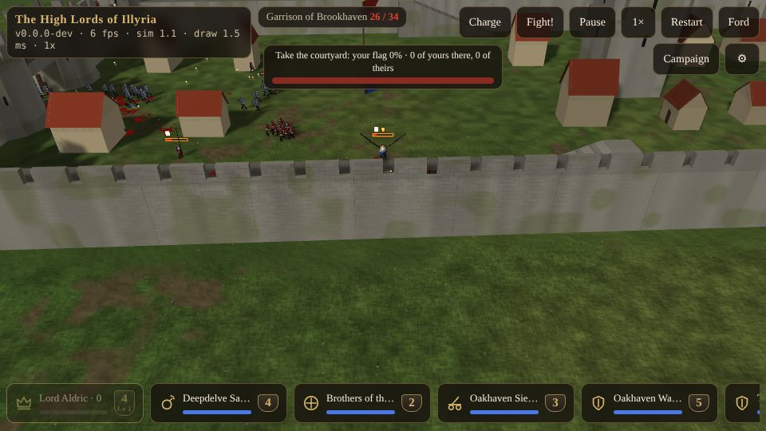
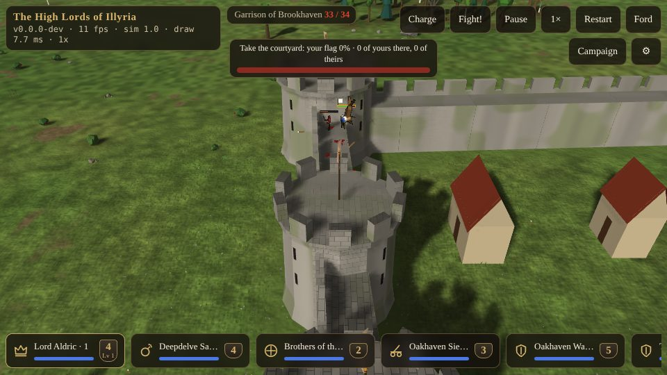
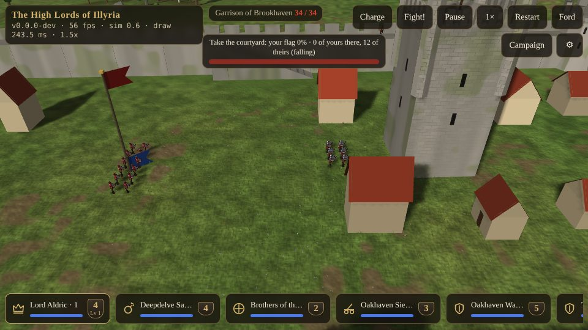

# Sieges {#sieges}

::: lore
*"Gate's open!"*

*"It's broken!"*

*"We're in!"*

— the 1st Oakhaven Bowmen, at Kestrel Point
:::

Every battle for a town is a siege: the defenders are inside the walls, and the attackers are outside, on the road before the gate. The walls are real. They stop men and arrows; the only way in on foot is the gate, once it is broken, or over the top on wings.

## The castle {#castle}

Every castle is different: square, long, many-sided or shield-shaped, with drum towers at the corners and on either side of the gate; capitals add an inner bailey round a great keep. Inside are the keep, streets of houses, and a **courtyard** behind the gate, kept open for mustering, where a **flagpole** stands. Every tower and the keep fly their owner's banner.

- **The wall-walk.** The walls are thick: 4 m (a capital's 4.5 m), so the walk along the top is wide enough for two men to pass, and men on it keep to the right. **Ramps** of earth faced with stone, 3 m wide, run up the inner faces from the courtyard to a landing beside the walk, three in a town (a capital's inner bailey has one more). Along the walk's outer edge stands a **parapet**: a low breastwork about knee high the whole way, and **merlons** higher than a man between **embrasures** a metre wide, every four metres.
- **One archer to an embrasure.** A soldier on the walk can shoot out over the wall only from an embrasure, leaning into it; behind a merlon he cannot. *(A town's ring of about 390 m of wall has about 80 embrasures; a capital's outer ring of about 550 m, about 105.)* The garrison's archers are placed one to an embrasure, spread round the walls; the rest wait at the foot of a ramp, and are sent up to any embrasure left empty, by the dead or never manned.
- **How exposed the defenders are.** A defender at an embrasure stands against the breastwork, so about three quarters of him shows to a flat shot from far out; shots from close under the wall rise steeply and meet the parapet before him. Archers shooting up at the walk aim at the chest and shoot direct, only when the flight clears the parapet. The defenders have the height: a metre more reach for every metre above the target, and plunging shots that hit harder. They shoot first.
- **Falling.** A man thrown against the parapet stops there; one thrown above it goes over and falls to the foot of the wall. The parapet is no shelter from a catapult's stone coming down from above.

## Gates {#gates}

Every gate is two leaves of oak banded with iron, shut. While it stands it blocks walkers and missiles like the wall. It has **250 hit points for every metre** of its width: a town gate eight metres wide has 2,000.

- **Blows.** Attackers whose orders lead through a gate, or who stand idle at it with no enemy on their side, hack at it. A blow does a quarter of its damage to the timbers: a legion of dwarves needs well over a minute.
- **Blasts do far more:** grenadiers' satchels **three times** their blast, fireballs **one and a half**, catapult stones **five times**. Three or four good stones break a gate.
- **Broken is broken.** The leaves hang shattered from their hinges and the timbers lie in the passage; everyone on the march finds the new way in, and missiles fly through. Arrows stuck in the doors fall when they break. A town's own side never hacks at its own gate.

**Walls do not break.** Stones and fireballs kill the men on them, and break gates; the stone stands.

## Engines {#engines}

The **catapult** is a wheeled mangonel: slow (0.8 m/s, and it wants roads), no use hand to hand, reloading for 14 seconds. Its arm always slams the same padded crossbar, so the stone leaves at a fixed 53 degrees and the crew wind the skein for the range: out to **150 m**, never nearer than **30 m** (it would come down on them). A stone smashes everything within 3 m, 100 damage at the centre falling off to the edge, throws men off their feet and off the wall-walks, and does five times its damage to a gate. Idle catapults throw at any foe within 140 m.

Tap a catapult, then a gate, and it batters the gate until it falls, then stands down. Ordered at a wall, it bombards the wall-walk there. In a campaign siege, the catapults in your stack come with you; in the dice they break the walls' bonus and fight two points stronger (chapter ).

## Taking the courtyard {#capture-point}

A siege is won by taking the heart of the town, not by killing every last man. Every moment, the flagpole in the courtyard counts the men of each side standing within **14 m** of it (alive, on their feet, not broken).

- If the **attackers** have more there, their flag climbs: **2 points, and one more for each man they are ahead by (at most 8)**, of 1,000, every step. One man more takes 33 seconds to raise it; eight more, 10 seconds.
- If the **defenders** have more, it comes down as fast. Even numbers hold it where it is. An empty courtyard lets it sink slowly.
- When the attackers' flag reaches the top, **the town is taken** and the battle ends in their victory, whoever is still standing elsewhere.

A bar at the top of the screen says how it goes: *Take the courtyard: your flag 45% · 12 of yours there, 3 of theirs (rising)*. On the pole, the defenders' flag comes down as yours goes up.

Back on the campaign map, a town taken at its courtyard is yours at once: the banner rose in the battle. The defenders still standing fall back to an open cell next to the town, or (a neutral garrison, or with nowhere to go) lay down their arms. A town won by killing or routing every defender instead is held, and its banner raised on the map, as after the dice (chapter ).

::: tip "Taking a town"
Batter the gate with stones and satchels while your archers keep heads down on the walk near it; send fliers over the wall at the courtyard; then put more men round the flagpole than they have. Six men to their two take the courtyard in under seventeen seconds.
:::

## Defending {#defending}

In this edition you fight in 3D only the battles you start, so you meet the walls from outside: the computer lords' attacks on your towns are settled with the dice, where your walls give every defender their bonus. If an enemy is raising its banner in a town of yours, attacking it there means storming your own walls: they hold them now. The battle captain is ready for the other way round: besieging a town of yours, the enemy turns his catapults on your gate. Keep the archers in the embrasures and their reserve at the foot of the ramps, and a solid block in the courtyard, since numbers there are all that matter.
