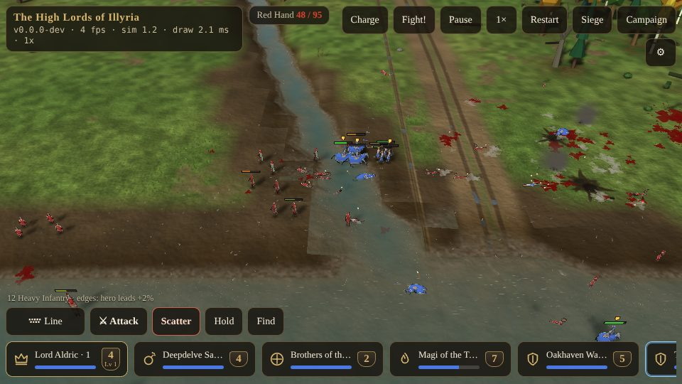

# Blood, Voices and Sound {#blood}

::: lore
*"Casualties, my lord."*

— the herald
:::

## How a soldier dies {#death}

How a man dies decides what is left of him and how it sounds. Every weapon has a kind of damage: **slash** (swords, sabres, claws), **cleave** (axes, great blades, a fiend's or a dragon's claws), **blunt** (clubs, staves, an elephant's weight, a catapult's stone), **pierce** (pikes, lances, fangs, horns, arrows), **explosive** (satchel charges) and **fire** (fireballs). The killing blow's kind, the way it came from, and its **overkill** (how far below nothing it took him) choose the body:

| The killing blow | The body | Left behind |
|---|---|---|
| Slash past 12 overkill, cleave past 7 (a man-sized body) | whole but for a limb; past twice that, the head | the part, thrown on along the blow, bleeding as it skids; a pool where he fell |
| A blast past 5 overkill | torn apart | head, trunk, limbs and worse, flung from the blast, rolling down slopes too steep to grip, leaving trails of blood |
| Anything but fire and arrows, past 50 overkill (a catapult stone landing on a man) | torn apart | as above, burst from the side the blow came from |
| An arrow | whole, fallen the way the arrow flew | the arrow, pinned in him where it struck |
| Fire | whole, burned black | smoke rising from him for a while |
| Anything else | whole, fallen the way the blow drove him | |

A blast throws its pieces long and low: each strikes the ground, hops on and skids to a stop, leaving a splat of blood at every strike and a smear along the skid, so a burst leaves red trails radiating out from a ragged black star of scorch. Loose pieces can be kicked by men walking through them. On a castle's wall-walk the dead lie along the walk, never across it into the stone. The dead of both sides stay where they fell for the rest of the battle, the corpses and the arrows in the ground; nothing is tidied away. The undead and catapults do not bleed: the dead leave bones, the engines a heap of timbers.

::: note "Not yet built"
Remains that stay on the land from battle to battle, weathering slowly over the campaign (the *Bone Field at Oakhaven Ford*), are planned.
:::

## The voices {#voices}

As in *Myth*, the soldiers speak. Fourteen voices (the soldier, the archer, the dwarf, the rider, the hero, the wizard, the berserker, the archon, the engine crew, the wordless brute, the undead, the fiend, the beast, and the herald who reports your losses) have lines for thirty-six situations, close to a thousand lines in all.

- **Answering orders.** Selected, a soldier answers: "*Sir?*", "*Orders?*", "*Bow ready.*", "*Aye? What now?*" (a dwarf). A hero answers for those he leads.
- **The battle as it goes.** A veteran's call to hold the line, a hero's rally, a hero's fall on either side ("*The lord is down!*"), breaking ("*Ride for your lives!*"), wavering and rallying ("*Back to it.*"), kills and a veteran's taunts ("*Stay down.*", "*Another feather.*"), promotions, bad wounds, arrows falling, blows in the flank, friendly fire, a grenadier's satchel ("*Fire in the hole!*"), healing, the catapult throwing, a gate broken ("*The gate's down!*"), first sight of the enemy, riders breaking into the gallop and the men they ride at, victory and defeat.
- **Idle chatter** after twenty seconds without a blow: "*My feet ache.*", "*Need more arrows.*", "*I need a drink.*"
- **The cries** of pain and of death, and the choking moan of a man shot, by the way he died.
- **The herald**: "*Casualties*" when a quarter of your soldiers have fallen, "*Severe casualties*" at half, "*Total casualties*" at four fifths.

The enemy uses the same lines, a little lower. Voices are heard from where the camera looks, fading over 140 m; orders, victory, defeat and your own hero's fall are always heard. They take turns: grave news cuts in, chatter waits. Lines not yet recorded are read by your device's own speech voice (or, for the wordless, a short growl) if you allow it in the settings.

## Sound {#sound}

There is no music in battle, as in *Myth*: every sound tells you something.

- **The fighting:** bowstrings; satchels thrown and their fuses; fireballs; catapults loosing; arrows landing in earth, wood, stone or water, or on what they hit (a shield's splintering crack, armour's ring, the wet thwack of flesh); blows by their kind and the armour they meet; blasts, stones, gates struck and broken; and the deaths.
- **Arrows passing** close to a low camera whistle, higher as they come.
- **Ambience:** the wind (the high passes howl; the lowlands sweep, louder as the camera rises), insects and frogs near marsh and mud, carrion flies over the dead a little after they fall, and the enemy's **war drums** while he comes on beyond bowshot, silent once the armies meet.
- **Victory** gets a fanfare, **defeat** a drone.

Sounds fade with distance from the camera, and with its height. The settings (⚙) turn sound effects and ambience on or off and set their volume; a link there opens the **sound test**, where every sound and cry in the game can be heard on its own.
