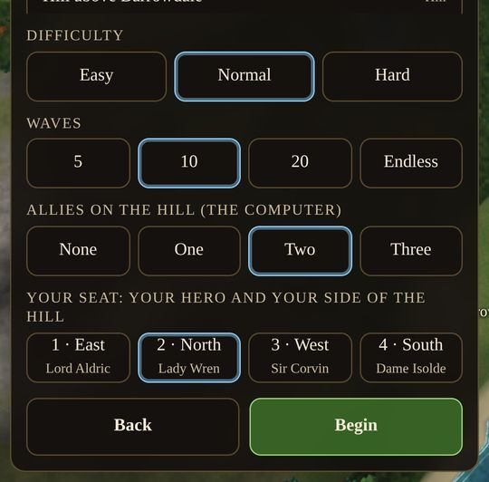
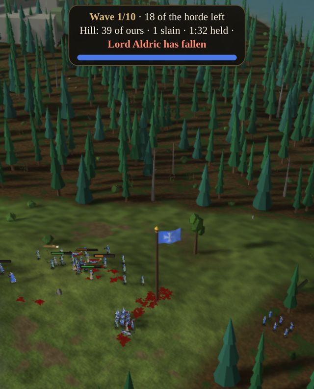
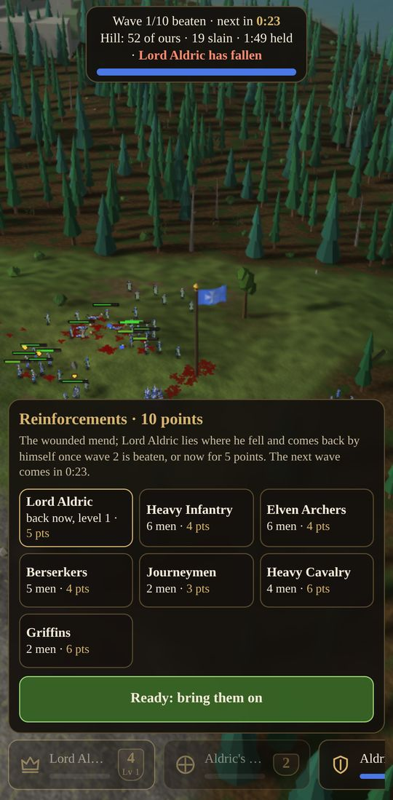
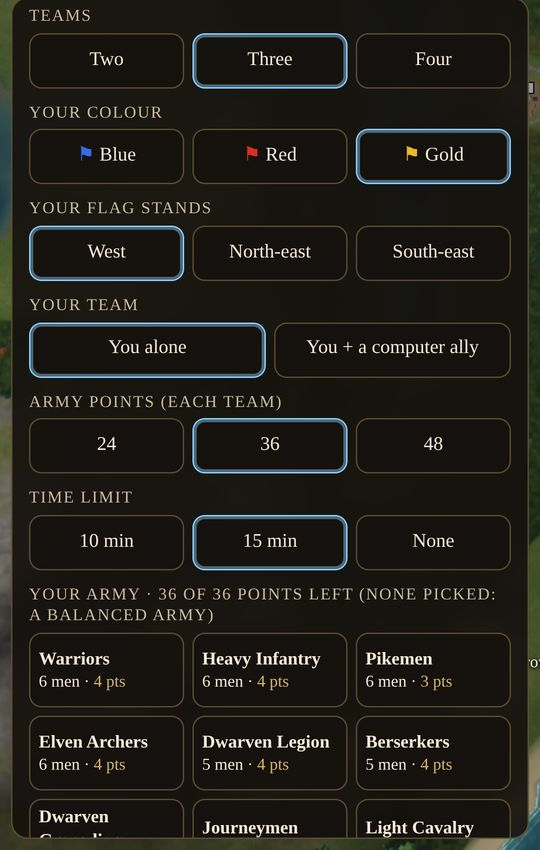
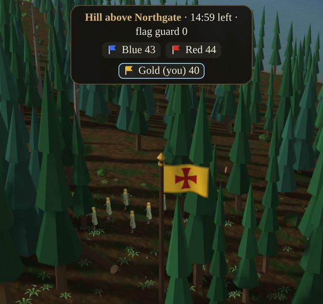

# Other Wars: Horde and Capture the Flag {#other-wars}

::: lore
*"Hold the hill. Whatever comes up it, hold the hill."*

— Lord Aldric, to the Grey Watch
:::

Two kinds of battle are fought outside the campaign, each on a field cut from the same continent, with the same soldiers and the same rules of battle as the rest of this book: facing, charges, morale, the arrows that miss. In **Horde** your hero and a small army hold a hilltop against wave after wave of the enemy. In **Capture the Flag** two to four armies each guard a flag and go for the others'. Both are played against the computer today and are built to be played between people (chapter ).

## Starting one {#starting-a-match}

Choose **Horde** or **Capture the Flag** on the title screen. A panel rises from the bottom of the screen, over the land:

- **Where to fight.** A list of places read from the continent itself: its highest hills ("Hill above Northgate"), its fords and bridges, its passes, its ruins and temples. The recommended ones, starred, come first. Tap one and the camera flies over it, high enough to see the land around; tap another to compare. Horde starts on the best hill.
- **The match's choices**, below (each mode's own, in the sections that follow).
- **Begin** starts the match; **Back** returns to the title screen.

At the end a panel tells how it went: **Play again** fights the same match again, **Menu** goes back to the title. The ☰ menu's *Main menu* leaves at any time.

## Horde {#horde}

The field is the ground round the chosen place, a kilometre square. **The hill** is its highest open ground near the middle that can be climbed from every side (no rock, water or slope steeper than about 25° on it), and the holders' blue banner flies on its top. Everything in Horde turns on that banner.

### Your army {#horde-army}

You start with your **hero** and a small army on your side of the top: **8 warriors, 6 pikemen, 8 archers and 2 journeymen**, the line forward, the pikes on its flank, the bowmen behind it and the healers at the crest. The first wave comes after **half a minute**: time to look at the ground and set your men.

**Allies.** Up to three computer allies can hold the hill with you, each with a hero and the same army, each on his own side of it: **Lord Aldric** to the east, **Lady Wren** to the north, **Sir Corvin** to the west, **Dame Isolde** to the south. With allies the setup asks for **your seat** (1 to 4): which of the four heroes is yours, and which side of the hill you hold. The allies take the other seats. Their squads stand beside yours and fight with you; they are not yours to order, and the cards along the bottom show only your own. Allies hold their side and meet whatever comes up it, and buy their own reinforcements. Every seat on the hill makes the waves **60% heavier**.

### The waves {#waves}

The horde forms up **150 m** out from the hill at the edge of the field and comes at it, from one side at first, then from two, three and four at once (a new side every second wave). The herald and the war horn announce each wave. The bar at the top says *Wave 3/10 · elite · 9 of the horde left*.

- **Each wave is heavier than the last ordinary one:** a weight of 24 for the first and 12 more each wave, times 0.7 on *Easy* and 1.4 on *Hard*, and 60% more for each seat beyond the first. A barrow-dead counts 2, a wolf rider 3, a spider 4, a minotaur 8, a giant 10, a devil 12, a demon 15.
- **New kinds join as it goes:** the dead alone in wave 1; raiders and bowmen from wave 2; wolf riders and spiders from 3; berserks and minotaurs from 4; steppe riders from 5; giants from 6; devils and bombers from 7; witch-kings from 8; demons from 9. Each wave has a theme (half its weight in one kind) and a few others beside it.
- **Every third wave is elite:** its soldiers come a rank up. All of them gain a rank every four waves besides, to elite at the most.
- **Every fifth wave is a boss wave**, three tenths heavier and led by a champion: *Vashgar of the Rift*, a demon, and every tenth wave *the Ashen Wyrm*. The bar says **BOSS**.

A wave is **beaten** when none of it is left standing: every one of them dead or fled.

### The break {#horde-break}

Then comes a **break** of 45 seconds, and the panel of **reinforcements** rises:

- **The wounded mend** half of what they have lost.
- **Veterans keep their ranks**, earned by their kills; the soldiers who killed most come back from the next wave harder still.
- **Each hero still standing rises a level** (a hero's level is +6% damage and +8% hit points: chapter ).
- **Your points:** 10 a break, and one more every second wave (10, 11, 11, 12...). Spend them on the six squads on offer; what you do not spend carries over. Each squad bought comes up behind your line at once, and is yours to order.

| Offered after waves 1, 3, 5... | Men | Points | Offered after waves 2, 4, 6... | Men | Points |
|---|---|---|---|---|---|
| Heavy Infantry | 6 | 4 | Warriors | 6 | 4 |
| Elven Archers | 6 | 4 | Pikemen | 6 | 3 |
| Berserkers | 5 | 4 | Dwarven Legion | 5 | 4 |
| Journeymen | 2 | 3 | Dwarven Grenadiers | 3 | 4 |
| Heavy Cavalry | 4 | 6 | Light Cavalry | 4 | 4 |
| Griffins | 2 | 6 | Wizards | 2 | 6 |

Press **Ready: bring them on** when you are done: the next wave comes at once when every person on the hill is ready, or when the break runs out.

### When the hero falls {#hero-returns}

A hero's fall is the worst blow an army can take, in Horde as everywhere: every man of his side within 30 m of him loses 850 morale, within 60 m 425, and green troops beside him break and run (chapter ). The bar says *Lord Aldric has fallen*.

But he is not lost for good. At the end of the wave he fell in, he still lies where he fell; then:

- **Recall him at once.** In that break his card heads the reinforcements: *Lord Aldric · back now · 5 pts*. He comes back that moment.
- **Or let him come back by himself.** He sits out the next wave, and returns when it is beaten.

Either way he comes back **at the crest of the hill on his own side**, with **half his health**, and keeps **his levels** (and the hit points they gave him), his **kills** and his **blessings**. His card and banner carry on as before. He does not gain the level of a wave he missed. Computer allies always recall their heroes when they have the points.

### Losing the hill {#hill-rule}

The hill is the ground within **22 m** of the banner. The holders keep it as long as **one of them** stands on it, alive and unbroken, however many of the horde stand there with him.

- When the horde stands on it and **no holder does**, its clock runs: **12 seconds** of that and the hill is lost. The bar drains, the alarm sounds, the herald calls, and the HUD says **Retake the hill! 7 s**. On the pole your blue comes down as their red goes up.
- The moment a holder sets foot on it again, the clock winds right back.
- The hill is also lost when **every holder is dead** (yours and your allies').

Survive the waves you chose (**5, 10 or 20**, or **endless**) and you have won. The end panel counts the waves survived, the horde slain, the time on the hill, and your hero: his level and the foes slain by his hand, or how he fell.

::: tip "Holding the hill"
Fight on the slope, not the crest: the high ground gives every blow and every arrow its edge (chapter ), and the horde arrives tired and strung out. Keep the archers and healers at the top where the banner is, so the hill is never empty while the line is out. Do not chase the beaten down the hill. Spend points on what the next wave needs: pikes against riders, the heavy line against the brutes, wizards and grenadiers for the dense packs of the dead. Keep the hero a step behind the line, where his presence steadies the men (+45 morale a second to the rallying) and his fall cannot break them.
:::

## Capture the Flag {#capture-the-flag}

Myth's rule: each team has a **flag**, and the last team with its flag standing wins.

### The setup {#ctf-setup}

- **Teams:** two, three or four. Each team is one colour: **Blue, Red, Gold, Green**.
- **Your colour:** which team is yours. Each team keeps its colour whoever plays it, so choosing a colour is choosing a team.
- **Your flag stands:** where on the field your flag is. The flags stand **150 m** from the middle of the field, evenly round it: west and east for two teams; west, north-east and south-east for three; the four corners for four. The team that would have stood where you choose takes your place instead.
- **Your team:** you alone, or you and a computer ally on the same team (with two or three teams).
- **Army points:** 24, 36 or 48 for each team, shared by its seats.
- **Time limit:** 10 minutes, 15 minutes, or none.
- **Your army:** tap squads to buy them with your points (the same squads and prices as Horde's: the table in ). Buy nothing and you are given a balanced army: line, missiles and healers.

Every army stands beside its own flag, facing the middle of the field.

### The flag rule {#flag-rule}

- **A flag falls** the moment an enemy soldier stands within **5 m** of it (on his feet and unbroken) while **none of its own team** does. One defender on it saves it, however many enemies stand round him. It falls to the team with the most men on it.
- **A team whose flag falls is out of the match.** Its whole army breaks and flees, and **never rallies**; its orders are not heeded. It can no longer win or take anything, and the other teams hunt it down or let it scatter. If it was yours, you may watch the match to its end, or leave.
- **The last team with its flag standing wins.** Two last flags falling in the same moment is a draw.
- **With a time limit**, when time runs out the team with its flag standing and the **most strength** left (the hit points of its men still standing and unbroken) wins; a tie is a draw.

### The alarm {#ctf-alarm}

When enemies come within **35 m** of your flag, the alarm sounds, the herald cries *"Our flag is under attack!"*, and a red banner flashes over the field: **⚑ Your flag (Gold) is under attack!** The bar at the top shows the time left, how many guard your flag, and each team: its flag, its colour and its men still standing, yours marked *(you)* and the fallen struck through. The cards along the bottom, and their bars, are in your colour.

### The computer's teams {#ctf-computer}

A team the computer plays keeps its **missile troops, its healers and every third squad of its line** at its flag as guards, meeting whoever comes near it. **The rest march on the nearest enemy flag** still standing, fighting whoever crosses their way. Within 40 m of it they cut down the guards standing on it, then force-march onto it. When its attack is spent, or after **six minutes**, its guards go too: a flag is not taken by waiting.

::: tip "Taking a flag"
A flag needs only one man on it to stand: a squad of the line round your flag is worth more than its number. Strike where the enemy's attack has gone out and left few guards behind. Fast troops (light cavalry, griffins) take a flag the moment the guards are drawn off it; archers and wizards clear the guards from a distance first. And remember that a flag falls to men *on their feet*: break the guards, and the flag is yours.
:::

## Your seat {#seats}

Every match is played by up to four **seats**, each a person, the computer or nobody, each on a team and each owning its own soldiers. Your seat is a setting of the match, not part of it: the soldiers you select and order, the cards along the bottom, the colour of their bars, the *(you)* on the bar, the alarm for your flag and the voices you hear as your own all follow your seat, whichever team and side it is. The battle itself is exactly the same whoever watches it from where, which is what will let people play one match together, each from his own seat.
