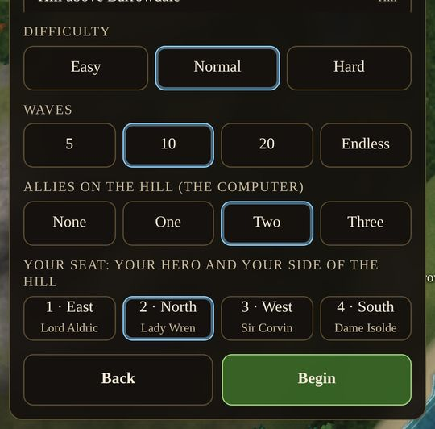
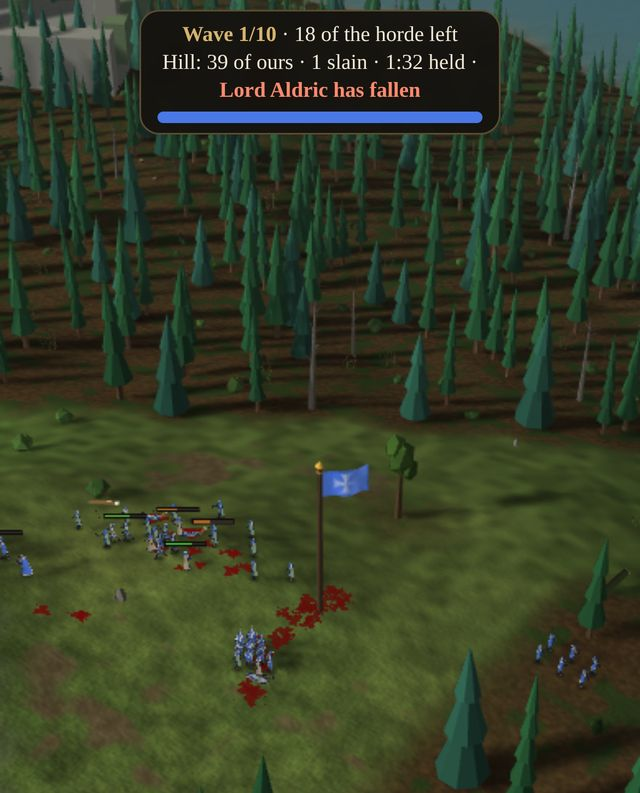
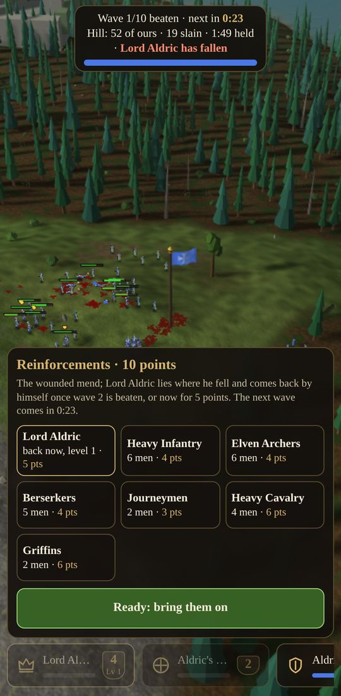
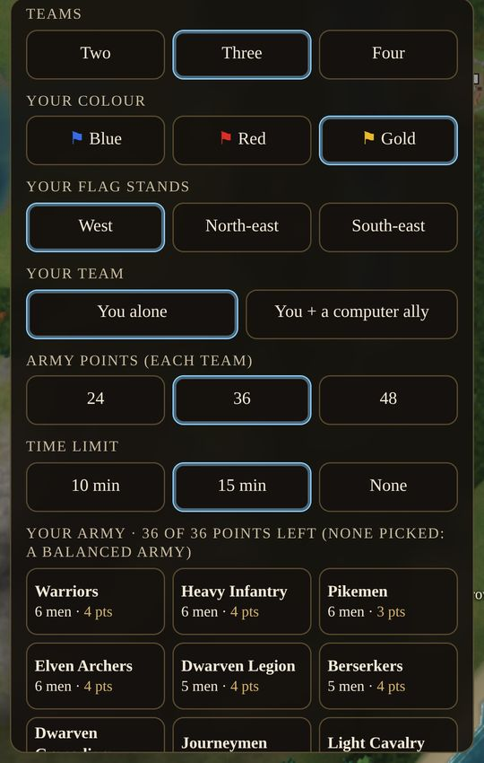
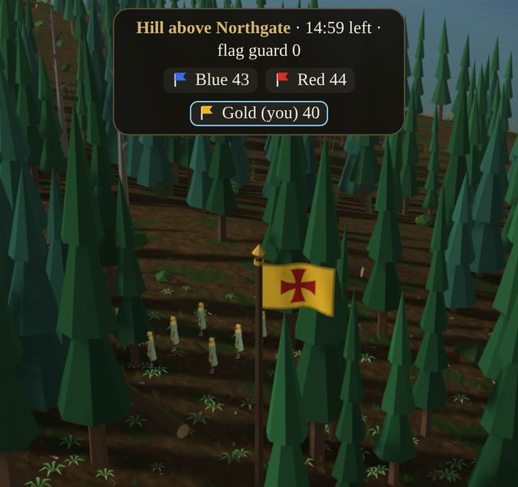

# Other Wars: Skirmish, Horde, Capture the Flag and the Sandbox {#other-wars}

::: lore
*"Hold the hill. Whatever comes up it, hold the hill."*

— Lord Aldric, to the Grey Watch
:::

The title screen offers five things to play. All are fought on the same continent, with the same soldiers and the same rules of battle as the rest of this book: facing, charges, morale, the arrows that miss.

| On the title screen | What it is | How it ends |
|---|---|---|
| **Campaign** (and **Continue**, when a war is saved) | The war for all Illyria: chapters  to . You choose which of the eight lords you are, which of the other seven are in the war (any, from none to all), and whether they play *Easy* or *Hard*; three save slots | By conquest (chapter ). With no lord against you it is a free game with no end |
| **Skirmish** | One set battle, fought out in full: **Oakhaven Ford** or **The siege** | The enemy destroyed, or the courtyard taken; or your army destroyed |
| **Horde** | Your hero and a small army hold a hilltop against wave after wave | The waves you chose survived; or the hill lost, or every holder dead |
| **Capture the Flag** | Two to four armies each guard a flag and go for the others' | One flag left standing; or time |
| **Sandbox** | Any squads of any side set down on a field of your choosing, to watch, command and tune | It does not: nothing is won or lost |

Everything outside the campaign is played against the computer, on one device. Horde and Capture the Flag are built to be played between people, by **seats** (), but **no play between people is in the game yet**: there is no network play of any kind (chapter ).

## Skirmish {#skirmish}

*One battle, fought out in full. Nothing carries over.* Choose **Skirmish**, then one of two battles. Both are always the same armies on the same ground, you in blue against the computer in red; there is nothing to set.

### Oakhaven Ford {#skirmish-ford}

The field is Oakhaven Ford. Your host stands 60 m west of the middle of the field, the Red Hand 170 m east of it, and comes on.

| Yours (Oakhaven) | | The Red Hand | |
|---|---|---|---|
| Oakhaven Warriors | 12 warriors | Red Hand Warband | 16 light infantry |
| The Grey Watch | 12 heavy infantry | Barrow Dead | 16 undead |
| Ferry Pikes | 12 pikemen | Blood Berserks | 8 berserkers |
| Iron Hill Sappers, Deepdelve Sappers | 8 and 6 grenadiers | Wolf Riders of Gnarl | 8 wolf riders |
| Wildmen of Kell | 10 berserkers | Steppe Riders | 6 light cavalry |
| 1st Oakhaven Bowmen, Silverwood Archers | 12 and 12 archers | Hill Giants | 3 giants |
| Brothers of the Root | 4 journeymen | Minotaurs of the Maze | 4 minotaurs |
| Magi of the Tower | 3 wizards | Brood of Mirkwold | 6 spiders |
| Lord Aldric | the hero | Pit Devils, Demons of the Rift | 3 devils, 2 demons |
| Oakhaven Lancers | 8 heavy cavalry | Red Hand Longbows | 12 archers |
| Ferry Riders | 8 light cavalry | Gnarl Bombers | 4 grenadiers |
| Moonwood Unicorns | 4 unicorns | Witch-Kings | 2 wizards |
| War Elephants of Tal | 2 elephants | Red Hand Menders | 3 journeymen |
| Sky Lancers | 4 pegasi | Ashen Wyrm | 1 dragon |
| Eyrie Griffins | 3 griffins | Red Hand Mangonel | 1 catapult |
| Host of Archons | 3 archons | Laughing Pack of Gnarl | 6 hyena-folk |

You **win** when no soldier of the Red Hand is left alive, and **lose** when none of yours is. A broken man who has run is not dead: he may rally and come back, and the battle is not over while he lives.

### The siege {#skirmish-siege}

The neutral walled town nearest the ford, and its garrison: archers of the **Town Watch** at the embrasures (two to each wall of the ring), 8 pikemen (the **Gate Wardens**) behind the gate, 12 light infantry (the **Town Militia**) in the courtyard and 6 heavy infantry (the **Castellan's Guard**) before the keep. They keep their gate as any garrison does (chapter ).

You besiege it with the foot of the same host, formed up on the road about 110 m before the gate: the Oakhaven Warriors and the Grey Watch (12 each), both squads of bowmen (12 each), both squads of sappers (8 and 6 grenadiers), 4 journeymen, Lord Aldric, 3 griffins, and the **Oakhaven Siege Train** of 2 catapults.

You **win** when your flag reaches the top of the pole in the courtyard (chapter ), or when no defender is left alive; you **lose** when none of yours is.

When a skirmish is over you may fight it again or go back to the main menu.

## Starting a match {#starting-a-match}

Choose **Horde** or **Capture the Flag** on the title screen. A panel rises from the bottom of the screen, over the land:

- **Where to fight.** A list of places read from the continent itself: its eight most prominent hills, each at least 400 m from the next ("Hill above Northgate"), and the hills, terraces and gorges made by hand; its fords and bridges; its passes; its ruins and temples. All stand at least 150 m clear of every town and village. The recommended ones, starred, come first: the two best hills, the best ford, the best pass and the best ruin. Tap one and the camera flies over it, high enough to see the land around; tap another to compare. Horde starts on the best hill, Capture the Flag on the first recommended place.
- **The match's choices**, below (each mode's own, in the sections that follow).
- **Begin** starts the match; **Back** returns to the title screen.

At the end a panel tells how it went: **Play again** fights the same match again, **Menu** goes back to the title. The ☰ menu's *Main menu* leaves at any time.

### The edge of the field {#field-edge}

A match is fought inside a ring of **stakes**: in Horde 270 m out from the hill, in Capture the Flag 250 m out from the middle of the field (100 m beyond the flags), in the sandbox as far as you set it. The camera does not leave it. **A soldier beyond the stakes loses a twentieth of his full health every second**, whoever he is, and is knocked back toward the middle: nobody hides outside, and whoever runs from the field dies there.

## Horde {#horde}

The field is the ground round the chosen place. **The hill** is its highest open ground within 150 m of the middle (a metre of height counting for 40 m nearer the middle) with no rock, water or slope steeper than about 25° within 24 m of its top, and with a way up it from at least six of the eight points of the compass. The holders' blue banner flies on its top. Everything in Horde turns on that banner.

### Your army {#horde-army}

You start with your **hero** and a small army on your side of the top: **8 warriors, 6 pikemen, 8 archers and 2 journeymen**, the line forward, the pikes on its flank, the bowmen behind it and the healers at the crest. The first wave comes after **half a minute**: time to look at the ground and set your men.

**Allies.** Up to three computer allies can hold the hill with you, each with a hero and the same army, each on his own side of it: **Lord Aldric** to the east, **Lady Wren** to the north, **Sir Corvin** to the west, **Dame Isolde** to the south. With allies the setup asks for **your seat** (1 to 4): which of the four heroes is yours, and which side of the hill you hold. The allies take the other seats. Their squads stand beside yours and fight with you; they are not yours to order, and the cards along the bottom show only your own. Allies hold their side and meet whatever comes within 50 m of them, and buy their own reinforcements with their own points. Every seat on the hill makes the waves **60% heavier**.

### The setup {#horde-setup}

| Choice | Offered | Starts at |
|---|---|---|
| **Difficulty** | Easy, Normal, Hard | Normal |
| **Waves** | 5, 10, 20, Endless | 10 |
| **Allies on the hill (the computer)** | None, One, Two, Three | None |
| **Your seat** (with allies) | 1 East, 2 North, 3 West, 4 South | 1 |

### The waves {#waves}

The horde forms up **150 m** out from the hill, on ground that leads up to it, and comes at it: from one side for the first two waves, then from two, three and (from wave 7) four at once. The side the first comes from is chance. The herald and the war horn announce each wave. The bar at the top says *Wave 3/10 · elite · 9 of the horde left*, and under it who stands on the hill, the horde slain, the time the hill has been held, and your hero's level.

- **Each wave is heavier than the last ordinary one:** a weight of 24 for the first and 12 more each wave, times 0.7 on *Easy* and 1.4 on *Hard*, and 60% more for each seat beyond the first. The dead, the raiders and the bowmen count 2 each; berserks, wolf riders, steppe riders and bombers 3; a spider 4; a witch-king 5; a minotaur 8; a giant 10; a devil 12; a demon 15; the Wyrm 40.
- **New kinds join as it goes:** the dead alone in wave 1; raiders and bowmen from wave 2; wolf riders and spiders from 3; berserks and minotaurs from 4; steppe riders from 5; giants from 6; devils and bombers from 7; witch-kings from 8; demons from 9. Each wave has a theme (half its weight in one kind) and a few others beside it, more kinds as the waves go by.
- **Every third wave is elite** (unless it is a boss wave): its soldiers come a rank up. All of them gain a rank every four waves besides (regulars from wave 5, veterans from 9, elite from 13), to elite at the most.
- **Every fifth wave is a boss wave**, three tenths heavier and led by a champion: *Vashgar of the Rift*, a demon, and every tenth wave *the Ashen Wyrm*, a dragon. The champion is a rank higher for every five waves (to elite), and from wave 20 he does not come alone. The bar says **BOSS**.

A wave is **beaten** when none of it is left standing: every one of them dead or broken and running. (A broken man who runs out past the stakes dies there.)

### The break {#horde-break}

Then comes a **break** of 45 seconds, and the panel of **reinforcements** rises:

- **The wounded mend** half of what they have lost.
- **Veterans keep their ranks**, earned by their kills, from wave to wave.
- **Each hero still standing rises a level** (a hero's level is +6% damage and +8% hit points: chapter ).
- **Your points:** 10 a break, and one more every second wave (10, 11, 11, 12...), to every seat on the hill. Spend them on the six squads on offer; what you do not spend carries over. Each squad bought comes up behind your line at once, and is yours to order.

Six of these eleven are offered at each break, a different six as the waves go by:

| Squad | Men | Points | Squad | Men | Points |
|---|---|---|---|---|---|
| Warriors | 6 | 4 | Dwarven Grenadiers | 3 | 4 |
| Heavy Infantry | 6 | 4 | Journeymen | 2 | 3 |
| Pikemen | 6 | 3 | Light Cavalry | 4 | 4 |
| Archers | 6 | 4 | Heavy Cavalry | 4 | 6 |
| Berserkers | 5 | 4 | Wizards | 2 | 6 |
| | | | Griffins | 2 | 6 |

Press **Ready: bring them on** when you are done: the next wave comes at once when every person on the hill is ready, or when the break runs out. (Before the first wave there is no panel and nothing to buy: the half minute simply runs.)

### When the hero falls {#hero-returns}

A hero's fall is the worst blow an army can take, in Horde as everywhere: every man of his side within 30 m of him loses 850 morale, within 60 m 425, and green troops beside him break and run (chapter ). The bar says *Lord Aldric has fallen*.

But he is not lost for good. At the end of the wave he fell in, he still lies where he fell; then:

- **Recall him at once.** In that break his card heads the reinforcements: *Lord Aldric · back now · 5 pts*. He comes back that moment.
- **Or let him come back by himself.** He sits out the next wave, and returns when it is beaten.

Either way he comes back **at the crest of the hill on his own side**, with **half his health**, and keeps **his levels** (and the hit points they gave him), his **kills** and his **blessings**. His card and banner carry on as before. He does not gain the level of a wave he missed. Computer allies always recall their heroes when they have the points.

### Losing the hill {#hill-rule}

The hill is the ground within **22 m** of the banner. The holders keep it as long as **one of them** stands on it, alive, unbroken and on the ground (a flier in the air holds nothing), however many of the horde stand there with him. An ally's man holds it as well as one of yours.

- When the horde stands on it and **no holder does**, its clock runs: **12 seconds** of that and the hill is lost. (An empty hill, with nobody of either side on it, is not being lost; and the clock runs only while a wave is on the field.) The bar drains, the alarm sounds, the herald calls, and the HUD says **Retake the hill! 7 s**. On the pole your blue comes down as their red goes up.
- The moment a holder sets foot on it again, the clock winds right back.
- The hill is also lost when **every holder is dead** (yours and your allies').

Survive the waves you chose (**5, 10 or 20**) and you have won: *The hill holds*. An **endless** match is never won: it goes on until the hill falls, and the count of waves survived is the score. The end panel counts the waves survived, the horde slain, the time on the hill, and your hero: his level and the foes slain by his hand, or how he fell.

::: tip "Holding the hill"
Fight on the slope, not the crest: the high ground gives every blow and every arrow its edge (chapter ), and the horde arrives tired and strung out. Keep the archers and healers at the top where the banner is, so the hill is never empty while the line is out. Do not chase the beaten down the hill. Spend points on what the next wave needs: pikes against riders, the heavy line against the brutes, wizards and grenadiers for the dense packs of the dead. Keep the hero a step behind the line, where his presence steadies the men (+45 morale a second to the rallying) and his fall cannot break them.
:::

## Capture the Flag {#capture-the-flag}

Myth's rule: each team has a **flag**, and the last team with its flag standing wins. Flags are not picked up or carried anywhere, and there is no score to run up: a flag is taken where it stands, once, and the team that loses it is out.

### The setup {#ctf-setup}

- **Teams:** two, three or four. Each team is one colour: **Blue, Red, Gold, Green**.
- **Your colour:** which team is yours. Each team keeps its colour whoever plays it, so choosing a colour is choosing a team.
- **Your flag stands:** where on the field your flag is. The flags stand **150 m** from the middle of the field, evenly round it: west and east for two teams; west, north-east and south-east for three; the four corners for four. The team that would have stood where you choose takes your place instead.
- **Your team:** you alone, or you and a computer ally on the same team (with two or three teams: a match has four seats at most). The ally has his own squads and commands them himself.
- **Army points:** 24, 36 or 48 for each team (it starts at 36), shared by its seats: with an ally you spend half of them and he the other half.
- **Time limit:** 10 minutes, 15 minutes (as it starts), or none.
- **Your army:** tap squads to buy them with your points, as many of a kind as you can pay for (all eleven of Horde's squads at Horde's prices: the table in ); **Clear the army** starts again. Buy nothing and an army is bought for you as the computer buys its own: down a list of warriors, archers, pikemen, heavy infantry, journeymen, grenadiers, berserkers and cavalry while the points last. There are no heroes in Capture the Flag, and no reinforcements: the army you begin with is the army you have.

Every army stands beside its own flag, facing the middle of the field.

### The flag rule {#flag-rule}

- **A flag falls** the moment an enemy soldier stands within **5 m** of it (alive, unbroken and on the ground: a flier must land) while **none of its own team** does. One defender on it saves it, however many enemies stand round him. It falls to the team with the most men on it, and flies their colour from then on.
- **A team whose flag falls is out of the match.** Its whole army breaks and flees, and **never rallies**; its orders are not heeded. It can no longer win or take anything, and the other teams hunt it down or let it scatter. If it was yours, you may watch the match to its end, or leave.
- **The last team with its flag standing wins.** Two last flags falling in the same moment is a draw.
- **With a time limit**, when time runs out the team with its flag standing and the **most strength** left (the hit points of its men still standing and unbroken) wins; a tie is a draw. With no limit the match lasts until one flag is left.

### The alarm {#ctf-alarm}

When enemies come within **35 m** of your flag, the alarm sounds, the herald cries *"Our flag is under attack!"*, and a red banner flashes over the field: **⚑ Your flag (Gold) is under attack!** The bar at the top shows the time left, how many guard your flag, and each team: its flag, its colour and its men still standing, yours marked *(you)* and the fallen struck through. The cards along the bottom, and their bars, are in your colour.

### The computer's teams {#ctf-computer}

A team the computer plays keeps its **missile troops (bowmen, grenadiers, wizards), its healers and every third squad it bought** at its flag as guards, meeting whoever comes within 45 m of it. **The rest march on the nearest enemy flag** still standing, fighting whoever crosses their way. Within 40 m of it they cut down the guards standing on it, then force-march onto it. When its attack is spent, or after **six minutes**, its guards go too: a flag is not taken by waiting.

::: tip "Taking a flag"
A flag needs only one man on it to stand: a squad of the line round your flag is worth more than its number. Strike where the enemy's attack has gone out and left few guards behind. Fast troops (light cavalry, or griffins, who must land on it) take a flag the moment the guards are drawn off it; archers and wizards clear the guards from a distance first. And remember that a flag falls to men *on their feet*: break the guards, and the flag is yours.
:::

## The Sandbox {#sandbox}

The sandbox is a field with nothing at stake: a place to set armies against each other and watch, to try an order, or to see what a number does. Choose **Sandbox** on the title screen.

**Before it starts**, a map of the continent shows the places a match can be fought, the recommended ones in gold. Tap anywhere on it for the middle of the field (a tap in a lake or the sea moves to the nearest dry ground), and set **how far the field reaches**: 80 to 480 m from its middle, 260 m as it starts. The stakes stand there ().

It opens with two squads of 12 heavy infantry, Blue's and Red's, facing each other 36 m apart in the middle, and a panel:

- **Add a squad.** Any kind of soldier in the game (the hyena-folk among them), for any of four sides, **Blue, Red, Gold or Green**, in a squad of 1, 6, 12 or 24. Press **Place on the field** and tap the ground inside the stakes: they are set down there, facing the nearest squad of another side. [[Esc]] ends the placing.
- **Command.** Which side is yours to select and order (Blue at first). Change it at any time and command each side in turn.
- **Fight on their own.** A box for each side, with the number of its men still standing. Ticked, the computer commands that side: every squad goes at the nearest foe. Unticked, its men stand where they are until ordered, defending themselves as any idle soldier does.
- **Time.** Pause, **Step a tick** (one thirtieth of a second), and the pace: a tenth, a quarter, a half, 1×, 2× or 4×.
- **Tune.** For the kind chosen above: health, melee damage, seconds a swing, reach, the shield's chance to block, speed, missile damage, reload, range, and the distance at which he engages, each beside the unit sheet's own number. A change counts at once for every soldier of that kind on the field, and for this sandbox only. **Sheet values** puts them back; **Copy changes** copies what you changed as a line of text.
- **Selected soldiers play.** Any animation of the soldiers you have selected, once or over and over.

Every side is every other side's enemy. Nothing is won or lost and nothing ends it: **Leave** goes back to the title screen.

## Your seat {#seats}

Every match is played by up to four **seats**, each a person, the computer or nobody, each on a team and each owning its own soldiers. (In Horde all four seats are one team, the holders, and the horde is a fifth seat that the computer always plays; in Capture the Flag two seats may share a team, its flag and its points.) A seat may order only its own soldiers, never an ally's. Your seat is a setting of the match, not part of it: the soldiers you select and order, the cards along the bottom, the colour of their bars, the *(you)* on the bar, the alarm for your flag and the voices you hear as your own all follow your seat, whichever team and side it is. The battle itself is exactly the same whoever watches it from where, which is what will let people play one match together, each from his own seat.

That is as far as it goes today. One person sits at one seat, the computer at the others, and nothing travels between devices: playing a match with other people is planned, not built (chapter ).
