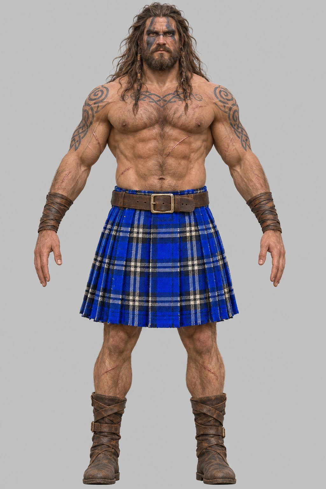
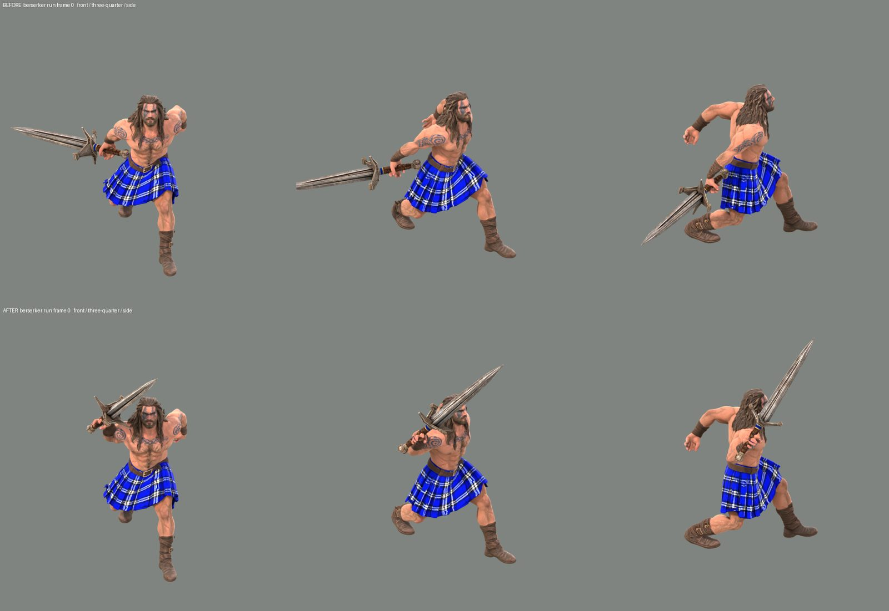
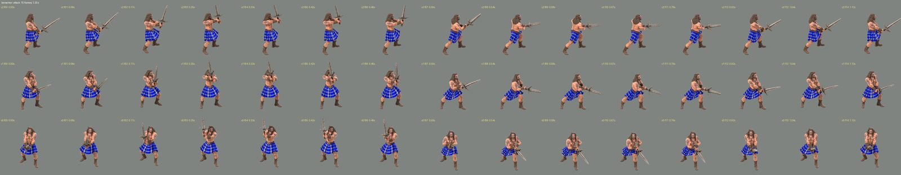
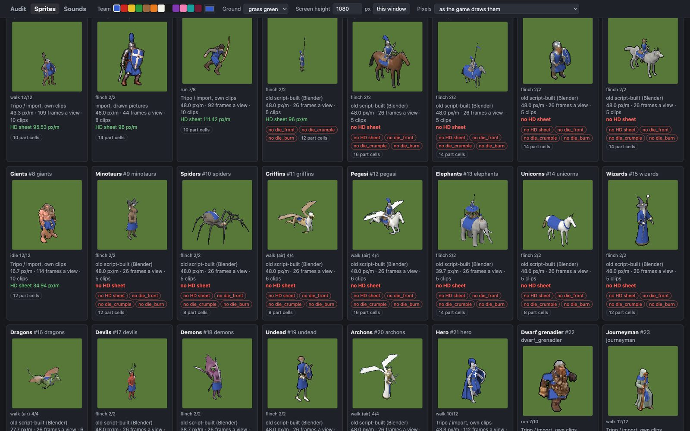
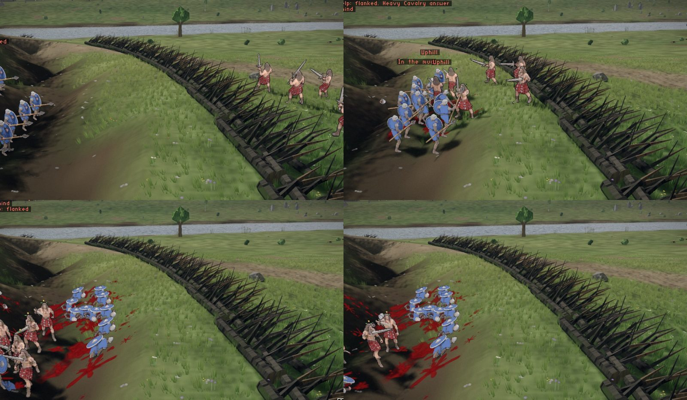
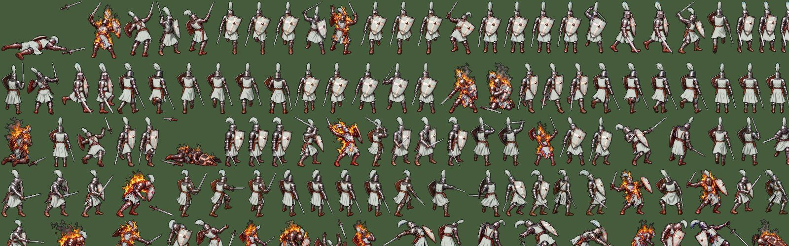
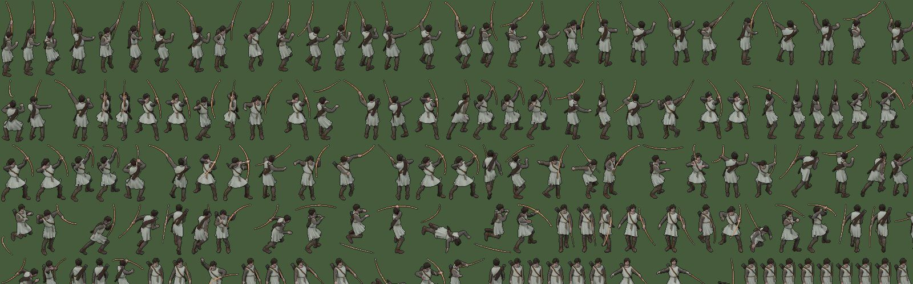

# Assets: from a description to a soldier on the field

A soldier in the game is a sprite: a flat picture facing the camera, one of many on a sheet. The pictures are renders of a 3D model. The steps, in order:

1. **Reference drawings** (`tools/sprites/refs.py`). For each unit an image-generation model draws a front view from a written description, then a side and a back view with the front as its guide so the character stays the same. Weapons and shields are drawn apart, each its own picture, on a plain grey background.
2. **A 3D model.** The owner turns the drawings into a rigged model with Tripo, an image-to-3D service. Models arrive as files; the pipeline never fetches them.
3. **Preparation** (`tools/sprites/tripo/prep.py`). Each delivery is decimated and saved once as a Blender file.
4. **Clips, keyed by numbers** (`tools/sprites/tripo/keyer.py`). The service's own animations were not usable: they mixed up left and right arms. So every clip is written pose to pose: where the feet stand, how low and how turned the hips are, where the sword hand is, which way the blade points, which way the shield faces. Arms and legs are solved from those targets, so a pose is exact and repeatable. In-betweens follow arcs, and planted feet are re-pinned every frame so they do not slide.
5. **Fitting** (`tools/sprites/tripo/fit.py`). The poses were written for a man. A dwarf is not that man made smaller: his legs are half as long and his trunk nearly as wide. Poses are fitted limb by limb to each body.
6. **Two checks on every frame of every clip.**
   - *No weapon through its bearer* (`clearance.py`). The deformed skin goes into a search tree; each held thing is a cloud of points; a point inside the body is found by which way the nearest skin faces and by rays cast from it. A solver then moves the weapon out.
   - *No arm inside its own body* (`limbs.py`). Each arm is tested against the rest of the same mesh, so the chest's depth is the model's own and not a bone line's.
   A unit is only drawn from a build that passes. Each unit's commit states its worst remaining depth, for example 1.2 cm for the dwarf.
7. **Riders** (`cavalry.py`). A rider and a horse are two models on two rigs, joined in one scene. The service's horse rigs are not reliable (bones misnamed, a leg with a bone too few), so the horse's skeleton is read by its shape, not its names. `couch_search.py` tries a grid of hand, elbow and aim for a couched lance and keeps the one that clears both rider and horse.
8. **Render and pack** (`tools/sprites/tripo/unit.py`, `tools/sprites/import.py`). Every clip is rendered from five of the eight directions (the renderer mirrors the other three) with a mask for the team colour. The importer packs two sheets: the normal one at 48 pixels a metre and a close-up one at up to 144, draws the one-pixel outline, and installs them.
9. **Body parts** (`tools/sprites/sheet_gibs.py`). Twenty parts are cut from each sheet's own idle picture, so what flies off a soldier is a piece of him.
10. **One command** (`tools/sprites/tripo_unit.sh UNIT`) runs build, render, contact sheets, the burning death, packing and clean-up. A man-sized unit renders in about four minutes.
11. **Review** (`tools/audit/sprites.html`). A page shows every unit's sheet as the game draws it, clip by clip, in any team colour, at a chosen screen height, with the unit's sounds beside its clips. It also says where each unit's pictures came from. This is where the owner looks for faults.

| A reference drawing | Poses checked, before and after | A clip as rendered |
|---|---|---|
|  |  |  |

| The audit page | In the game |
|---|---|
|  |  |

## The pipeline's earlier lives

| When | Route | Why it was left |
|---|---|---|
| 27 and 28 Oct | Simple sprites, then articulated figures baked into 8-direction sheets when the game starts (`61fc662`) | Replaced the same day by Blender renders; the pilot put the two side by side. |
| 28 Oct | Figures built from numbers in Blender scripts and pre-rendered, all 27 types (`60321ea`, `76b3e83`) | Not left yet: most types still use these. The owner wanted soldiers that hold up close to the camera. |
| 29 and 30 Oct | Painted by an image-generation model, a clip to a plate (`c17d216`, `147503d`) | One unit was finished. Details changed from frame to frame. The owner compared it with a 3D render the same day and chose 3D. |
| 31 Oct on | Renders of rigged 3D models with hand-keyed clips (`399d73d`) | In use. Eleven types so far. |

| Painted | From a model |
|---|---|
|  |  |

What it cost to learn:
- A model's own animation cannot be trusted. Measure each hand's travel to see which arm a clip swings.
- A shield must be strapped across the forearm. Strapped along it, it flips whenever the arm rises.
- Pipeline state kept only in a scratch folder is lost at a restart.
- A full render needs several hundred megabytes free. A disk that fills mid-render leaves truncated pictures.
