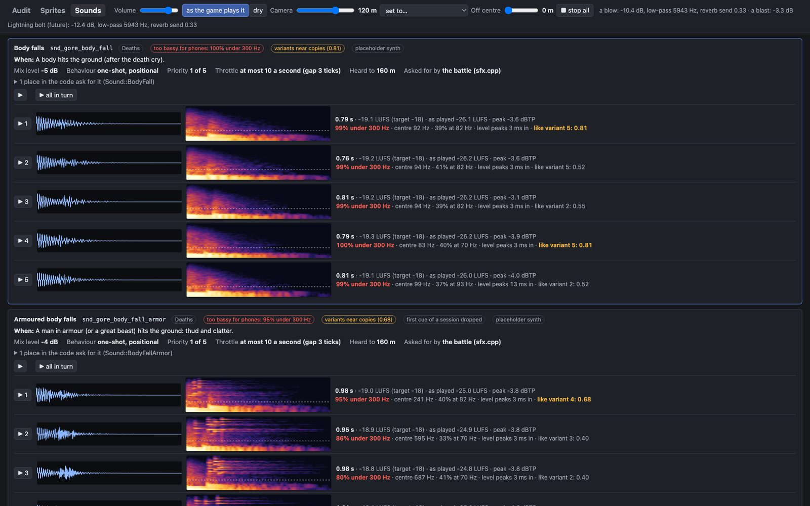
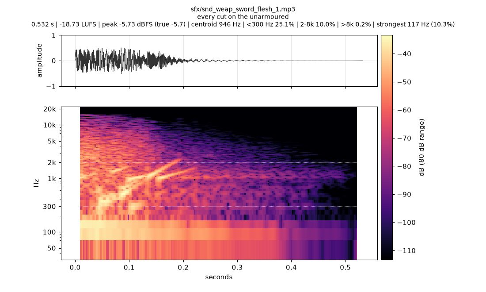

# Sound

The battle has no music, as in *Myth*: every sound tells the player something.

## What plays

`game/src/sfx.cpp` turns each tick's events (missiles loosed and landing, blows by weapon and armour, blasts, gates, deaths, men on the move, lit fuses) into positional cues. They are merged and throttled so a volley is one louder twang. It also works out the ambience: wind by the land under the view, insects over a swamp, flies over the dead, war drums, fire, rain. One table of cues and one manifest are read by both players: Web Audio in the browser and a mixer in the desktop app. What is on screen is heard; a cue gets quieter and duller with the camera's distance.

As of 15 Nov the manifest lists 90 sounds in 256 files (`docs/SOUND_EFFECTS.md`). The 14 Nov audit found every effect file to be synthesis.

## The punch list

On 14 Nov the owner asked whether sound was still a problem and said he had no list. An audit made one without ears: it read the code and measured every file (loudness, peaks, where the energy sits, how alike two variants are). It found the files technically clean and the faults elsewhere:

- A third of the set carried most of its energy below 300 Hz, where a phone or laptop speaker has nothing.
- Several "different" sounds measured as the same low thud.
- The Conquest was close to silent by construction.
- The first fanfare, blast and gate-break of a session were dropped while their files loaded.
- Nothing that moved made a sound: no footsteps, hooves, gate swing or water.

The list has 32 items in three priorities: 9 where sound is silent or broken where a player expects it, then 13, then 10. Every item says what a person must listen to, because the audit could not.

| The Sounds page: waveform, spectrum and warnings for each variant | One effect, measured |
|---|---|
|  |  |

## The Sound Editor

`tools/sound-editor` is a small local server and three pages. It is one place to inspect what the game has, audition candidates, record new effects and voice lines from the microphone, trim and level them, and choose. Choosing installs the sound into the game's working tree at once; there is no export step. Nothing is committed for you. The owner asked for exactly that: a server, so that making a choice is the whole act.

## Voices

`docs/VOICE_LINES.md` is a recording script generated from the game's own list of lines: every line by voice and situation, with its file name and how to deliver it, and a guide to recording (a soft room, mono, 48 kHz, two or three takes). `docs/VOICE_CHECKLIST.md` is the tick-list. **0 of 1,055 lines are recorded.** Until they are, the game uses placeholders.

## Licences

A sound in the game must be one of three things: synthesised by the project's own scripts, the owner's own recording, or CC0 / public domain with its source written down. Nothing that needs attribution or forbids commercial use goes in.
