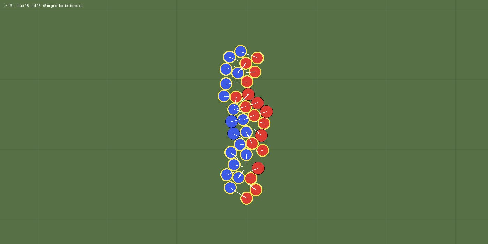
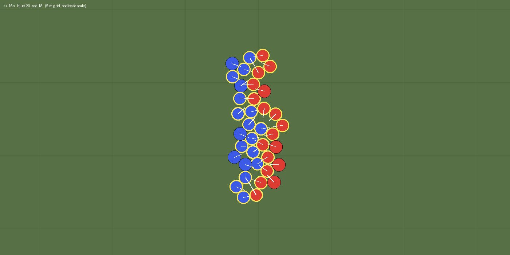
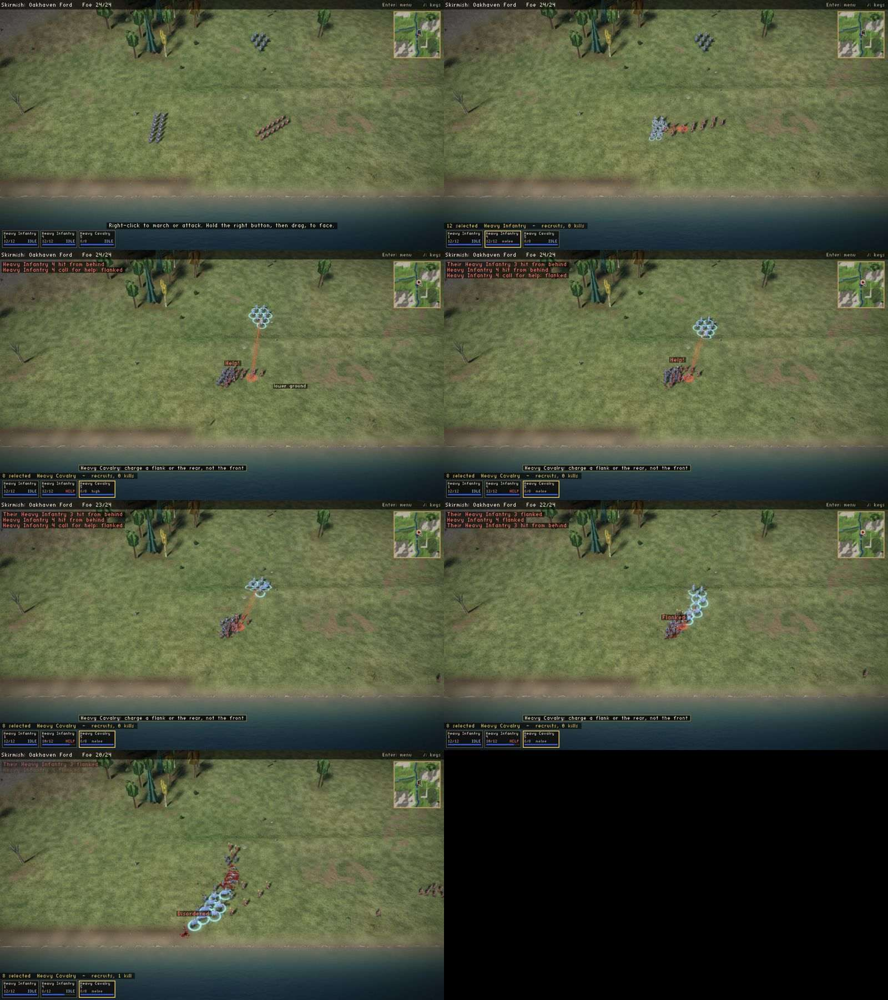
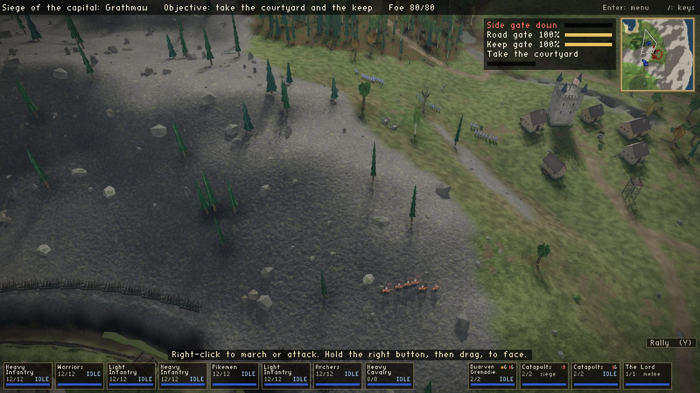

# Testing battles

## The simulation repeats to the man

The battle is a deterministic simulation: integers and fixed-point numbers only, a seeded random source, no clock, no floating point. The same seed and the same orders give the same battle on every machine. That buys three things.

- **Golden checksums.** Set battles (the Ford, a siege, a raid, boats, a Conquest's first days and others) are run in tests and their final state is hashed. The hash is pinned in the test. Any change to a rule that touches the battle moves a pin; the pin is then set again by hand with a note of what it was and why it moved. About thirty commits say "re-pin".
- **Native and browser must agree.** `illyria_simcheck` prints a trace of checksums. The WebAssembly build's trace must be byte for byte the native one. On the first day the same trace run under two compilers caught them drawing random numbers in a different order.
- **Measurements can be trusted.** A before-and-after comparison uses the same seeds, so a difference is the change and not luck.

## A test for each rule

A rule gets a small test whose name is the rule: `walls_keep_soldiers_out_but_the_gate_lets_them_in`, `archers_climb_the_ramps_and_man_the_walls`, `a_town_is_taken_only_when_the_banner_has_risen`, `a_boulder_smashes_a_gate_from_the_air_rolls_into_it_for_less_and_stops_at_a_wall`. The architecture rules (`docs/ARCHITECTURE_RULES.md`) ask that a bug fix adds the test that would have caught it. There are 674 tests.

## Headless tools

Small programs that run fights through the game's own simulation with no graphics and print numbers:

| Tool | What it answers |
|---|---|
| `illyria_balance` | Speeds, march times, an equal-gold matchup matrix of every type against every type, whole field battles with a scripted plan |
| `illyria_ordersdiag` | Spacing between men, frontage against depth, flank and rear charges, arrows against moving targets |
| `illyria_clumpcheck` | Whether men in a melee pile up, drawn as circles |
| `illyria_conquestsim` | Whole Conquests between computer lords: do they end, and when |
| `illyria_tickbench` | The cost of a tick at 1,800 to 7,000 men |
| `illyria_terrainaudit` | Roads, bridges, gates and towers across the continent |
| the tactics lab (in progress) | Named small battles over many seeds, both ways round, every run kept |

Every fight is run both ways round, with the sides' player numbers swapped. Without that, the side raised first struck first and even a mirror match was lopsided.

| A melee before spacing was fixed | After |
|---|---|
|  |  |

## Playing by script

`Illyria --play script.txt` (`docs/PLAYTEST.md`, a developer-only switch) plays the real desktop app from a text script: timed keys, clicks, drags and wheel turns handed to the same function the window's own events go to. It takes shots, prints stats and writes a log. The scripts in `tools/playtest/` cover the Ford, sieges, the satchel trap, boulders and more. A script cannot feel a drag or dodge by reflex, and it runs silent.

| A flank charge, shot by a play script | A sortie burning an engine |
|---|---|
|  |  |

## The reviewer

An AI agent briefed as a games-press critic plays a build through `--play`, writes a scored review with every claim marked as seen, read or not seen, and lists what to fix first. It has reviewed the game six times. It is not a person and cannot say how the game feels in the hand; it can say whether a plan beat doing nothing, which is what it keeps finding.

| Review | Build | Fun | Overall | Its headline |
|---|---|---|---|---|
| 2 | 14 Nov | | 6.5 | A first hour that does not teach you how to win |
| 3 | 14 Nov | 5.5 | 7.0 | Fights that will not end; a plan worth the same as no plan |
| 4 | 14 Nov | 6.5 | 7.5 | A beginning, an end and a score sheet; "it still does not need me" |
| 5 | 15 Nov | 7.0 | 7.5 | Can be lost, has a tomorrow; orders cannot be told from noise |
| 6 | 15 Nov | 7.0 | 7.5 | Better made; doing nothing still wins the first battle |

## The record

`docs/BALANCE.md` holds every measurement: what was asked, how it was measured, the numbers before, what was changed and where, the numbers after, and what was not met. It is about 780 lines.

## How much is run, and when

Day to day, a change runs the tests it touches, the golden tests it moves, the native-against-browser check and a build. The full suite takes many minutes and is run only before a production deploy, on the owner's word.
