# The land's look

The continent is generated from one seed and is the same for a skirmish and for the Conquest. Its look has been improved by the same loop each time: the owner sends a screenshot of something wrong, the same camera stations are shot before and after a change, and the pairs are compared.

## What the land is made from

- **Relief baked once.** `tools/terrainbake` wears the designed land down with simulated rain (droplet erosion, then slope collapse), traces where water drains into streams and pools, and writes the result as data compiled into the game. The tool may use floating point because it runs once, offline; the game then has exactly the same land on every platform.
- **One continent, three distances.** From far off the land is a shaded map; from the middle heights it is fields, woods and towns; near the ground it is grass blades, stones and mud. The same data feeds all three, and most of the work has been making the hand-over between them not show.
- **Trees as cards**, so every tree is drawn at every distance.

## The audit

`illyria_terrainaudit` (`docs/TERRAIN_AUDIT.md`) walks the generated continent and prints what is wrong with it. A test fails if anything comes back. Its first run on 9 Nov found:

| | |
|---|---|
| Castle gates with a road reaching them | 0 of 80 |
| Castles joined to the road network | 0 of 80 |
| Roads running through water that is no bridge or ford | four of the six designed roads |
| Castles cut off from every road by water | 5 |

Roads now reach every gate from one generator, and every bridge and ford is walked across by a man, a rider and an engine in a test.

## Passes, with their pictures

| Pass | Before | After |
|---|---|---|
| Roads, 9 Nov | 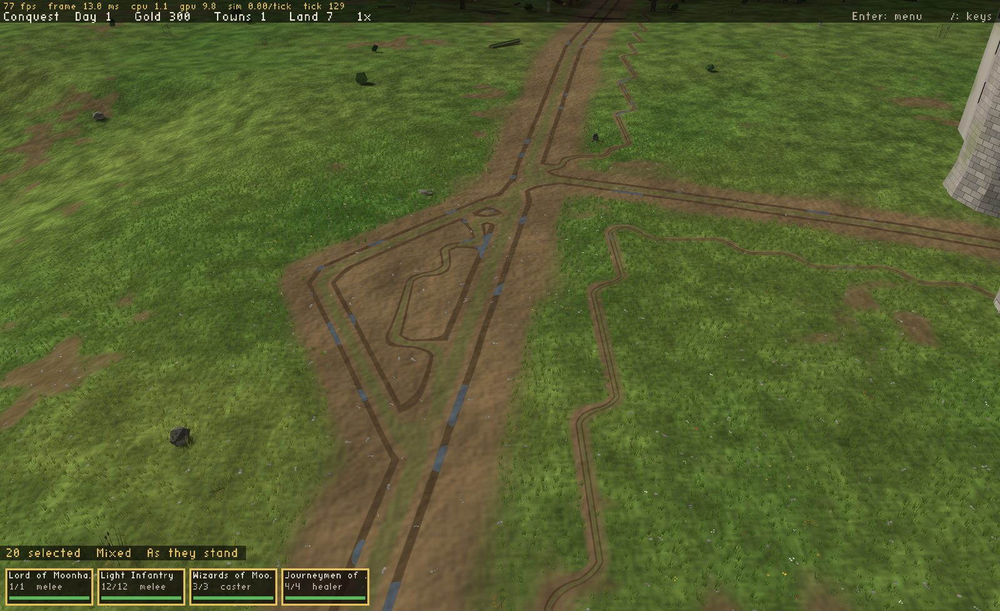 | 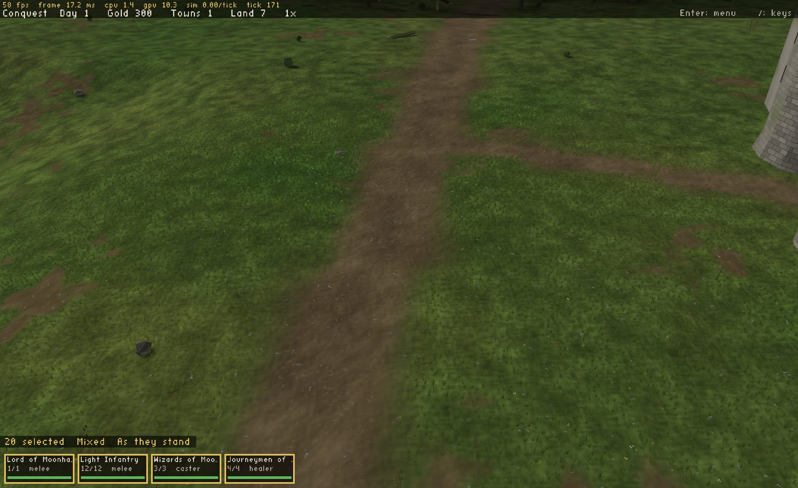 |
| A bridge that could not be, 9 Nov | 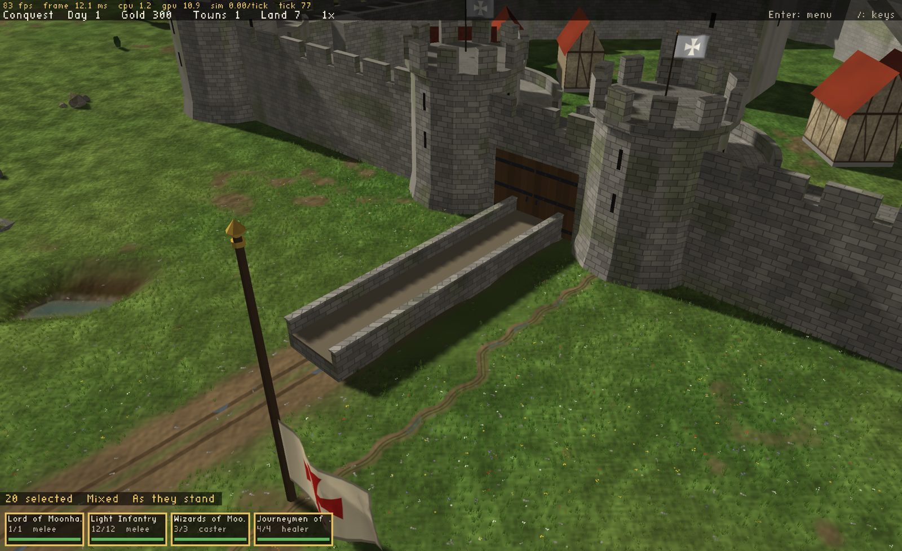 | 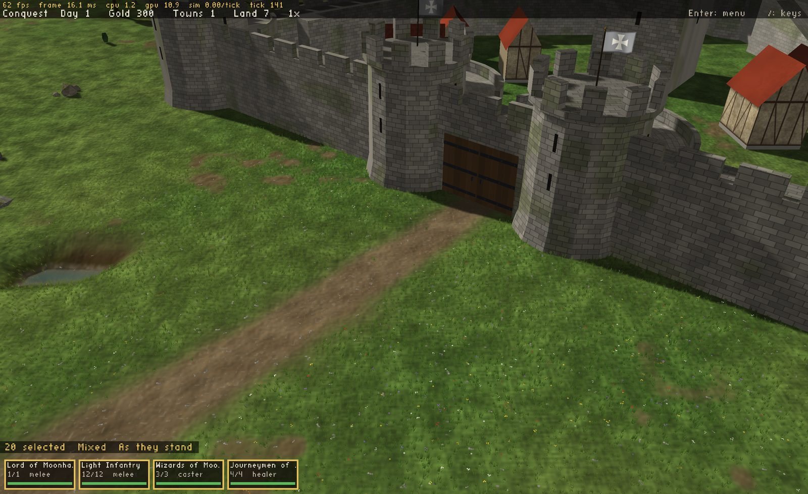 |
| Lakes, 9 Nov | 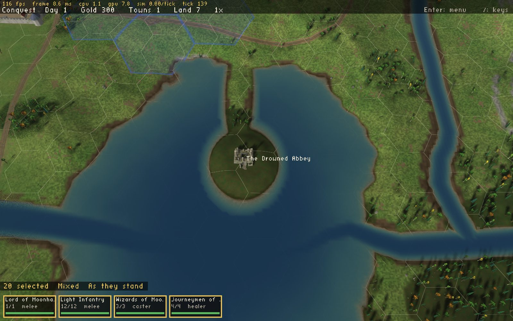 | 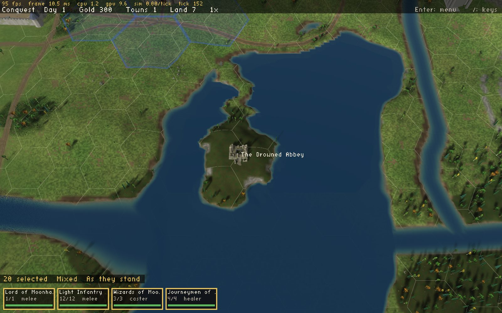 |
| The middle heights, 9 to 11 Nov | 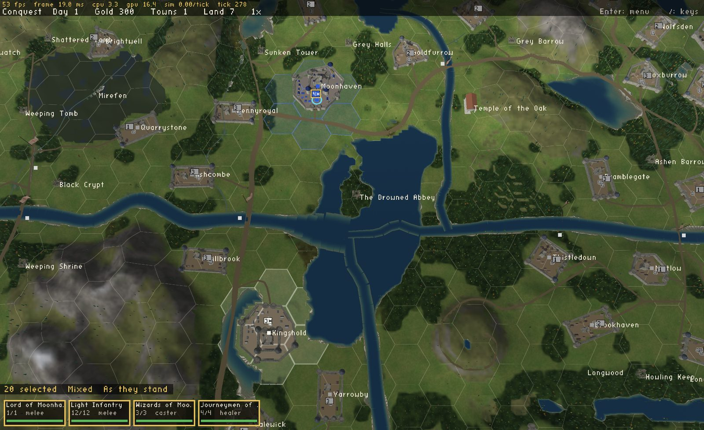 | 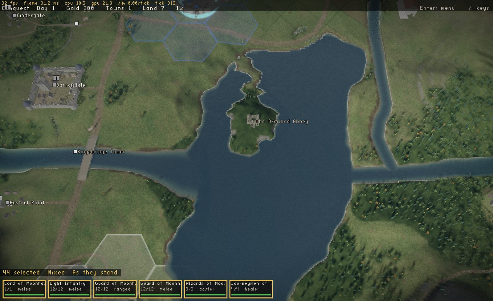 |
| Towns, 14 Nov | 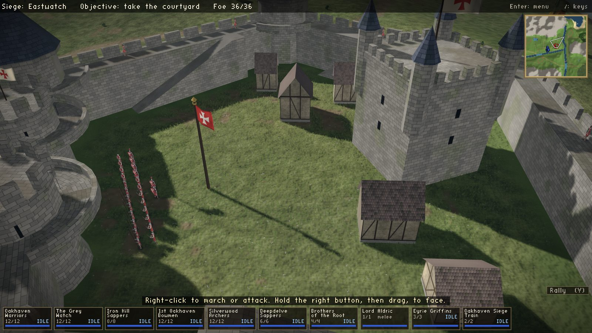 | 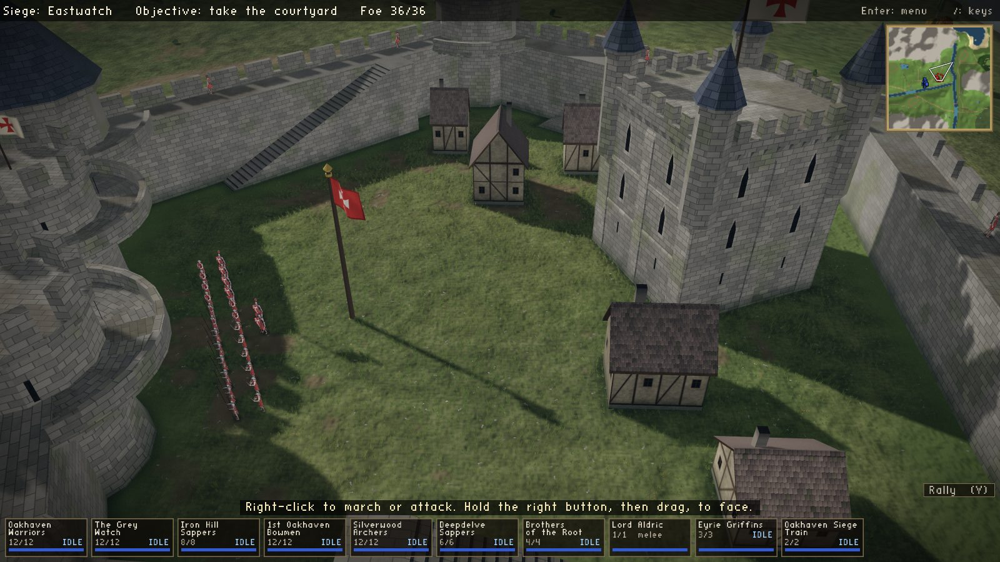 |

- **Water.** Rivers sit below their banks; lakes have natural shores and isles; rivers end at the sea; one function makes the chop of every water so no tile or seam shows; the shoreline is a smooth curve instead of cell-sized stairs. Under water the view is tinted, fogged and lit by caustics. In a fight, blood spreads in the water and bodies drift downstream.
- **The middle heights** took ten rounds. The first attempt was stopped the day it began because it looked bad; it came back two days later.
- **Towns** were grey blocks crossed by hex lines next to textured castles. They now share the castles' stone and tile, with soft shadows that widen with distance.
- **Timber** (palisades, abatis, watchtowers) is drawn stake by stake in different tones of wood.

| Under the sea | A river mouth | A palisade and ditch |
|---|---|---|
| 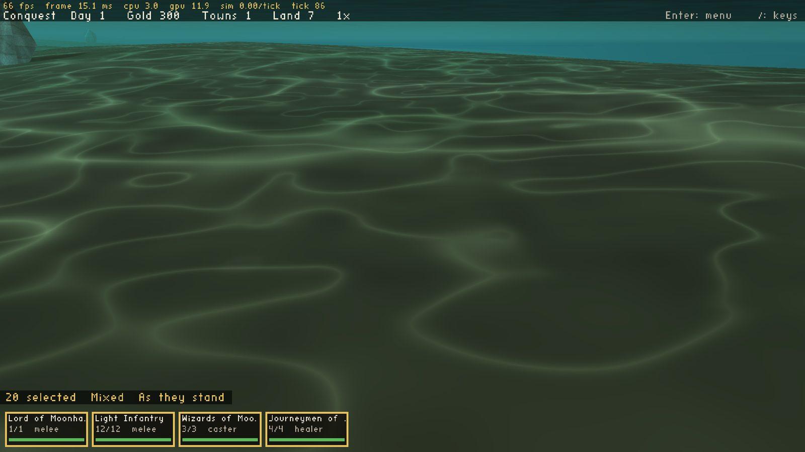 | 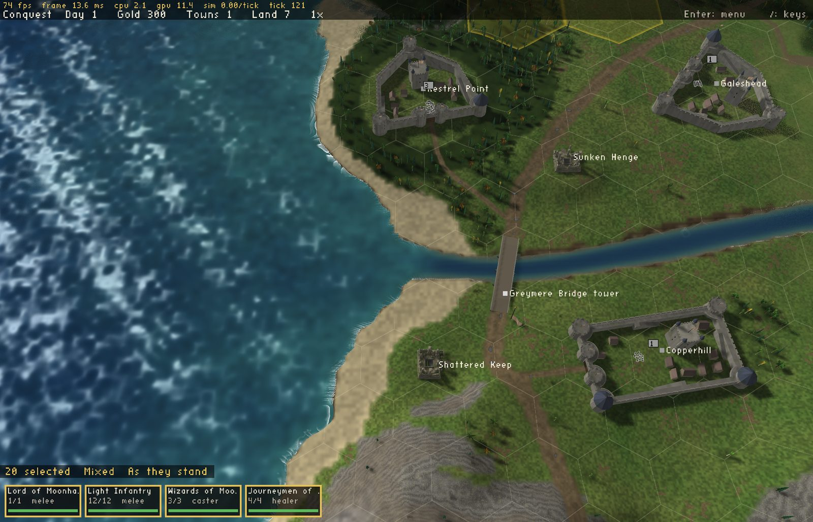 | 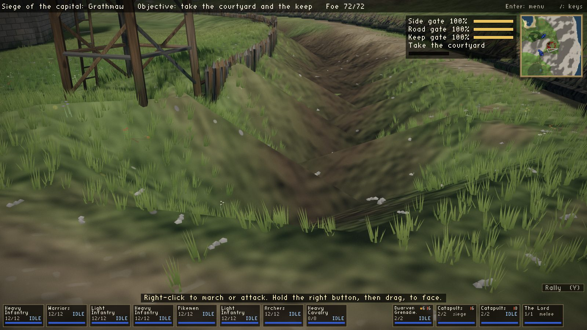 |

## Speed

Looks are held to a frame budget. The desktop app renders at a dynamic resolution that aims at 60 frames a second, grass is culled off-screen first, and noise is computed only where it shows (`cb0a9cb`).
